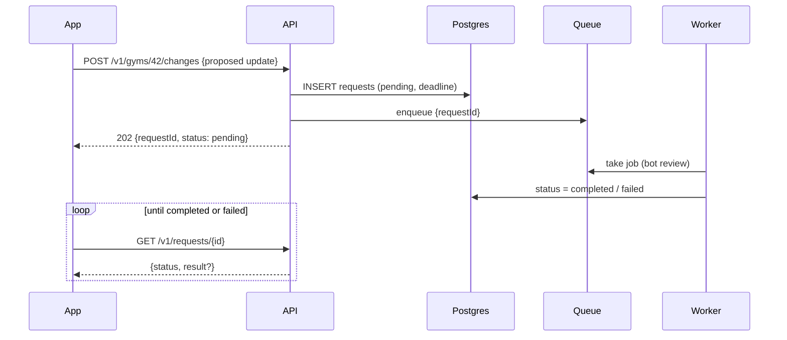
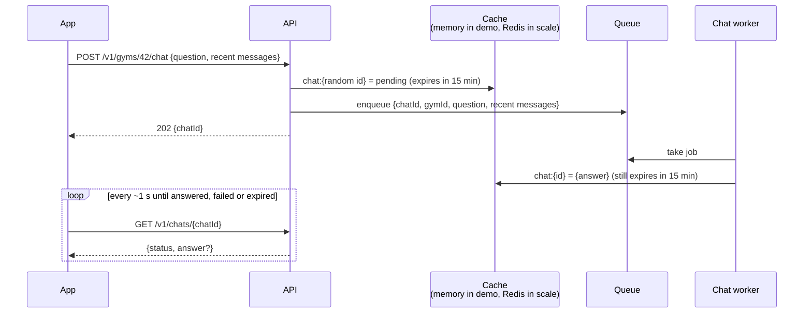
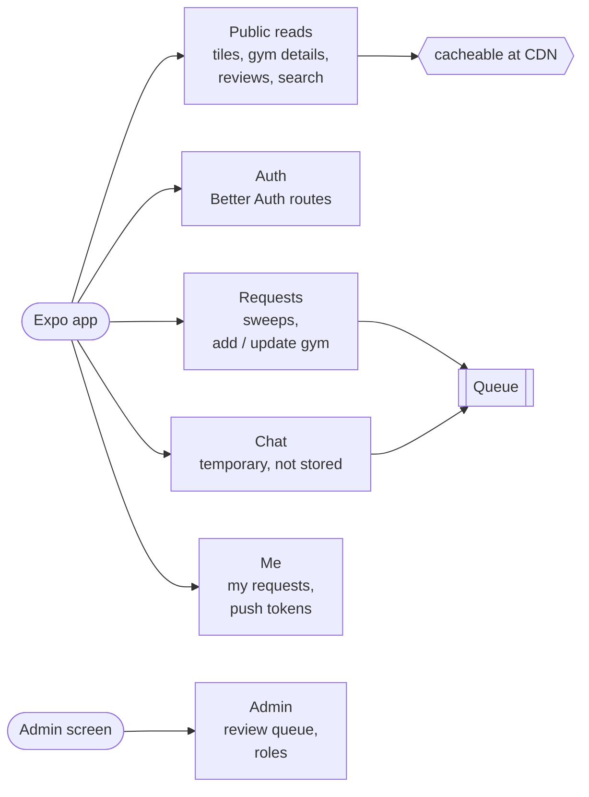

# Gym Finder: API Design

Phase 2 of the roadmap, step 3. It builds on [DESIGN_DISCUSSION.md](./DESIGN_DISCUSSION.md) (Option B, demo/scale modes, queues, request status) and [STACK_AND_SCHEMA.md](./STACK_AND_SCHEMA.md) (Fastify, Zod, Better Auth, the schema). Requirement IDs refer to [REQUIREMENTS.md](./REQUIREMENTS.md).

Part 1 covers the choices that shape the whole API, each with variations and a **recommendation**. Part 2 is the endpoint list that the Claude CLI builds from. Nothing here is final until Joey signs off in review.

---

## Part 1: Shape of the API

### 1.1 API style

| Variation | Pros | Cons |
|---|---|---|
| **REST + JSON, schemas in Zod, OpenAPI generated from them** | Plain URLs, so `GET /v1/tiles/{geohash}` can be cached by CloudFront and the browser (the whole caching plan depends on this). Any client or tool can call it. Zod schemas in `packages/shared` give the app typed requests and responses. OpenAPI gives free docs and a test console. | A little more typing than tRPC: each route declares its schema. |
| tRPC | End-to-end types with almost no boilerplate. | Calls are tied to our TypeScript client. Batched POST-style calls don't cache well at a CDN. Harder for anything else (admin scripts, a future partner) to use. |
| GraphQL | Client picks exactly the fields it wants. | Queries are POSTs to one URL, so CDN caching of tiles needs extra work (persisted queries). A schema layer and resolvers to maintain. Solves a problem we don't have (many different screens wanting different fields). |

**Recommendation: REST + JSON with Zod schemas shared in `packages/shared`**, using Fastify's Zod type provider so the same schema validates the request, types the handler and produces the OpenAPI doc (served at `/v1/docs` outside production).

### 1.2 Versioning

All routes live under **`/v1`**. A breaking change gets `/v2` routes, and the old ones stay up until app store versions that use them are gone. Mobile apps can't be force-updated instantly, so this matters more than on the web. Adding optional fields is not a breaking change.

### 1.3 Slow work: what an endpoint returns

Anything that goes through a queue (sweeps, chat, bot review) can't answer in the same request (decided in DESIGN_DISCUSSION.md section 5.3).

| Variation | Pros | Cons |
|---|---|---|
| Wait for the job inside the request | Simple client code. | Holds a connection open for seconds to minutes; mobile networks and the load balancer time out; exactly what the queue design avoids. |
| **Return `202 Accepted` with a request ID, then the app polls `GET /v1/requests/{id}`** | Works through CloudFront and the load balancer; stateless; the same pattern for every kind of slow job; the request row is already in Postgres, so polling is a cheap lookup. | A few seconds of delay; extra small requests. |
| Same, plus **Server-Sent Events** on `GET /v1/chats/{chatId}/events` | Chat answers can appear word by word. | Needs pub/sub between worker and API (Postgres `LISTEN/NOTIFY` in demo, Redis in scale). |
| WebSockets | Real-time both ways. | We don't need two-way; more infrastructure. |

**Recommendation: `202` + request ID + polling for everything now. SSE for chat is a later add-on on the same chat ID.** Polling uses a short backoff: every 1 s for chat, every 5 s for sweeps, and stop when the screen closes. "My requests" also gets Expo push notifications when a status changes (section 2.7).



### 1.4 Chats are temporary

**Decided by Joey (2026-11-02): chats are not stored.** No chat question or answer is written to Postgres, chats never appear on "My requests", and there is no chat history on the server. The chat lives only on the user's screen; closing the gym's details clears it.

How a chat still goes through the queue without being stored:



- **Chat IDs are random UUIDs**, not database IDs, so nobody can guess someone else's chat. Knowing the ID is what lets the app read the answer, so no device ID or account is needed (FR-15).
- **Follow-up questions:** the server keeps no conversation, so the app sends the last few messages with each question as context.
- **Queue jobs are deleted when done.** The chat queue is set to keep no history of finished jobs (pg-boss in demo mode stores jobs in Postgres, so this matters there).
- **Failures:** a failed or expired chat shows an error with a Retry button on the same screen, which simply asks again.
- **Saving facts (FR-9) is still allowed:** when an answer contains a useful fact (a price, a trial offer), the worker proposes it as a `gym_change` with its source, which goes through the normal review. Only the fact and its source are kept, never the conversation.
- **Logs:** chat text is not written to server logs either; logs record only the gym ID, timing and outcome.

Signed-in users use a Better Auth session: a cookie on web and the Better Auth Expo client's stored token on mobile, with the same server code.

### 1.5 Tiles and caching

**Decided by Joey (2026-11-02): gyms, filters and tile loading only happen at zoom 11 and above**, the same cutoff as `FILTERS_VISIBLE_AT_ZOOM = 11` in the vibe-coded map screens. Below zoom 11 the app requests no tiles (so nothing is added to any cache), shows no gym pins and no filter chips, exactly like the vibe-coded app today. Every cache below (app, CloudFront, Redis) therefore only ever holds tiles someone looked at closely.

The map loads gyms by fixed geohash5 tile (STACK_AND_SCHEMA.md 2.3, 2.4). The response is the same for every user, so CloudFront and the browser can cache it.

Keeping caches fresh after an admin approves a change:

| Variation | Pros | Cons |
|---|---|---|
| Long cache time, never purge | Most cache hits. | An approved change can take hours to show up. |
| **Short CDN cache (`s-maxage=600`) + a CloudFront invalidation of that one tile when a change is approved** | Approved changes appear within seconds; tiles nobody changes stay cached. At our volume, invalidations are within CloudFront's free monthly allowance. | One more AWS call on approval (behind the cache interface, so demo mode without CloudFront just skips it). |
| Versioned URLs (`/tiles/{gh}?v=17`) from a version list the app downloads first | Perfect caching, no purges. | Extra request and a version list to keep in sync; complex for little gain. |

**Recommendation: short cache times plus a per-tile invalidation on approval.** The tile response also carries an `ETag`, so a browser or the app can revalidate with `If-None-Match` and get a tiny `304` when nothing changed.

Filters and the price list (FR-10). **Decided by Joey (2026-11-02): keep them exactly as in the vibe-coded app** (`gym-map-screen.web.tsx` / `gym-map-screen.tsx` on `GymFinderVibeCoded`). Everything runs **in the app, on tiles already loaded**, so tiles stay cacheable (one URL per tile, not one per filter combination) and filtering is instant:

| Control | Behaviour (as in the vibe-coded app) |
|---|---|
| Text search box | Matches the typed text against name, description, address and categories (`gymMatchesSearch`), filtering the pins on the map. No server search. |
| Drop-ins only | Shows only gyms that accept drop-ins. |
| Trials only | Shows only gyms with a trial. |
| Category dropdown | The fixed category list (`GYM_CATEGORIES`) plus "Unknown" for gyms with no category; empty selection = all categories. |
| **No price filter** | Prices are not a filter. |
| Day-pass price list (right sidebar) | Opens when "Drop-ins only" is on and no gym is selected. Lists the gyms in view that have a day-pass price, **cheapest first**, then a divider and the **unverified** day-pass prices, also cheapest first, at the bottom. |

So the tile carries every field these need: name, description, address, categories, drop-in, trial, and the day-pass price with whether it's verified.

Stale tiles: if a tile has never been fetched from Overpass, or the fetch is older than about a week, the API still answers right away with what it has, sets `"stale": true`, and enqueues a refresh. The app can re-request the tile after ~30 s when `stale` is true. Because CDN hits never reach the API, the refresh only triggers on cache misses, which is enough at a 10-minute cache time.

### 1.6 Conventions

| Topic | Convention |
|---|---|
| IDs | Bigints in the database, **sent as strings in JSON** (`"id": "123"`). JavaScript loses precision above 2^53, and strings let us switch to UUIDs later without changing the app. |
| Money | `{ "amountMinor": 15000, "currency": "IDR", "usdCents": 95 }`: original amount and currency, plus a USD snapshot for sorting. The app shows the original currency. |
| Times | ISO 8601 UTC strings. |
| Field names | camelCase in JSON, snake_case in the database (Drizzle maps them). |
| Lists | Cursor pagination: `?limit=20&cursor=...` → `{ items, nextCursor }`. Offsets break when rows are added while scrolling. |
| Errors | `{ "error": { "code": "rate_limited", "message": "...", "details": {...} } }` with the right HTTP status: 400 validation, 401 not signed in, 403 not allowed, 404, 409 conflict/duplicate, 429 rate limited (with `Retry-After`), 500. `code` is a stable string the app can switch on; `message` is for humans. |
| Rate limits | Per user, or per IP when signed out, using `@fastify/rate-limit` (memory store in demo mode, Redis in scale mode, behind the cache interface). Tight limits on sweeps and chat, loose on reads. |
| Validation | Every body, query and path parameter has a Zod schema; unknown fields are rejected. |
| Health | `GET /healthz` (process up) and `GET /readyz` (database and queue reachable) for the load balancer and Docker. Not under `/v1`. |

### 1.7 What the app calls directly, not through our API

- **Photon** for location search (CLAUDE.md). It's a public geocoder built for search-as-you-type, and routing it through us only adds latency. If we ever self-host Photon, only its base URL changes.
- **Base map tiles** (Protomaps PMTiles) straight from CloudFront/S3.
- Overpass and Google Maps are **never** called by the app; only our workers call them.

---

## Part 2: Endpoints



Legend: 🌐 public, no sign-in · 🔑 anyone holding the random chat ID · 🔒 signed in · 🛡️ admin only.

### 2.1 Auth (FR-13, FR-14)

Handled by Better Auth, mounted at `/v1/auth/*`. We don't write these routes ourselves; the main ones are:

| Method | Path | Who | Notes |
|---|---|---|---|
| POST | `/v1/auth/sign-up/email` | 🌐 | Email + password. Sends a verification email. |
| POST | `/v1/auth/sign-in/email` | 🌐 | |
| POST | `/v1/auth/sign-in/social` | 🌐 | Google and Apple (Apple is required on iOS once Google is offered). |
| POST | `/v1/auth/sign-out` | 🔒 | |
| GET | `/v1/auth/get-session` | 🔒 | Current user, including `role`. |
| POST | `/v1/auth/forget-password`, `/v1/auth/reset-password` | 🌐 | |

### 2.2 Map tiles (FR-4, FR-5)

**`GET /v1/tiles/{geohash5}`** 🌐

```json
{
  "geohash": "qw3k8",
  "fetchedAt": "2026-10-28T09:12:00Z",
  "stale": false,
  "gyms": [
    {
      "id": "1042",
      "name": "Bali Strength Club",
      "lat": -8.6501,
      "lng": 115.1385,
      "address": "Jl. Raya Canggu 12",
      "description": "Free weights, rig and sauna.",
      "categories": ["Traditional"],
      "acceptsDropIn": true,
      "hasTrial": true,
      "dayPass": { "amountMinor": 150000, "currency": "IDR", "usdCents": 950, "verified": true },
      "rating": 4.6
    }
  ]
}
```

`description` is cut to about 300 characters to keep tiles small; the full text is in gym details. `dayPass` is the verified day-pass price when there is one, otherwise the stored unverified one (`verified: false`), which the price list shows at the bottom. Unverified prices are stored, not just pending in the review queue (STACK_AND_SCHEMA.md 2.6).

Headers: `Cache-Control: public, max-age=60, s-maxage=600, stale-while-revalidate=600`, `ETag`. An unknown or empty tile returns `200` with `"gyms": []` (and enqueues a fetch), not `404`, so the empty answer is cached too.

The app works out which geohash5 cells cover the screen and requests them in parallel. **Open (section 3, item 10):** at zoom 11 a phone screen covers roughly 30 × 65 km, which is about 100 geohash5 tiles (a desktop browser, several hundred). That is too many requests per screen, so the tile size used for *loading* may need to grow to geohash4 (about 39 × 20 km, roughly 6 to 20 tiles per screen at zoom 11).

**Decided by Joey (2026-11-02): gyms, filters and tile loading only happen at zoom 11 and above**, the same cutoff as `FILTERS_VISIBLE_AT_ZOOM = 11` in the vibe-coded map screens. Below zoom 11 the app requests no tiles (so nothing is added to any cache), shows no gym pins and no filter chips, exactly like the vibe-coded app today. The app keeps this as one shared constant (`MIN_GYM_ZOOM = 11` in `packages/shared`).

### 2.3 Gyms (FR-6, FR-7, FR-10)

| Method | Path | Who | Notes |
|---|---|---|---|
| GET | `/v1/gyms/{id}` | 🌐 | Full details (below). `Cache-Control: public, s-maxage=300`, invalidated on approval like tiles. |
| GET | `/v1/gyms/{id}/reviews?cursor=` | 🌐 | Paginated. |
| POST | `/v1/gyms/{id}/reviews` | 🔒 | `{ rating, body }`. One review per user per gym (409 on a second; update with PUT). |
| PUT | `/v1/gyms/{id}/reviews/mine` | 🔒 | Edit own review. |

Gym details response:

```json
{
  "id": "1042",
  "name": "Bali Strength Club",
  "location": { "lat": -8.6501, "lng": 115.1385 },
  "address": "Jl. Raya Canggu 12",
  "categories": ["commercial"],
  "description": "...",
  "acceptsDropIn": true,
  "trial": { "available": true, "details": "First class free" },
  "openingHours": "Mo-Su 06:00-22:00",
  "details": { "amenities": ["showers", "lockers"], "website": "https://..." },
  "prices": [
    {
      "kind": "day_pass",
      "amountMinor": 150000, "currency": "IDR", "usdCents": 950,
      "sourceKind": "gym_website", "sourceUrl": "https://...",
      "verifiedBy": "bot",
      "lastSeenAt": "2026-10-20T00:00:00Z"
    },
    {
      "kind": "week_pass",
      "amountMinor": 600000, "currency": "IDR", "usdCents": 3800,
      "sourceKind": "user", "sourceUrl": null,
      "verifiedBy": null,
      "lastSeenAt": "2026-11-01T00:00:00Z"
    }
  ],
  "rating": 4.6,
  "reviewCount": 12,
  "status": "active",
  "updatedAt": "2026-10-20T00:00:00Z"
}
```

`prices` can hold a verified and an unverified price of the same kind; `verifiedBy: null` marks unverified ones. `openingHours` uses the OSM `opening_hours` format, which the app parses for "open now".

### 2.4 Requests: one shape for sweeps and gym changes (FR-11, FR-16, FR-18)

Every endpoint below creates a row in `requests` (STACK_AND_SCHEMA.md 2.10) and returns **`202`** with the request:

```json
{
  "id": "88231",
  "kind": "sweep",
  "status": "pending",
  "createdAt": "2026-11-02T10:00:00Z",
  "deadline": "2026-11-02T10:02:00Z",
  "result": null,
  "failureReason": null,
  "changes": []
}
```

How requests are created, endpoint by endpoint or through one generic endpoint:

| Variation | Pros | Cons |
|---|---|---|
| One generic `POST /v1/requests { kind, ... }` | One route. | The body shape depends on `kind`, so validation and docs get murky; permissions and limits differ per kind and end up as if-statements. |
| **One endpoint per action**, all returning the same request shape | Each route has its own clear schema and permission; URLs read naturally (`POST /v1/gyms/42/changes`). Reading status is still one generic endpoint. | More routes (each is small). |

**Recommendation: one endpoint per action, one shared request shape and status endpoint.**

| Method | Path | Who | Body | What happens |
|---|---|---|---|---|
| POST | `/v1/sweeps` | 🔒 | `{ geohash }` or `{ bbox }` (split into geohash5 tiles, capped count) | Sweep job per tile (FR-11). A tile swept recently returns `200` with an already-`completed` request; a tile already queued attaches to the existing job (same request returned). `result: { gymsFound, gymsNew }`. |
| POST | `/v1/gyms` | 🔒 | Proposed new gym: name, location, categories, prices with `sourceKind` / `sourceUrl` / `menuPostedOn`, ... | Add-gym request (FR-16). One `gym_changes` row, then bot review. |
| POST | `/v1/gyms/{id}/changes` | 🔒 | Partial update with evidence for any price | Update-gym request (FR-16). |
| GET | `/v1/requests/{id}` | 🔒 | | Current status (polling). Readable by the user who made it, or an admin. |
| POST | `/v1/requests/{id}/retry` | 🔒 | | Only for `failed` requests: creates a new request with the same input and returns it. |

`changes` lists the `gym_changes` a request produced, each with `reviewStatus` (`pending_bot`, `awaiting_admin`, `approved`, `rejected`) and a short reason when rejected. The status the user sees on "My requests" is derived (STACK_AND_SCHEMA.md 2.10): `failed` if the job failed, `pending` until every change is decided, then `completed` with counts.

Deadlines: bot review ~10 minutes, sweeps ~1 hour (they drain slowly on purpose). The watchdog marks overdue requests `failed` with `failureReason: "timed_out"`.

### 2.4b Chat (FR-8, FR-9): temporary

| Method | Path | Who | Body | What happens |
|---|---|---|---|---|
| POST | `/v1/gyms/{id}/chat` | 🌐 | `{ question, history: [{ role, text }] }` (last few messages, capped) | `202 { chatId }`. Nothing is written to Postgres (section 1.4). |
| GET | `/v1/chats/{chatId}` | 🔑 | | `{ status: "pending" \| "answered" \| "failed" \| "expired", answer?, sources? }`. Kept in the cache for 15 minutes, then gone. |
| GET | `/v1/chats/{chatId}/events` | 🔑 | | *(Later)* SSE stream so the answer appears word by word. |

Rate limited per user or IP. Useful facts in an answer become `gym_changes` for review (FR-9); the conversation itself is never saved.

### 2.5 Me (FR-18)

| Method | Path | Who | Notes |
|---|---|---|---|
| GET | `/v1/me/requests?status=&cursor=` | 🔒 | The "My requests" page: add-gym, update-gym and sweep requests, newest first. Chats are not listed (they're not stored). |
| POST | `/v1/me/push-tokens` | 🔒 | `{ expoPushToken, platform }`. Used to notify on status changes. |
| DELETE | `/v1/me/push-tokens/{token}` | 🔒 | On sign-out. |
| DELETE | `/v1/me` | 🔒 | Delete account (Apple and Google require in-app account deletion). Requests are kept but unlinked; reviews are removed. There are no chats to delete. |

### 2.6 Admin (FR-14, FR-17)

| Method | Path | Who | Notes |
|---|---|---|---|
| GET | `/v1/admin/changes?reviewStatus=awaiting_admin&cursor=` | 🛡️ | Review queue, oldest first. Each item shows the proposed change, the current gym values side by side, the evidence (source, URL, menu photo date), and the bot's notes. |
| POST | `/v1/admin/changes/{id}/approve` | 🛡️ | Applies the change to `gyms` / `gym_prices` in one transaction, then invalidates the tile and gym caches. `409` if someone already decided it. |
| POST | `/v1/admin/changes/{id}/reject` | 🛡️ | `{ reason }`, shown to the user. |
| GET | `/v1/admin/changes?decidedBy=bot&cursor=` | 🛡️ | Spot-check what the bot auto-approved (e.g. seeded gyms). |
| PATCH | `/v1/admin/users/{id}` | 🛡️ | `{ role: "admin" \| "user" }`. Replaces the demo's "apply to be admin" flow; the first admin is set with a CLI command. |

### 2.7 Notifications

When a request's status changes, the worker sends an Expo push notification to the user's tokens ("3 gyms added in Canggu", "Your update to Bali Strength Club was approved"). Pushes go through the queue like other slow work. Signed-out users get no push; their screen polls.

### 2.8 Not exposed as endpoints

- **Seeding** is a CLI command run by us (`npm run seed -- --list destinations.json`), not an HTTP route.
- **Overpass refresh, coverage job, watchdog** run on schedules inside the worker.
- **Currency conversion**: the demo's `/api/fx` goes away. Workers store `usdCents` when they save a price, using a daily rates table.

### 2.9 From the demo routes to the new ones

| Demo route (`server/index.js`) | New route |
|---|---|
| `POST /api/auth/signup`, `/signin`, `GET /api/auth/me` | Better Auth `/v1/auth/*` |
| `GET /api/gyms/all`, `/by-area`, `/count`, `/area-scanned` | `GET /v1/tiles/{geohash5}` |
| `GET/POST /api/gyms/:id/reviews` | `GET/POST /v1/gyms/{id}/reviews` |
| `POST /api/gyms/:id/chat` (synchronous) | `POST /v1/gyms/{id}/chat` → 202 + polling `GET /v1/chats/{chatId}`, not stored |
| `POST /api/gyms/find-more` (synchronous scrape) | `POST /v1/sweeps` → 202 + polling |
| `POST /api/gyms/submissions` | `POST /v1/gyms` |
| `POST /api/gyms/:id/edit-request` | `POST /v1/gyms/{id}/changes` |
| `GET /api/admin/submissions`, `.../approve`, `.../deny` | `/v1/admin/changes...` |
| `POST /api/users/apply-admin` | Removed; `PATCH /v1/admin/users/{id}` |
| `GET /api/fx` | Removed (section 2.8) |

---

## 3. Decisions needed from Joey

Recommendations in bold.

1. **API style:** **REST + Zod + generated OpenAPI**, or tRPC / GraphQL? (1.1)
2. **Slow work:** **202 + request ID + polling now, SSE for chat later**? (1.3)
3. ~~Signed-out users~~ **Decided (Joey, 2026-11-02): chats are temporary and not stored** (1.4, 2.4b). This also removes the need for a device ID.
4. **Cache freshness:** **Decided (Joey, 2026-11-02): tiles are only fetched and cached at zoom 11 and above, and gyms and filters only show from zoom 11, exactly like the vibe-coded app.** The 10-minute CDN cache with a per-tile refresh on approval stays as recommended unless you say otherwise. (1.5)
5. **Filters:** **Decided (Joey, 2026-11-02): exactly as in the vibe-coded app**: text search, drop-ins, trials and categories, all in the app on loaded tiles; no price filter; the right sidebar lists day-pass prices cheapest first with unverified ones at the bottom. No server search endpoint. (1.5)
6. **Endpoints:** **one per action with a shared request shape**, rather than one generic `POST /requests`? (2.4)
7. **Social login:** **Google + Apple** at launch, or email only first? (2.1)
8. **Admins:** drop the demo's "apply to be admin" flow; admins promote users, and the first admin is set from the command line? (2.6)
9. **Reviews:** one review per user per gym, editable? (2.3)

10. **Tile size for loading at zoom 11:** geohash5 tiles (4.9 km) mean ~100 requests per phone screen at zoom 11. **Recommendation: load and cache by geohash4 (~39 × 20 km, ~6 to 20 tiles per screen), and keep geohash5 for Overpass refreshes and sweep jobs**, where smaller areas keep each job light. A busy geohash4 tile (a whole big city) is maybe 1,000 gyms, about 30 KB compressed. Alternative: keep geohash5 and raise the minimum zoom to 13, which changes how the vibe-coded app behaves.

Once these are settled, the Claude CLI can start the restructure using this doc as the API contract.
