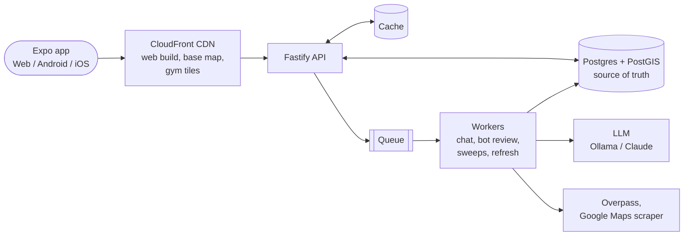
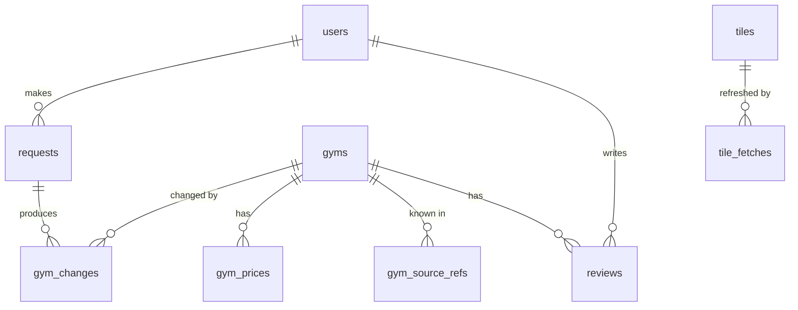

# Gym Finder: Design

**Gym Finder helps budget backpackers and digital nomads find nearby gyms, free trials and the cheapest walk-ins, anywhere in the world.** It runs on Web, Android and iOS from one Expo codebase and is built to grow from a near-free demo to thousands of users.

This page is the short overview. Each section links to the detailed doc where the options were compared and decided:

| Doc | Covers |
|---|---|
| [REQUIREMENTS.md](./REQUIREMENTS.md) | What the app must do (FR-x, NFR-x IDs) |
| [DESIGN_DISCUSSION.md](./DESIGN_DISCUSSION.md) | Architecture options, database, caching and queues |
| [STACK_AND_SCHEMA.md](./STACK_AND_SCHEMA.md) | Tools, AWS hosting, database schema |
| [API.md](./API.md) | REST endpoints, the contract the app and server build against |
| [CLAUDE.md](./CLAUDE.md) | The same decisions as rules for Claude sessions |

---

## 1. What the app does

1. **Find a place.** Search a city or address (Photon geocoder) or use your current location.
2. **Browse the map.** Gyms load for the area on screen as you pan and zoom. Data comes from OpenStreetMap (Overpass), Google Maps sweeps and user submissions.
3. **Filter.** Text search, drop-ins only, trials only, category. A right sidebar lists day-pass prices, cheapest first.
4. **Open a gym.** See prices, trial, opening hours, description and reviews, and ask an AI chatbot about that gym.
5. **Contribute.** Signed-in users add gyms, suggest updates, write reviews and ask the bot to "find more gyms" in an area. Progress shows on a **My requests** page.
6. **Admins** review anything a bot couldn't verify.

## 2. Architecture

**A modular monolith API plus background workers, connected by a queue** (Option B in [DESIGN_DISCUSSION.md](./DESIGN_DISCUSSION.md#6-decision-option-b)). The API answers fast; anything slow (chat, scraping, bot review, Overpass refreshes) becomes a job that a worker picks up.

### Two modes, one codebase

One `MODE` setting, read once at startup, picks the implementation behind each interface (queue, cache, LLM, hosting). Business code never checks the mode. CI tests both.

| | **Demo mode** (near-free) | **Scale mode** (paying users) |
|---|---|---|
| Hosting | One Lightsail instance, Docker Compose | ECS Fargate, autoscaled on queue depth |
| Database | Postgres + PostGIS in a container, nightly backup to S3 | RDS Postgres + PostGIS |
| Queue | pg-boss (tables in Postgres) | BullMQ on Redis (ElastiCache) |
| Cache | In memory | Redis (ElastiCache) |
| LLM | Ollama on Joey's PC via a tunnel | Claude (Anthropic API or Bedrock) |
| Static files | S3 + CloudFront | S3 + CloudFront |

Important data is always written to Postgres first; a queue job only carries IDs. Jobs may fail, and when they do the user is told (see section 5).

## 3. Stack

| Area | Choice |
|---|---|
| App | Expo SDK 58, Expo Router, TypeScript (dev build, needed for the native map) |
| Server | TypeScript + Fastify; one codebase, two entry points (`api.ts`, `worker.ts`) |
| Shared types | Zod schemas in `packages/shared`, used by app and server |
| Repo | npm-workspaces monorepo: `apps/mobile`, `apps/server`, `packages/shared`, `infra/` |
| Database access | Drizzle ORM + checked-in migrations |
| Auth | Better Auth, users in our Postgres. Email, Google, Facebook at launch; Apple before the iOS release |
| Map | MapLibre with self-hosted Protomaps vector tiles on S3 + CloudFront |
| Scraper | Playwright in sweep workers; never paid proxies or scraping APIs |
| Infrastructure | AWS CDK (TypeScript), SSM Parameter Store for secrets, CloudWatch + Sentry |

Details and alternatives: [STACK_AND_SCHEMA.md part 1](./STACK_AND_SCHEMA.md#part-1-stack).

## 4. Data model

| Table | Holds |
|---|---|
| `gyms` | Name, PostGIS point (GIST / R-tree index), `geohash4` and `geohash5`, categories, drop-in, trial, flexible `details` (JSONB) |
| `gym_prices` | Current price per gym per kind (day pass, week, month, trial): at most one verified and one unverified row, with source, URL and `last_seen_at`. No price history |
| `gym_source_refs` | The gym's ID in each source (OSM, Google Maps, ...), used to merge duplicates |
| `requests` | What a user asked for (add gym, update gym, sweep), with status `pending / completed / failed` and a deadline |
| `gym_changes` | Each proposed change, its evidence and review status. Also the audit log |
| `tiles`, `tile_fetches` | When each geohash5 cell was last refreshed from each source |
| `users`, `reviews` | Accounts with a `role` (user / admin); one editable review per user per gym |

IDs are bigints (sent to the app as strings). Full schema: [STACK_AND_SCHEMA.md part 2](./STACK_AND_SCHEMA.md#part-2-database-schema).

## 5. API shape

REST + JSON under `/v1`, every route validated by a Zod schema, OpenAPI docs generated from them. Full endpoint list: [API.md](./API.md).

| Area | Main routes |
|---|---|
| Map | `GET /v1/tiles/{geohash4}`: all gyms in a ~39 × 20 km tile, the same for every user, so it is cached by CloudFront |
| Gyms | `GET /v1/gyms/{id}`, reviews (`POST`, `PUT .../reviews/mine`) |
| Requests | `POST /v1/sweeps`, `POST /v1/gyms`, `POST /v1/gyms/{id}/changes` → `202` + request ID |
| Status | `GET /v1/requests/{id}` (polling), `POST /v1/requests/{id}/retry`, `GET /v1/me/requests` |
| Chat | `POST /v1/gyms/{id}/chat` → `202 { chatId }`, then `GET /v1/chats/{chatId}` |
| Admin | `/v1/admin/changes` review queue (approve / reject), `PATCH /v1/admin/users/{id}` for roles |
| Auth | Better Auth at `/v1/auth/*` |

**Slow work returns `202` and the app polls.** Every slow job has a deadline; a watchdog marks overdue ones `failed`, and the user sees a Retry button. Signed-in users also get Expo push notifications when a request's status changes.

The app calls Photon (location search) and the base map tiles directly. Only workers ever call Overpass or Google Maps.

## 6. Key rules

- **Verification and approval.** A change skips admin review when a bot can verify it:
  - a price on the gym's own website is verified (no date check);
  - a price menu photo posted on Google Maps less than a year ago is verified;
  - anything else (a user's edit, a price the chatbot found in a review or on the web) is stored as **unverified**, shown at the bottom of the price list, and waits for an admin. Only admins verify.
  - a **new gym** is verified if it's in OpenStreetMap, on Google Maps or on its own website within about 50 m with a matching name and isn't a duplicate; **name, address, hours, categories, drop-ins and trial** are verified if found on the gym's website or Google Maps listing. **Closing or removing a gym always needs an admin.**
  - the bot rejects spam, missing name or location, impossible locations and exact duplicates on its own, telling the user why. Non-price changes waiting for an admin stay hidden until approved.
  - the chatbot may also search the web, but what it finds there is unverified unless it's the gym's own website or a recent menu photo. (REQUIREMENTS.md FR-8, FR-24 to FR-27.)
- **Chats are temporary.** Chat questions and answers are never stored in Postgres or logs. Answers live in the cache for about 15 minutes under a random chat ID; follow-ups send recent messages along. Useful facts from a chat are still proposed as `gym_changes`.
- **Zoom 11 rule.** Gyms, filters and tile loading only happen at zoom 11 and above (`MIN_GYM_ZOOM = 11`). Below that, no tiles are requested or cached.
- **Tiles.** The map loads geohash4 tiles; Overpass refreshes (about weekly) and sweeps work on geohash5 cells. Stale tiles are served at once and refreshed in the background. An approved change invalidates its tile in the CDN.
- **UI stays as it is.** The vibe-coded app's UI (`GymFinderVibeCoded` branch) is kept: right sidebar with collapsible sections, filter chips, day-pass list, gym panel, add/edit flows. The restructure changes what's underneath, not how it looks. The only addition is an Edit button on your own review.
- **Filters run in the app** on loaded tiles, exactly as in the vibe-coded app. No price filter and no server search.
- **No secrets in the repo.** Config lives in env vars and SSM.
- **LLM behind one interface**, so Ollama can be swapped for Claude without touching business code.
