# Gym Finder: High-Level Design Discussion

Phase 2 of the roadmap, step 1: **high-level architecture only**. Stack details, schema and API come in later docs. Requirement IDs (FR-x, NFR-x) refer to [REQUIREMENTS.md](./REQUIREMENTS.md).

Fixed constraint: one Expo (Expo Router, TypeScript) client for Web, Android and iOS (NFR-3). Everything below is about what sits behind it.

## 1. Are the requirements realistic?

Mostly yes. 10,000 daily users (NFR-1) is a modest load that one small server plus a database can handle, and every functional requirement has been built in some form already in the demo code on this branch. Four things need adjusting before they turn into design constraints:

| Requirement | Verdict | What the design does about it |
|---|---|---|
| FR-11 Google Maps sweeps | **Not as written.** Scraping Google Maps breaks its Terms of Service (see open question 1). | Treat the sweep as a *pluggable data source*. Ship with compliant sources (OSM/Overpass, then Google Places API or Foursquare, paid per call). A different source can be swapped in per region later (OOS-1) without touching the rest of the system. |
| NFR-2 1,000 bot req/s | **Unrealistic for 10k DAU, and unaffordable if it means LLM calls.** 10k users × ~20 actions ≈ 2–3 req/s average, maybe 30 at peak. | Design for ~50 req/s peak on the API and a few LLM calls per second, behind a queue. Section 6 shows how each piece scales if real load ever approaches 1,000/s. |
| FR-4 "every gym in the world" | Realistic as *"every gym our sources know about"*. Some regions will start sparse. | Background coverage job + user submissions fill gaps over time. |
| FR-8/9 AI chatbot | Realistic, but it's the most expensive part per user. | LLM calls go through one interface and a queue, with answers cached on the gym record (FR-9) so repeat questions cost nothing. |

**Bottom line:** I'm on board with the requirements once FR-11 is reworded to "sweep using a licensed source" and NFR-2 is restated as a peak rate we can afford. The options below all assume those two changes.

## 2. What every option has to handle

Whatever the shape, the system has the same five jobs. The options differ in how these are split into deployable pieces.

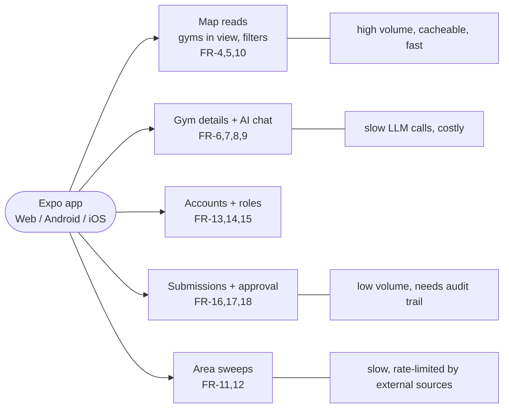

The key insight is that **map reads** are by far the most frequent and are easy to cache, while **chat, sweeps and bot review** are slow, call external services, and should never block a request thread. Splitting "fast reads" from "slow background work" matters much more than splitting by feature.

## 3. Architecture options

### Option A: Single modular monolith

One Node API server does everything: serves map data, runs chat calls inline, runs sweeps and the coverage job in-process. This is roughly what the demo `server/index.js` is today.

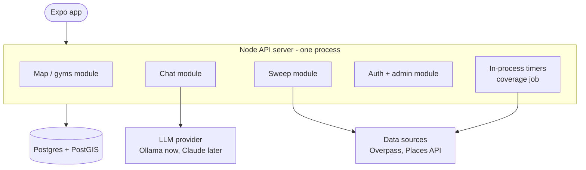

**Pros**
- Simplest to build, deploy and debug: one process, one log, one deploy.
- Cheapest to host (fits the near-free GCP e2-micro idea).
- Closest to the existing demo code, so least rework.

**Cons**
- A slow sweep or LLM call ties up the same server that serves the map. Ten people chatting at once could make the map feel sluggish.
- Can't scale chat separately from reads. Adding servers to handle chat also duplicates the in-process timers (two coverage jobs running at once).
- A crash in a sweep takes down the whole app.
- Doesn't meet NFR-4 ("scale without a rewrite") well: getting out of it later means pulling background work out anyway.

### Option B: Modular monolith API + background workers via a queue

Same single codebase, but deployed as two kinds of process. The **API** only does fast things (reads, auth, accepting requests). Anything slow (chat replies, sweeps, bot review, Overpass refresh, coverage job) becomes a **job on a queue** that **workers** pick up. Redis does double duty as cache and queue. The app gets results by polling or a push/stream.

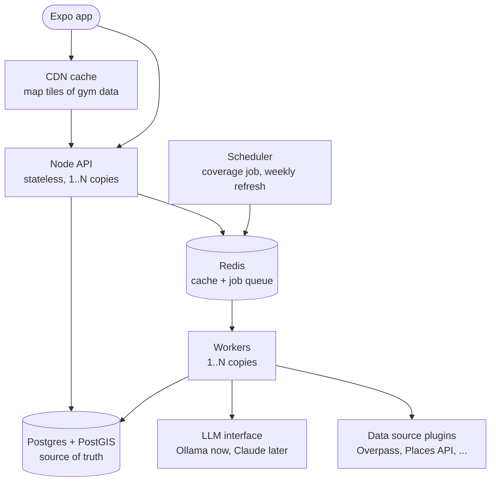

**Pros**
- Map stays fast no matter how many chats or sweeps are running.
- API and workers scale independently: add workers when chat gets busy, add API copies when map traffic grows.
- Queue gives natural rate limiting, so we never exceed Overpass fair-use or LLM budget, and retries for flaky sources.
- Still one codebase and one language, so it's nearly as simple to work on as Option A.
- Uses pieces already agreed (Postgres+PostGIS, Redis, LLM behind one interface).

**Cons**
- More moving parts than A: two process types plus Redis to run and monitor.
- Chat and sweeps become asynchronous, so the app needs a "working on it..." state and a way to get the result (polling or streaming).
- Slightly more hosting cost than A (Redis free tier covers the start).

### Option C: Microservices / serverless functions

Each feature becomes its own service (or set of cloud functions) with its own deploy, talking through an API gateway and an event bus.

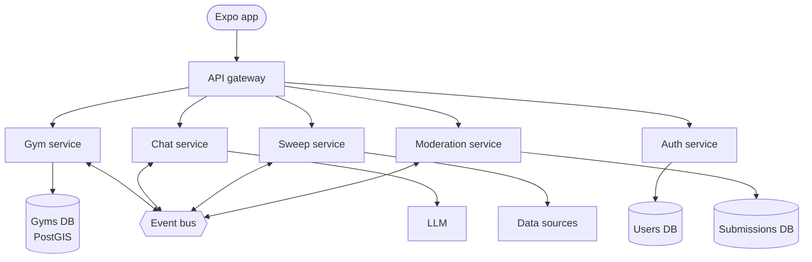

**Pros**
- Each piece scales and deploys fully independently.
- Strong isolation: a broken sweep service can't affect anything else.
- Fits large teams where different people own different services.

**Cons**
- Heavy overhead for a one-person project at 10k DAU: many deploys, network calls between services, distributed debugging.
- Data is split across services, so simple things (approving a submission updates a gym) become cross-service workflows.
- Serverless functions have time limits and cold starts that fit badly with long sweeps and LLM calls.
- Highest cost and complexity for no benefit at the expected load.

### Option D: Backend-as-a-Service (e.g. Supabase) + a worker

Use a hosted platform that bundles Postgres+PostGIS, auth, row-level permissions and auto-generated APIs. The app reads gyms directly from it. Only the slow work (chat, sweeps, bot review) runs in a small custom worker.

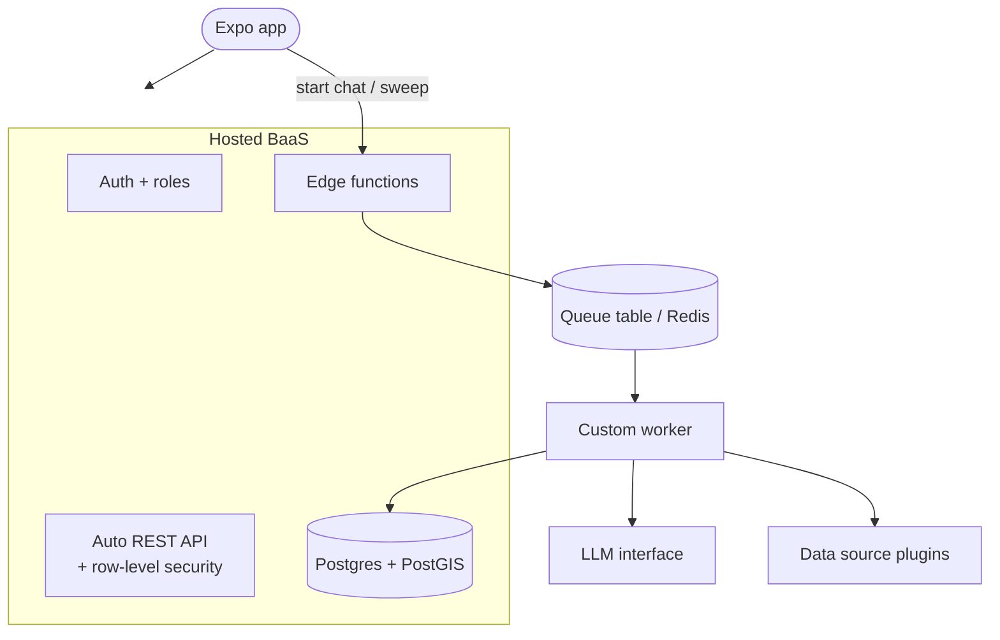

**Pros**
- Auth, sign-up, password reset and roles (FR-13, 14) come built in, so less security code to write ourselves.
- Generous free tier, managed backups, PostGIS supported.
- Fastest path to a working product.

**Cons**
- Vendor lock-in: auth and permission rules live in the platform, so moving off it later is real work.
- Business rules (approval flow, filters) split between database policies, edge functions and the worker, which is harder to reason about than one codebase.
- Throws away the existing Express server and auth code.
- Less control over caching and how queries scale.

## 4. Comparison

| | A. Monolith | **B. Monolith + workers** | C. Microservices | D. BaaS + worker |
|---|---|---|---|---|
| Build effort now | Lowest | Low | High | Low |
| Reuses demo code | Most | Most | Little | Little |
| Map stays fast under chat/sweep load | No | Yes | Yes | Yes |
| Scales past 10k DAU without rewrite (NFR-4) | Weak | Good | Best | Good, within vendor limits |
| Hosting cost at start | ~Free | ~Free | Highest | ~Free |
| Ops complexity | Lowest | Medium | Highest | Low |
| Lock-in | None | None | Low | High |

## 5. Building-block choices

The options above are the overall *shape*. Inside any shape, three building blocks change how the system behaves the most: **which database**, **where caches go**, and **where queues go**. Each one is laid out below as variations with a diagram, and why one wins for this app.

### 5.1 Database: PostgreSQL+PostGIS vs NoSQL

What the data looks like decides this. Gym Finder's data is:
- **Geographic.** The main query is "gyms inside this map rectangle, filtered by category / drop-in / trial / text" (FR-5, FR-10).
- **Relational.** Users → submissions → gyms → reviews → admin decisions (FR-16 to FR-18). Approving a submission must update the gym *and* the submission together, or neither.
- **Moderate in size.** Probably a few million gyms worldwide, at most. That fits one Postgres server comfortably.

**Variation 1: PostgreSQL + PostGIS (relational with a geo extension)**

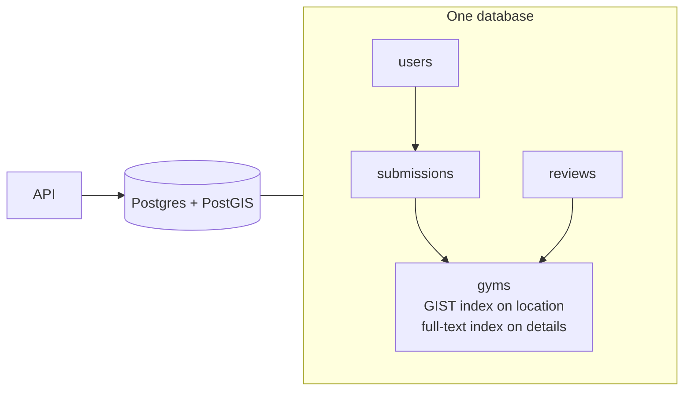

- ✅ PostGIS is the industry standard for geo queries: bounding box, radius, nearest, clustering, all indexed.
- ✅ Transactions: "approve submission + update gym" is atomic, so no half-applied changes.
- ✅ Filters, joins and full-text search in one query, no second system needed for FR-10.
- ✅ JSONB columns give NoSQL-style flexibility for the messy, varying gym details (prices in many currencies, odd opening hours).
- ✅ Already chosen in earlier decisions and used by the demo code.
- ❌ Scaling writes past one server is harder than with NoSQL (needs partitioning or sharding). Not a concern at this size: gym data is read-heavy, and read replicas cover reads.

**Variation 2: Document NoSQL (MongoDB, Firestore)**

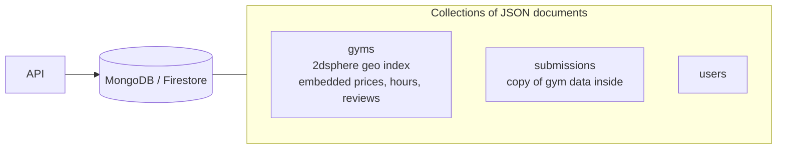

- ✅ Flexible schema: each gym document can hold whatever fields are known.
- ✅ MongoDB has decent geo queries (2dsphere). Firestore syncs live to mobile apps, which is attractive for Expo.
- ✅ Scales writes horizontally out of the box.
- ❌ Firestore's geo support is weak (needs geohash workarounds, one range filter per query), so "gyms in view + filters" gets awkward and expensive (billed per document read, so every map pan costs money).
- ❌ Relations (submission → gym → reviewer) must be duplicated or joined in app code, so data drifts out of sync.
- ❌ Multi-document transactions exist in MongoDB but are second-class; approval flow is more fiddly.

**Variation 3: Wide-column / key-value NoSQL (DynamoDB, Cassandra)**

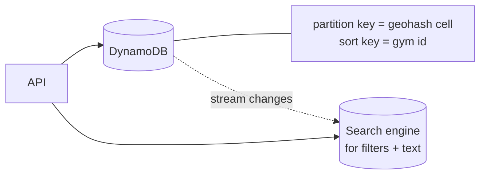

- ✅ Near-unlimited scale with predictable latency; pay-per-request.
- ✅ Geohash-cell partition keys map neatly onto the tile idea.
- ❌ Only fast for the queries you designed keys for. Filters and text search need a second system (OpenSearch), so two stores to keep in sync.
- ❌ No joins, limited transactions; the approval flow needs careful design.
- ❌ Built for millions of requests per second, which this app won't have. All of the cost of that scale, none of the benefit.

**Verdict:** PostgreSQL + PostGIS. The data is geographic and relational, the size fits one server, and JSONB covers the "flexible fields" argument that usually favours NoSQL. NoSQL would win if we had huge write volume or no relations, and we have neither.

### 5.2 Caching: where should caches go?

Caches help when the *same* answer is requested many times. Here that's map tiles (everyone looking at Bali sees the same gyms) and gym details. They don't help for per-user data (my submissions) or rare queries.

| Variation | Where | Pros | Cons |
|---|---|---|---|
| **No cache** | Every request hits Postgres | Simplest; always fresh | Postgres does all the work; fine at launch, first thing to strain under growth |
| **Client cache only** (layer 1) | In the app (e.g. React Query) | Free; instant re-pans | Each user still hits the server once per tile; no sharing between users |
| **Redis in front of Postgres** (layer 4) | Server side | Shared between all users; also caches LLM answers and rate-limit counters; easy to invalidate on approval | One more service to run; must invalidate on every gym change |
| **CDN for tile responses** (layer 2) | At the edge, near users | Absorbs most map traffic before it reaches our servers; fastest for users worldwide; cheap | Only works because tiles are public and identical per user; stale until TTL expires or a purge |
| **All layers** (1+2+4) | Everywhere | Best scale and speed | Most invalidation to think about |
| **Persistent cache of external data** (layer 6, Postgres itself) | Storing Overpass/Places results | Protects external rate limits and cost; this is what `fetched_areas` already does | Data goes stale; needs the weekly refresh |

**Verdict:** layers 1, 2, 4 and 6. Fixed geohash tiles are what makes this work: if the app asked for "gyms in this exact rectangle", every pan would be a unique request and no cache would ever hit. Snapping to fixed tiles turns millions of unique rectangles into a small set of reusable keys. Redis is the place to add next once Postgres load matters, which matches the earlier decision to include it now. Do **not** cache per-user data (submission status, admin queue) at the CDN.

### 5.3 Queues: where should queues go?

A queue belongs anywhere work is **slow, flaky, rate-limited, or costly**, so the user shouldn't wait on it and we control how fast it runs.

| Work | Slow? | External limit? | Queue? |
|---|---|---|---|
| Map tile read | No | No | **No**, must be instant |
| Auth, submitting a request | No | No | **No** (but the bot review it triggers: yes) |
| AI chat reply (FR-8) | 2–30 s | LLM cost/throughput | **Yes** |
| Bot review of submissions (FR-17) | Seconds | LLM | **Yes** |
| Area sweep (FR-11) | Minutes | Source rate limits / billing | **Yes** |
| Overpass tile refresh, coverage job | Seconds–minutes | ~100 req/day fair use | **Yes**, with a rate limiter |
| Cache invalidation after approval | No | No | Optional (event) |

**Variation 1: No queue (do it inside the request)**

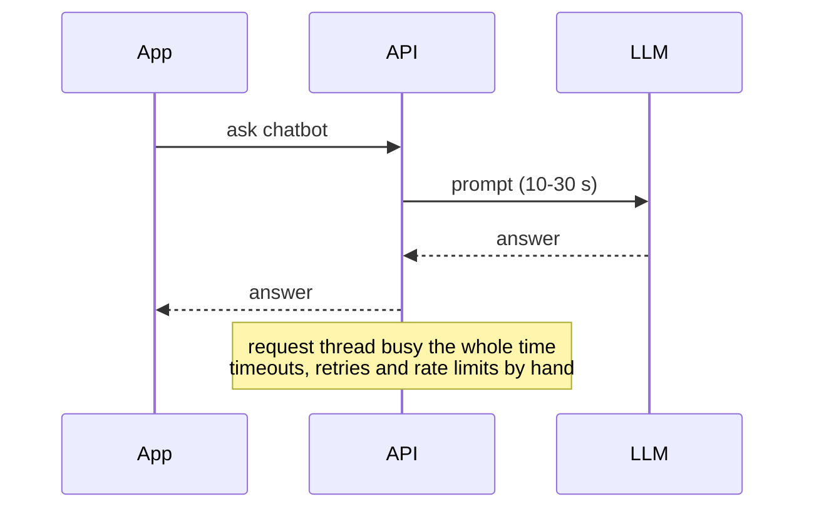
- ✅ Simplest; the answer comes back in the same request.
- ❌ Long requests hit mobile/proxy timeouts; a burst of chats or sweeps starves map reads; no retries; easy to exceed Overpass/LLM limits.

**Variation 2: Queue in Redis (e.g. BullMQ)**

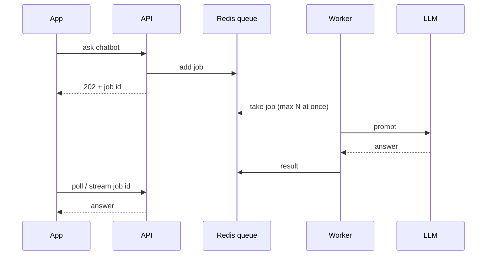
- ✅ Fast; built-in retries, delays, rate limits, cron-style schedules (coverage job).
- ✅ Reuses Redis we already run for caching.
- ❌ Jobs live in Redis memory: need persistence turned on so a restart doesn't lose them.

**Variation 3: Queue in Postgres (e.g. pg-boss, or a jobs table with `SKIP LOCKED`)**
- ✅ No extra service; job + data change can be one transaction (e.g. "create submission and its bot-review job" can't half-happen).
- ❌ Adds load to the main database; lower throughput than Redis. Fine at this scale, worse later.

**Variation 4: Managed cloud queue (SQS, Google Pub/Sub, Cloud Tasks)**
- ✅ Zero ops, effectively unlimited scale, durable.
- ❌ Ties us to one cloud; harder to run locally; overkill now.

**Verdict:** queue chat, bot review, sweeps and external refreshes; never queue map reads. Use a Redis queue (Variation 2) since Redis is already in the plan, with a per-source rate limiter on the sweep/refresh queues so Overpass and paid APIs are never exceeded. Postgres-backed queues are a reasonable fallback if we ever want to drop Redis.

### 5.4 Putting the chosen blocks together

## 6. Recommendation: Option B

Option B keeps the simplicity of one codebase but separates the two kinds of work that actually behave differently. It's a short step from the demo code (move slow handlers into job processors), uses the pieces already agreed on, and every scaling move later is "add more copies" rather than a rewrite. Option A is a fine *first deploy* of B's code (run the worker in the same process), but the queue boundary should be in the code from day one.

### Key flows in Option B

**Map read path (FR-4, 5, 10).** Gyms are grouped into fixed tiles (geohash cells, as agreed earlier). The same tile is the same response for every user, so it caches well at the CDN and in Redis. Postgres is only hit on a cache miss.

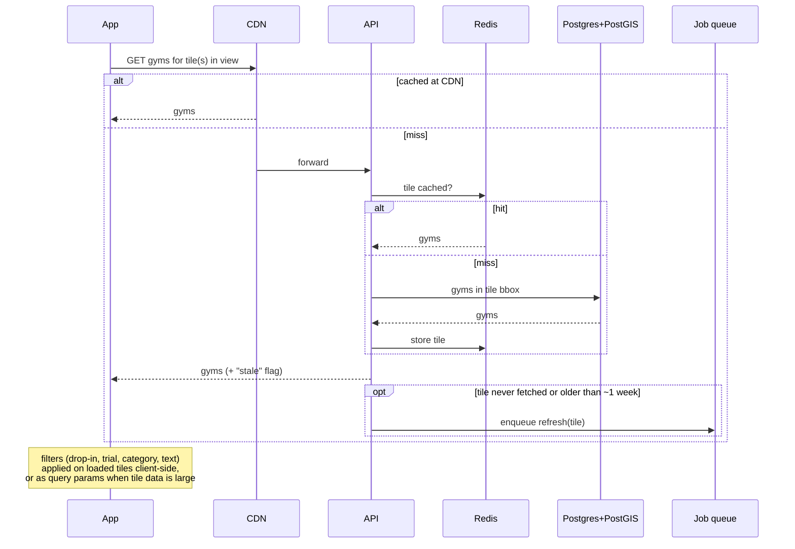

This also answers the open question in `docs/gym-data-design.md`: a stale tile is served immediately and refreshed in the background, so no user waits on Overpass.

**Pluggable data sources (FR-11, OOS-1).** Sweeps, the coverage job and the weekly refresh all call the same interface. Choosing a source is config, so Google Places, Foursquare, or regional sources can be added without changing anything else.

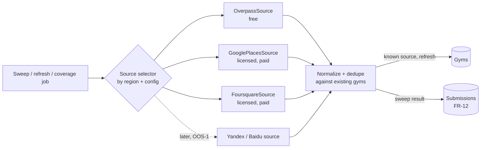

**Submissions and approval (FR-12, 16, 17, 18).** User submissions, sweep results and chatbot-found facts all enter the same pipeline.

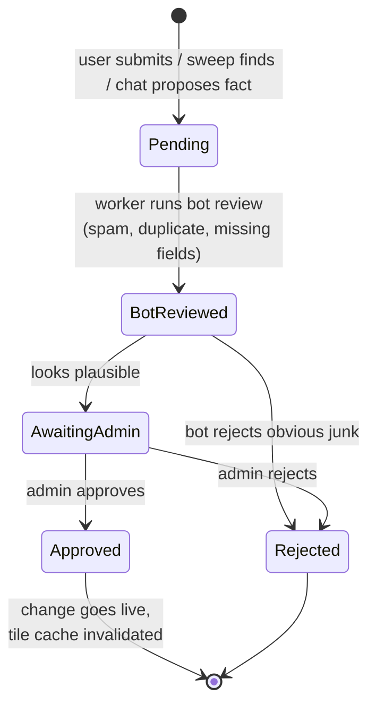

**AI chat (FR-8, 9).** The API accepts the question and returns a job id; a worker calls the LLM through the single LLM interface (Ollama now, Claude later) with the gym's record as context, then streams or posts the answer back. Answers to common questions are saved on the gym record (via the approval flow) so the next user gets them without an LLM call.

### How Option B scales

| Load | Setup |
|---|---|
| Launch → 10k DAU (~30 req/s peak) | 1 API + 1 worker (can share one small VM), managed Postgres, Redis free tier, CDN in front. |
| ~100k DAU (~300 req/s) | 2–4 API copies behind a load balancer, more workers, Postgres read replica. CDN absorbs most map reads. |
| ~1,000 req/s (NFR-2's number) | Map reads are ~all CDN/Redis hits, so API copies scale horizontally. LLM throughput is bounded by budget, not architecture: a queue with per-user rate limits. External sweeps stay rate-limited by the source's terms regardless. |

## 7. Decisions needed from Joey

1. **Pick the architecture** (recommended: B) and the building blocks in section 5 (Postgres+PostGIS, caches at client/CDN/Redis, Redis queues for slow work).
2. **Reword FR-11** to "sweep using a licensed source (e.g. Google Places API)" instead of scraping Google Maps.
3. **Restate NFR-2** as an affordable peak, e.g. "~50 API req/s and a few LLM calls/s at launch, scaling horizontally".

Once these are settled, the next docs are stack choices, then schema, then API.
