# Gym Finder: High-Level Design Discussion

Phase 2 of the roadmap, step 1: **high-level architecture only**. Stack details, schema and API come in later docs. Requirement IDs (FR-x, NFR-x) refer to [REQUIREMENTS.md](./REQUIREMENTS.md).

Fixed constraint: one Expo (Expo Router, TypeScript) client for Web, Android and iOS (NFR-3). Everything below is about what sits behind it.

## 1. Are the requirements realistic?

Yes. 10,000 daily users (NFR-1) is a modest load that one small server plus a database can handle, and every functional requirement has been built in some form already in the demo code on this branch. Reviewing them against the design, with Joey's decisions from the PR review:

| Requirement | Verdict | What the design does about it |
|---|---|---|
| FR-11 Google Maps sweeps | **Decided: we scrape Google Maps.** This breaks Google's Terms of Service; Joey has accepted that risk (risk: blocked IPs, account bans, legal letters). | The sweep is still a *pluggable data source*, so the Google Maps scraper sits behind the same interface as Overpass. If it gets blocked or we need to stop, the Places API or another source swaps in without touching the rest of the system. Regional sources (OOS-1) slot in the same way. |
| NFR-2 1,000 bot req/s | **Realistic as an intake rate, using queues.** Bot requests are accepted into a queue at up to 1,000/s and *drained* at a much slower, controlled rate by workers. | Separate queues with different drain rates: "find more gyms" sweeps drain slowly (they hit Google Maps), per-gym requests (chat, bot review) drain faster. Same-area sweep requests are merged so the backlog stays bounded. Workers on each queue **auto-scale and run in parallel**, adding copies as the queue grows. See section 5.3. |
| FR-4 "every gym in the world" | **Realistic as a number that grows with use.** Every search, OSM refresh and bot sweep adds gyms. | Lazy per-tile OSM refresh + daily coverage job + sweeps + user submissions. |
| FR-8/9 AI chatbot | **Realistic.** Demo mode runs Ollama on our own server (no per-call bill); scale mode switches to Claude once there are users and premium accounts (section 6.1). | Behind one LLM interface, so switching is config. In demo mode the limit is our server's compute: a queue caps how many LLM jobs run at once, and answers are saved on the gym record (FR-9) so repeat questions skip the LLM. Kept behind one LLM interface. |

**Bottom line:** on board. The options below all assume these decisions.

## 2. What every option has to handle

Whatever the shape, the system has the same five jobs. The options differ in how these are split into deployable pieces.


The key insight is that **map reads** are by far the most frequent and are easy to cache, while **chat, sweeps and bot review** are slow, call external services, and should never block a request thread. Splitting "fast reads" from "slow background work" matters much more than splitting by feature.

## 3. Architecture options

### Option A: Single modular monolith

One Node API server does everything: serves map data, runs chat calls inline, runs sweeps and the coverage job in-process. This is roughly what the demo `server/index.js` is today.

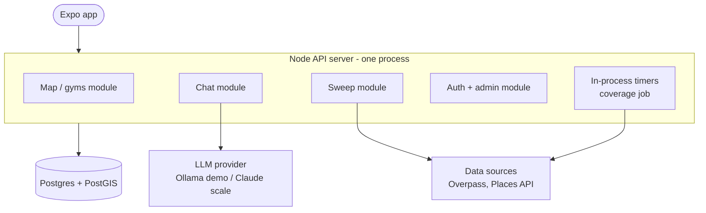

**Pros**
- Simplest to build, deploy and debug: one process, one log, one deploy.
- Cheapest to host (fits the near-free GCP e2-micro idea).
- Closest to the existing demo code, so least rework.

**Cons**
- A slow sweep or LLM call ties up the same server that serves the map. Ten people chatting at once could make the map feel sluggish.
- Can't scale chat separately from reads. Adding servers to handle chat also duplicates the in-process timers (two coverage jobs running at once).
- A crash in a sweep takes down the whole app.
- Doesn't meet NFR-4 ("scale without a rewrite") well: getting out of it later means pulling background work out anyway.

### Option B: Modular monolith API + background workers via a queue (chosen)

Same single codebase, but deployed as two kinds of process. The **API** only does fast things (reads, auth, accepting requests). Anything slow (chat replies, sweeps, bot review, Overpass refresh, coverage job) becomes a **job on a queue** that **workers** pick up. Redis does double duty as cache and queue. The app gets results by polling or a push/stream.

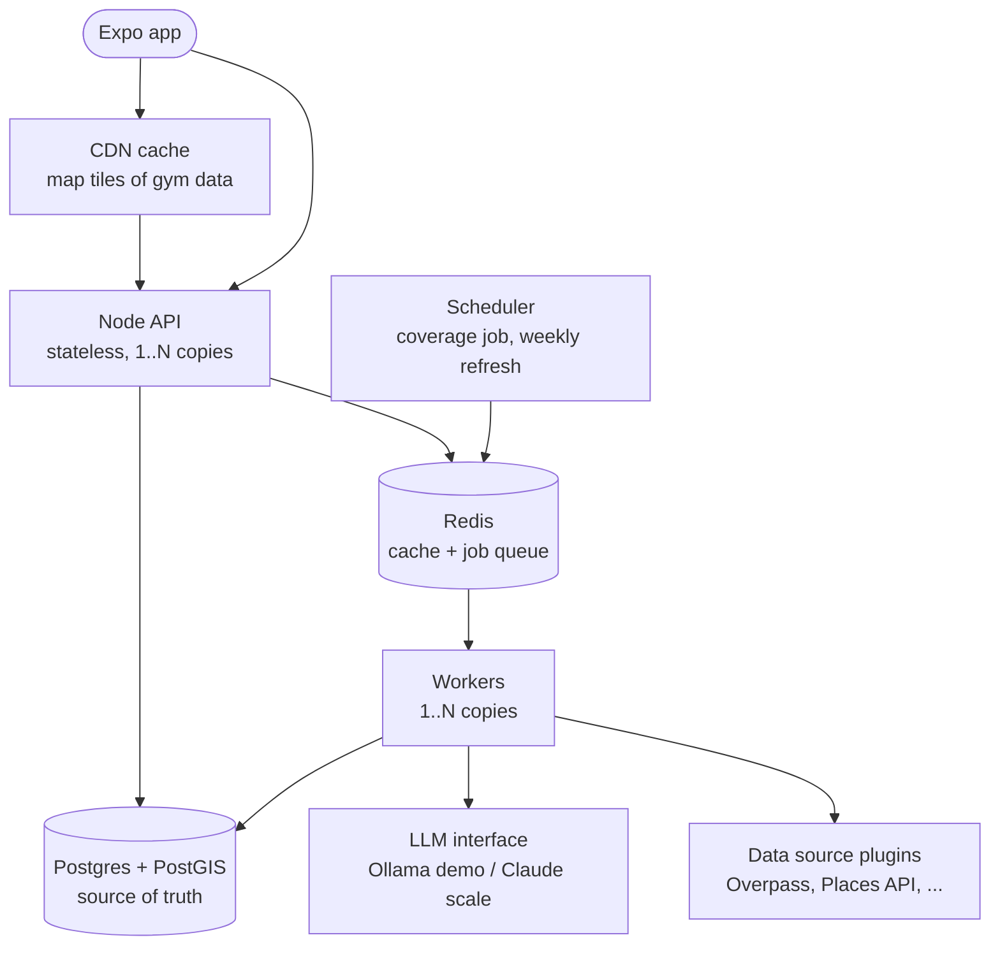

**Pros**
- Map stays fast no matter how many chats or sweeps are running.
- API and workers scale independently: add workers when chat gets busy, add API copies when map traffic grows.
- Queue gives natural rate limiting, so we never exceed Overpass fair-use or LLM budget, and retries for flaky sources.
- Still one codebase and one language, so it's nearly as simple to work on as Option A.
- Uses pieces already agreed (Postgres+PostGIS, Redis, LLM behind one interface).

**Cons**
- More moving parts than A: two process types plus Redis to run and monitor.
- Chat and sweeps become asynchronous, so the app needs a "working on it..." state and a way to get the result (polling or streaming).
- Slightly more hosting cost than A (Redis free tier covers the start).

### Option C: Microservices / serverless functions

Each feature becomes its own service (or set of cloud functions) with its own deploy, talking through an API gateway and an event bus.


**Pros**
- Each piece scales and deploys fully independently.
- Strong isolation: a broken sweep service can't affect anything else.
- Fits large teams where different people own different services.

**Cons**
- Heavy overhead for a one-person project at 10k DAU: many deploys, network calls between services, distributed debugging.
- Data is split across services, so simple things (approving a submission updates a gym) become cross-service workflows.
- Serverless functions have time limits and cold starts that fit badly with long sweeps and LLM calls.
- Highest cost and complexity for no benefit at the expected load.

### Option D: Backend-as-a-Service (e.g. Supabase) + a worker

Use a hosted platform that bundles Postgres+PostGIS, auth, row-level permissions and auto-generated APIs. The app reads gyms directly from it. Only the slow work (chat, sweeps, bot review) runs in a small custom worker.


**Pros**
- Auth, sign-up, password reset and roles (FR-13, 14) come built in, so less security code to write ourselves.
- Generous free tier, managed backups, PostGIS supported.
- Fastest path to a working product.

**Cons**
- Vendor lock-in: auth and permission rules live in the platform, so moving off it later is real work.
- Business rules (approval flow, filters) split between database policies, edge functions and the worker, which is harder to reason about than one codebase.
- Throws away the existing Express server and auth code.
- Less control over caching and how queries scale.

## 4. Comparison

| | A. Monolith | **B. Monolith + workers** | C. Microservices | D. BaaS + worker |
|---|---|---|---|---|
| Build effort now | Lowest | Low | High | Low |
| Reuses demo code | Most | Most | Little | Little |
| Map stays fast under chat/sweep load | No | Yes | Yes | Yes |
| Scales past 10k DAU without rewrite (NFR-4) | Weak | Good | Best | Good, within vendor limits |
| Hosting cost at start | ~Free | ~Free (same single server as A in demo mode, section 6.1) | Highest | ~Free |
| Ops complexity | Lowest | Medium | Highest | Low |
| Lock-in | None | None | Low | High |

## 5. Building-block choices

The options above are the overall *shape*. Inside any shape, three building blocks change how the system behaves the most: **which database**, **where caches go**, and **where queues go**. Each one is laid out below as variations with a diagram, and why one wins for this app.

### 5.1 Database: PostgreSQL+PostGIS vs NoSQL

What the data looks like decides this. Gym Finder's data is:
- **Geographic.** The main query is "gyms inside this map rectangle, filtered by category / drop-in / trial / text" (FR-5, FR-10).
- **Relational.** Users → submissions → gyms → reviews → admin decisions (FR-16 to FR-18). Approving a submission must update the gym *and* the submission together, or neither.
- **Moderate in size.** Probably a few million gyms worldwide, at most. That fits one Postgres server comfortably.

**Variation 1: PostgreSQL + PostGIS (relational with a geo extension)**

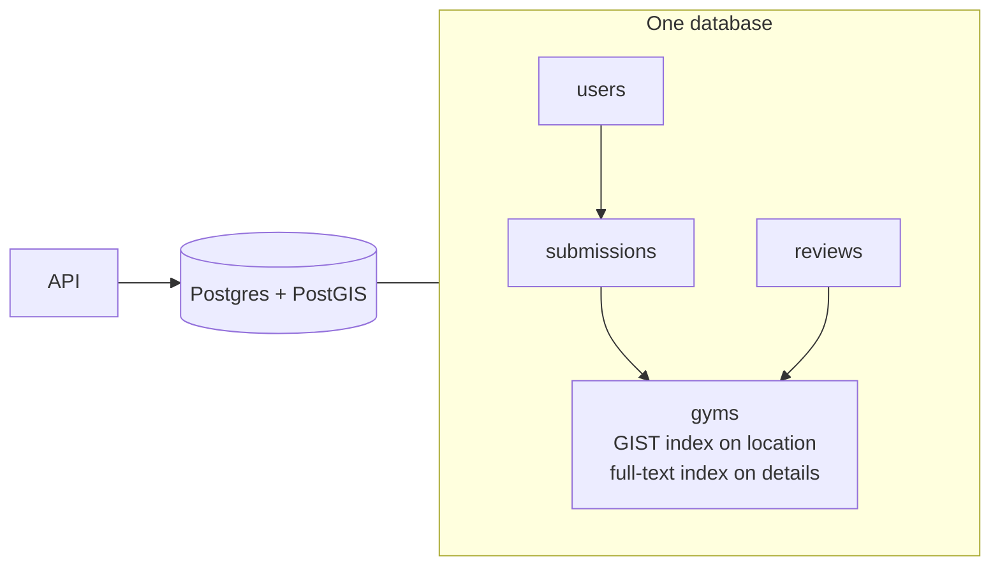

- ✅ PostGIS is the industry standard for geo queries: bounding box, radius, nearest, clustering, all indexed.
- ✅ Transactions: "approve submission + update gym" is atomic, so no half-applied changes.
- ✅ Filters, joins and full-text search in one query, no second system needed for FR-10.
- ✅ JSONB columns give NoSQL-style flexibility for the messy, varying gym details (prices in many currencies, odd opening hours).
- ✅ Already chosen in earlier decisions and used by the demo code.
- ❌ Scaling writes past one server is harder than with NoSQL (needs partitioning or sharding). Not a concern at this size: gym data is read-heavy, and read replicas cover reads.

**Variation 2: Document NoSQL (MongoDB, Firestore)**

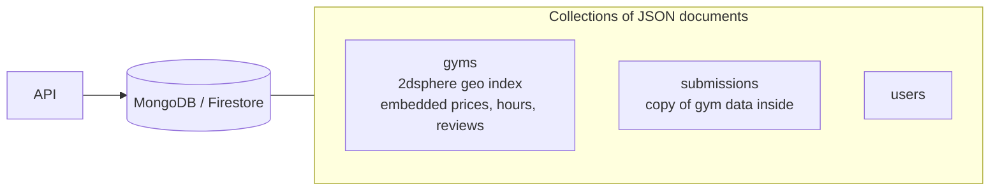

- ✅ Flexible schema: each gym document can hold whatever fields are known.
- ✅ MongoDB has decent geo queries (2dsphere). Firestore syncs live to mobile apps, which is attractive for Expo.
- ✅ Scales writes horizontally out of the box.
- ❌ Firestore's geo support is weak (needs geohash workarounds, one range filter per query), so "gyms in view + filters" gets awkward and expensive (billed per document read, so every map pan costs money).
- ❌ Relations (submission → gym → reviewer) must be duplicated or joined in app code, so data drifts out of sync.
- ❌ Multi-document transactions exist in MongoDB but are second-class; approval flow is more fiddly.

**Variation 3: Wide-column / key-value NoSQL (DynamoDB, Cassandra)**

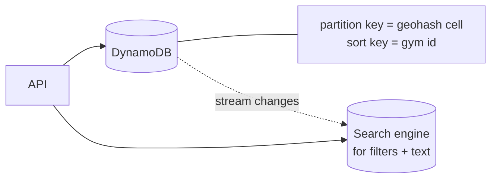

- ✅ Near-unlimited scale with predictable latency; pay-per-request.
- ✅ Geohash-cell partition keys map neatly onto the tile idea.
- ❌ Only fast for the queries you designed keys for. Filters and text search need a second system (OpenSearch), so two stores to keep in sync.
- ❌ No joins, limited transactions; the approval flow needs careful design.
- ❌ Built for millions of requests per second, which this app won't have. All of the cost of that scale, none of the benefit.

**Verdict (decided by Joey, 2026-10-31):** PostgreSQL + PostGIS. The data is geographic and relational, the size fits one server, and JSONB covers the "flexible fields" argument that usually favours NoSQL. NoSQL would win if we had huge write volume or no relations, and we have neither.

### 5.2 Caching: where should caches go?

Caches help when the *same* answer is requested many times. Here that's map tiles (everyone looking at Bali sees the same gyms) and gym details. They don't help for per-user data (my submissions) or rare queries.

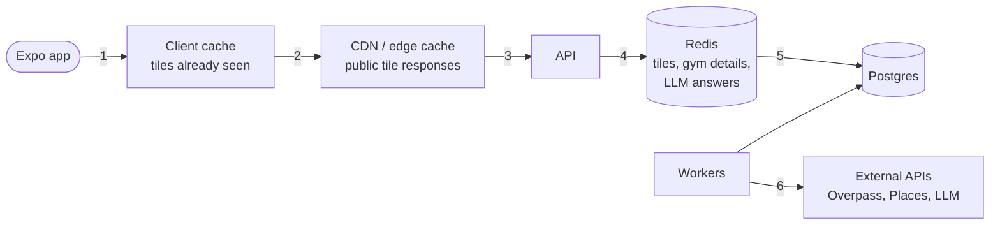

| Variation | Where | Pros | Cons |
|---|---|---|---|
| **No cache** | Every request hits Postgres | Simplest; always fresh | Postgres does all the work; fine at launch, first thing to strain under growth |
| **Client cache only** (layer 1) | In the app (e.g. React Query) | Free; instant re-pans | Each user still hits the server once per tile; no sharing between users |
| **Redis in front of Postgres** (layer 4) | Server side | Shared between all users; also caches LLM answers and rate-limit counters; easy to invalidate on approval | One more service to run; must invalidate on every gym change |
| **CDN for tile responses** (layer 2) | At the edge, near users | Absorbs most map traffic before it reaches our servers; fastest for users worldwide; cheap | Only works because tiles are public and identical per user; stale until TTL expires or a purge |
| **All layers** (1+2+4) | Everywhere | Best scale and speed | Most invalidation to think about |
| **Persistent cache of external data** (layer 6, Postgres itself) | Storing Overpass/Places results | Protects external rate limits and cost; this is what `fetched_areas` already does | Data goes stale; needs the weekly refresh |

**Verdict:** layers 1, 2, 4 and 6. Fixed geohash tiles are what makes this work: if the app asked for "gyms in this exact rectangle", every pan would be a unique request and no cache would ever hit. Snapping to fixed tiles turns millions of unique rectangles into a small set of reusable keys. Redis is the place to add next once Postgres load matters, which matches the earlier decision to include it now. Do **not** cache per-user data (submission status, admin queue) at the CDN.

### 5.3 Queues: where should queues go?

A queue belongs anywhere work is **slow, flaky, rate-limited, or costly**, so the user shouldn't wait on it and we control how fast it runs.

| Work | Slow? | External limit? | Queue? |
|---|---|---|---|
| Map tile read | No | No | **No**, must be instant |
| Auth, submitting a request | No | No | **No** (but the bot review it triggers: yes) |
| AI chat reply (FR-8) | 2–30 s | LLM cost/throughput | **Yes** |
| Bot review of submissions (FR-17) | Seconds | LLM | **Yes** |
| Area sweep (FR-11) | Minutes | Source rate limits / billing | **Yes** |
| Overpass tile refresh, coverage job | Seconds–minutes | ~100 req/day fair use | **Yes**, with a rate limiter |
| Cache invalidation after approval | No | No | Optional (event) |

**Variation 1: No queue (do it inside the request)**

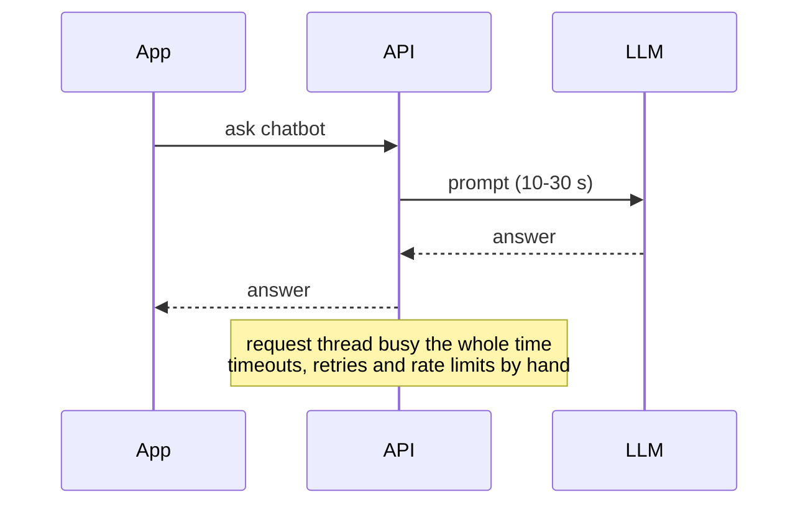
- ✅ Simplest; the answer comes back in the same request.
- ❌ Long requests hit mobile/proxy timeouts; a burst of chats or sweeps starves map reads; no retries; easy to exceed Overpass/LLM limits.

**Variation 2: Queue in Redis (e.g. BullMQ)**

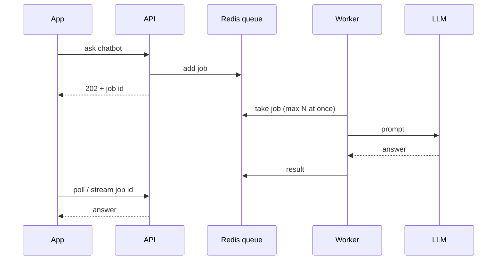
- ✅ Fast; built-in retries, delays, rate limits, cron-style schedules (coverage job).
- ✅ Reuses Redis we already run for caching.
- ❌ Jobs live in Redis memory: need persistence turned on so a restart doesn't lose them.

**Variation 3: Queue in Postgres (e.g. pg-boss, or a jobs table with `SKIP LOCKED`)**
- ✅ No extra service; job + data change can be one transaction (e.g. "create submission and its bot-review job" can't half-happen).
- ❌ Adds load to the main database; lower throughput than Redis. Fine at this scale, worse later.

**Variation 4: Managed cloud queue (SQS, Google Pub/Sub, Cloud Tasks)**
- ✅ Zero ops, effectively unlimited scale, durable.
- ❌ Ties us to one cloud; harder to run locally; overkill now.

**Variation 5: Kafka (event log)**
- ✅ Handles millions of messages per second; messages are stored on disk and can be replayed.
- ✅ Good when many different consumers need the same stream of events.
- ❌ It's a log, not a job queue: no built-in per-job retries, delays or rate limits, so we'd build those ourselves.
- ❌ Heavy to run (a cluster, or a paid managed service). 1,000 msg/s is about 0.1% of what it's built for.

#### Why Redis and not Kafka, and what about data loss?

**Scale.** Kafka scales further, but we don't need that. A single Redis instance handles tens of thousands of jobs per second, so 1,000/s uses a few percent of it. Kafka's advantage starts at hundreds of thousands to millions of messages per second.

**Fit.** Our work is *jobs* (do this sweep, answer this chat), and job features matter most here:

| Need | Redis job queue (BullMQ) | Kafka |
|---|---|---|
| Retry a failed job with backoff | Built in | Build it yourself (retry topics) |
| Delay or schedule a job | Built in | Build it yourself |
| Priorities (seed jobs low, user sweeps high) | Built in | Separate topics + custom logic |
| Per-source rate limit (don't get blocked) | Built in | Build it yourself |
| Merge duplicate jobs (same tile) | Built in (job IDs) | Build it yourself |
| Replay history, many independent consumers | No | **Yes, its main strength** |
| Running cost | One small instance / free tier | Cluster or paid managed service |

**Data loss.** Redis keeps data in memory, so a crash *can* lose recent jobs. The design makes that harmless:

1. **Persistence on:** Redis append-only file with `appendfsync everysec`, so at most ~1 second of new jobs is at risk.
2. **Postgres first, queue second:** anything that matters (a user's gym submission, an admin approval) is written to Postgres *before* a job is queued, and the job only carries the row's ID. Losing the job never loses the data.
3. **Recovery sweeper:** a periodic job finds Postgres rows stuck in "pending" with no live job and re-queues them.
4. **The rest can be re-created:** sweeps and chat replies can simply be requested again.

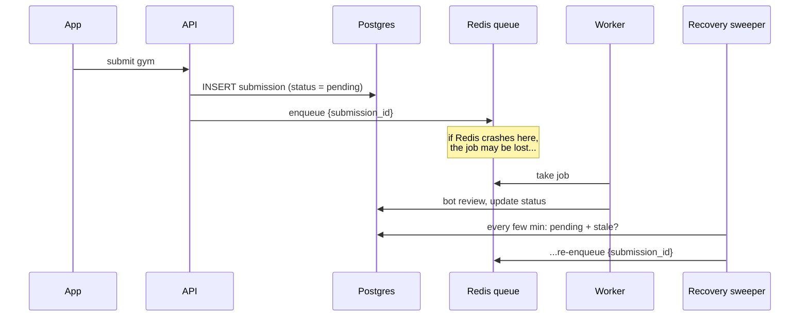

**When Kafka (or a managed queue like SQS) would be the better pick:** if volume grows into hundreds of thousands of events per second, if several separate systems need to read the same event stream (analytics, search indexing, notifications), or if we need to replay history. Because the queue sits behind one interface, switching then is a new implementation, not a rewrite.

#### Handling 1,000 bot requests per second (NFR-2)

The idea is to accept requests fast and process them slowly. The queue absorbs the burst; each queue drains at the rate its downstream can take.

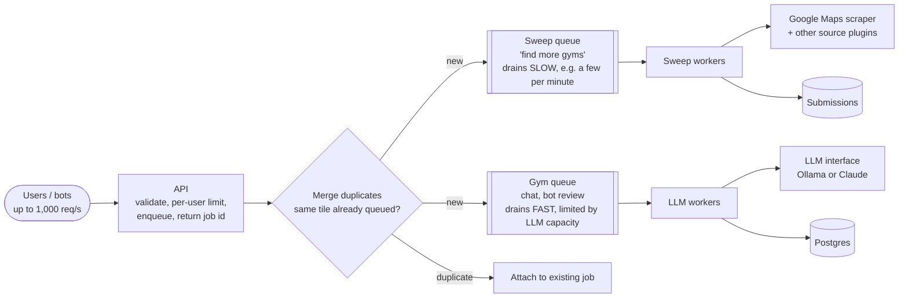

Why the extra pieces matter: at a sustained 1,000/s in and a few per minute out, a sweep queue would grow by ~86 million jobs a day and never empty. Three things keep it bounded:
1. **Merge duplicates:** many users asking to sweep the same area becomes one job (keyed by geohash tile).
2. **Skip fresh tiles:** a tile swept recently is answered from the database, not re-queued.
3. **Per-user limits:** one user or bot can't fill the queue alone.

#### Auto-scaling the workers

Each queue's workers scale on their own, based on how long that queue is. More jobs waiting means more worker copies running in parallel; an empty queue scales down to a minimum (or zero).

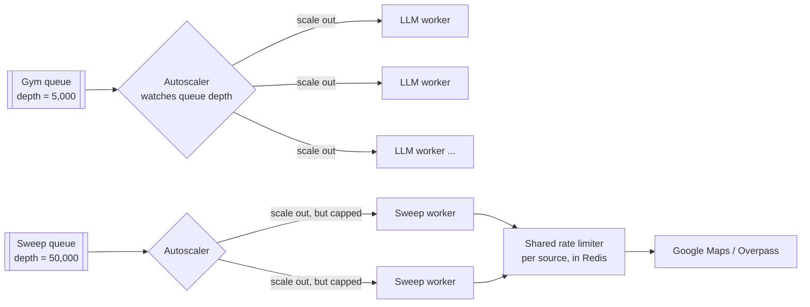

- ✅ Pay for capacity only when there's a backlog; grows with users without code changes (NFR-4).
- ✅ Gym and sweep queues scale independently, so a seeding run doesn't steal capacity from chat.
- ❌ Sweep workers need a **shared** rate limiter and a max worker count. Without it, scaling out just sends more scrape requests at once and gets us blocked faster. More sweep workers help with parsing and dedupe work, not with going past the source's limit.
- ❌ LLM workers scale only as far as the LLM does: with Ollama that means GPU machines; with Claude it means API rate limits and the bill. Either way it's the main cost lever.
- ❌ Needs a platform that can scale on queue depth (e.g. Kubernetes with KEDA, Cloud Run, Fly.io machines). The near-free single VM can't, so this comes with the move to managed hosting.

**Verdict:** queue chat, bot review, sweeps and external refreshes; never queue map reads. Use separate queues with their own drain rates (slow for sweeps, faster for per-gym jobs), each with workers that auto-scale on queue depth. Redis queues (Variation 2) handle 1,000 jobs/s easily and Redis is already in the plan, so start there. Kafka (Variation 5) is worth it only if we later need very high volume or several systems reading the same event stream; because the queue sits behind one interface, switching later doesn't touch the rest of the code. Postgres-backed queues are a reasonable fallback if we ever want to drop Redis.

### 5.4 Putting the chosen blocks together

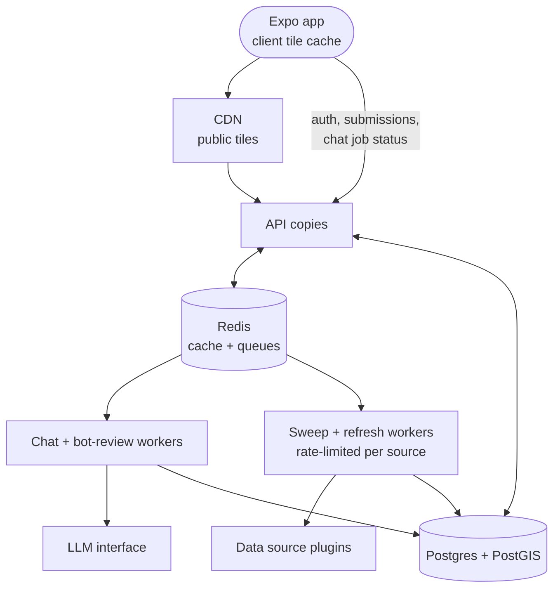

## 6. Decision: Option B

**Decided by Joey (2026-10-31):** Option B. It avoids the extra resource costs microservices would bring, costs the same as A in demo mode, and keeps everything scalable.


Option B keeps the simplicity of one codebase but separates the two kinds of work that actually behave differently. It's a short step from the demo code (move slow handlers into job processors), uses the pieces already agreed on, and every scaling move later is "add more copies" rather than a rewrite. Option A is a fine *first deploy* of B's code (run the worker in the same process), but the queue boundary should be in the code from day one.

### 6.1 Two modes: demo and scale

We want to run cheaply now (no paid queues, Ollama), but be able to switch to high-scale mode straight away once there are users and premium accounts. That works if **every piece that differs between modes sits behind an interface, and the mode is picked by config**, not by code changes. Option B fits this well because "API + workers + queue" can all run inside one process in demo mode.

**Demo-mode B costs the same as Option A.** Everything runs on the same single small server A would use: the API and the worker as two processes (or one), the queue as a table in the same Postgres, and Ollama alongside. No Redis, no paid queue, no extra machine. The only difference from A is that slow jobs go through the queue table instead of running inside the request, so a busy chat or sweep can't slow the map down. That separation is what makes the later switch to scale mode a config change instead of a rewrite.

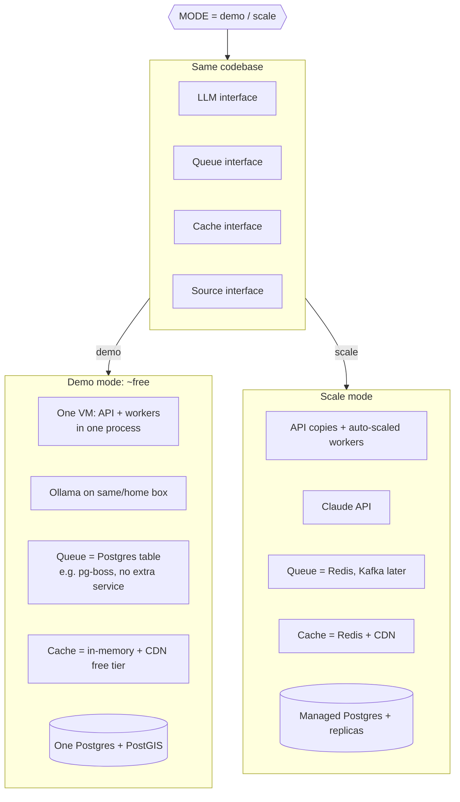

| Piece | Demo mode | Scale mode | What switching takes |
|---|---|---|---|
| LLM | Ollama | Claude | Config + API key |
| Queue | Postgres table (pg-boss) or in-process | Redis queue (Kafka later) | Config; drain or move jobs still waiting |
| Cache | In-memory per process + free CDN | Redis + CDN | Config + a Redis URL |
| Workers | Same process as API, fixed count | Separate, auto-scaled on queue depth | Deploy config |
| Database | One Postgres+PostGIS | Managed Postgres + read replicas | Dump/restore or managed migration (the only slow step) |

**How the switch works: one setting, chosen at startup, not on/off checks in the code.** A single `MODE=demo|scale` setting (or one flag per piece, e.g. `QUEUE=postgres|redis`, `LLM=ollama|claude`) is read once when the server starts and picks which implementation each interface gets. Business code only ever calls `queue.add(...)`, `llm.ask(...)`, `cache.get(...)` and never checks the mode itself.

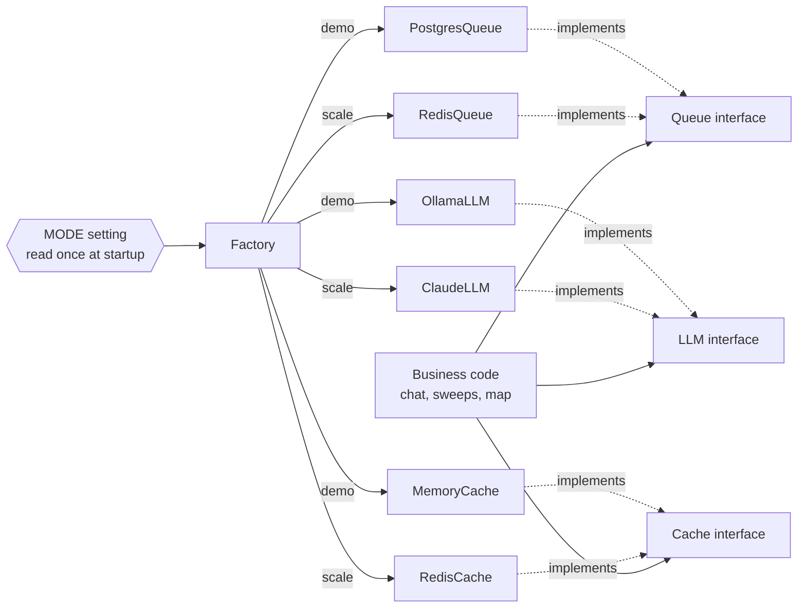

| Approach | Why |
|---|---|
| ✅ **Mode picks the implementation at startup** | One place to change; demo and scale run the exact same business code; adding Kafka later is one more implementation, not edits everywhere. |
| ❌ `if (scaleMode)` checks scattered through the code | Easy to miss one; the demo path and scale path drift apart, so the scale path breaks without anyone noticing until switch day. |
| ❌ **Turning queues *off* in demo mode** (running slow jobs inside the request) | Brings back the problems of Option A: chats and sweeps block the map, no retries, no rate limits on scraping. And the queue code would go untested until switch day. Keep queues **on** in demo mode, just backed by a Postgres table, which costs nothing extra. |

Redis is the piece that can truly be absent in demo mode: the cache falls back to in-memory and the queue to Postgres. Claude vs Ollama is the same pattern.

**CI tests both modes.** The test suite runs twice, once with `MODE=demo` and once with `MODE=scale` (Redis in a test container, Claude stubbed), so neither side can quietly break.

- ✅ Near-zero cost until there's revenue, with no rewrite when we switch.
- ✅ Demo mode still exercises the real queue and cache code paths, so the switch is low-risk.
- ✅ A Postgres-backed queue in demo mode costs nothing extra and keeps jobs safe over restarts (a pure in-memory queue loses them).
- ❌ Two of everything to test. Mitigation: CI runs the test suite in both modes (above).
- ❌ Interfaces must stick to what both sides support (e.g. no Kafka-only or Redis-only features in business logic).
- ❌ "Immediately" applies to config and services; moving the database to a managed host still needs a short planned migration.

### Key flows in Option B

**Map read path (FR-4, 5, 10).** Gyms are grouped into fixed tiles (geohash cells, as agreed earlier). The same tile is the same response for every user, so it caches well at the CDN and in Redis. Postgres is only hit on a cache miss.

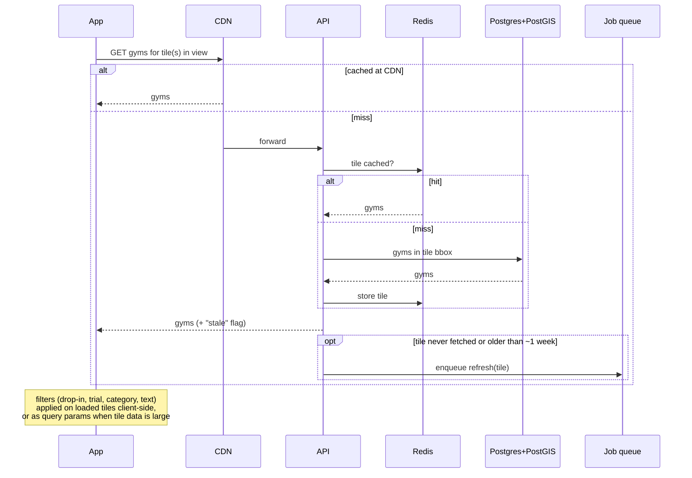

This also answers the open question in `docs/gym-data-design.md`: a stale tile is served immediately and refreshed in the background, so no user waits on Overpass.

**Pluggable data sources (FR-11, OOS-1).** Sweeps, the coverage job and the weekly refresh all call the same interface. Choosing a source is config, so the Google Maps scraper, Google Places API, Foursquare, or regional sources can be added or swapped without changing anything else.

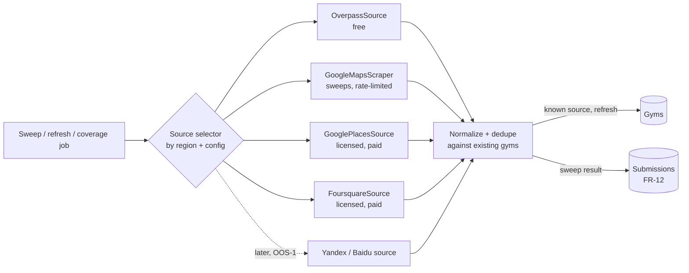

**Pre-release seeding (new requirement: populate top travel destinations before launch).** The seeding script is not a separate system. It is a small command-line tool that turns a list of destinations into sweep jobs, and then reuses the same queue, workers and source plugins as user-requested sweeps.

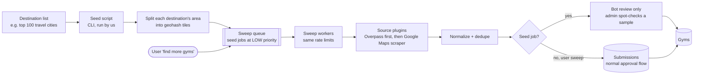

- ✅ No new pipeline to build or maintain: seeding is "lots of sweeps", so it tests the real sweep path before launch.
- ✅ Resumable: progress is just which tiles are fresh in `fetched_areas`, so a crashed or blocked run picks up where it stopped.
- ✅ Low priority means user sweeps after launch still jump ahead if seeding is still running.
- ✅ Same rate limits protect us from getting blocked mid-seed.
- ❌ Slow by design. Seeding many cities at a careful scrape rate takes days, so it should start well before release.
- ❌ Thousands of seeded gyms can't each go through admin approval (FR-17). The diagram assumes seeded results get bot review only, with admins checking a sample. **This needs Joey's OK.**

**Submissions and approval (FR-12, 16, 17, 18).** User submissions, sweep results and chatbot-found facts all enter the same pipeline.

```mermaid
stateDiagram-v2
    [*] --> Pending: user submits / sweep finds / chat proposes fact
    Pending --> BotReviewed: worker runs bot review<br/>(spam, duplicate, missing fields)
    BotReviewed --> Rejected: bot rejects obvious junk
    BotReviewed --> AwaitingAdmin: looks plausible
    AwaitingAdmin --> Approved: admin approves
    AwaitingAdmin --> Rejected: admin rejects
    Approved --> [*]: change goes live,<br/>tile cache invalidated
    Rejected --> [*]
```

**AI chat (FR-8, 9).** The API accepts the question and returns a job id; a worker calls the LLM through the single LLM interface (Ollama in demo mode, Claude in scale mode) with the gym's record as context, then streams or posts the answer back. Answers to common questions are saved on the gym record (via the approval flow) so the next user gets them without an LLM call.

### How Option B scales

| Load | Setup |
|---|---|
| Demo mode, launch → 10k DAU (~30 req/s peak) | One small VM running API + workers in one process, Postgres queue, Ollama, free CDN. |
| Scale mode switch-on | Separate API and auto-scaled workers, Redis cache + queue, Claude, managed Postgres. |
| ~100k DAU (~300 req/s) | 2–4 API copies behind a load balancer, more workers, Postgres read replica. CDN absorbs most map reads. |
| ~1,000 req/s (NFR-2's number) | Map reads are ~all CDN/Redis hits, so API copies scale horizontally. Bot requests are accepted into queues at full speed and drained at each queue's own rate (section 5.3). Workers auto-scale on queue depth; LLM throughput is bounded by Claude's rate limits and budget (scale mode). Sweeps drain slowly on purpose to avoid getting blocked by Google Maps. |

## 7. Decisions

Settled in PR review:
- **FR-11:** sweeps scrape Google Maps; ToS risk accepted. Scraper sits behind the pluggable source interface.
- **NFR-2:** 1,000 bot req/s is handled by queues with separate drain rates, whose workers auto-scale and run in parallel (section 5.3).
- **LLM:** Ollama in demo mode, Claude in scale mode, switched by config.
- **Two modes:** a near-free demo mode and a high-scale mode, switchable by config without code changes (section 6.1).
- **FR-4:** coverage grows with use.
- **Architecture:** Option B, modular monolith API + background workers via a queue.
- **Database:** PostgreSQL + PostGIS (section 5.1).

Still needed from Joey:
1. **Seeded gyms and approval:** can pre-release seed results skip per-gym admin approval (bot review + admin spot checks), or must every one go through FR-17?

Once this is settled, the next docs are stack choices, then schema, then API.
