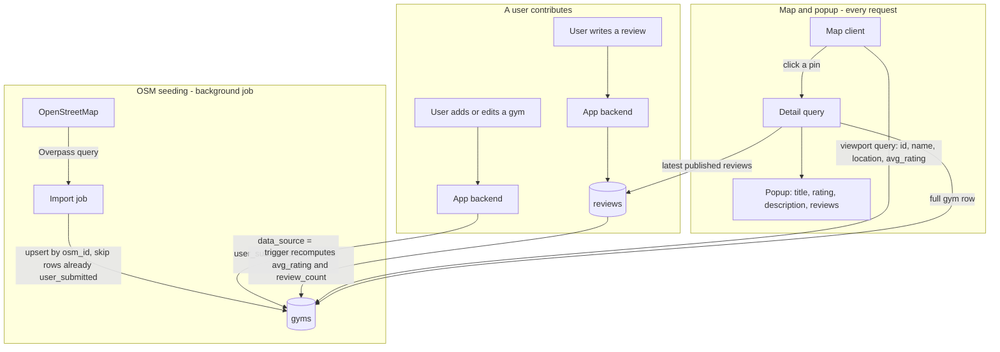
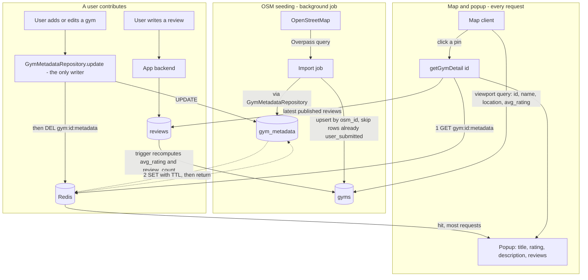

# Gym Finder

A way to find gyms anywhere in the world, weighted toward the places backpackers and digital nomads actually go (Bali/Canggu, Chiang Mai, Lisbon, Medellín, Mexico City, Bangkok, etc.) rather than even global coverage. This doc is about one question: **where does the gym data come from?**

## The options

### 1. Official map/places APIs (Google Places, Foursquare, OpenStreetMap/Overpass)

Three different products, worth distinguishing:
- **Google Places API** — the default choice, best global density, but billed per-request and that bill scales with how many cities/refreshes we do.
- **Foursquare Places API** — Foursquare started as the consumer check-in app (Swarm/City Guide today), but the company is now mainly a B2B places-data business (it merged with Factual, another places-data company) selling exactly this kind of API. Dedicated gym/fitness categories, historically a more generous free tier than Google's, but weaker coverage outside the US/Europe — a real downside for Southeast Asia/Latin America hubs specifically.
- **OpenStreetMap / Overpass API** — free, volunteer-built, `leisure=fitness_centre` tagging. No bill at any scale, and several nomad hubs have surprisingly active local OSM communities, but coverage is inherently uneven since it depends on who's bothered to map a given city.

**Pros**
- Legally clean — licensed, ToS-compliant, no scraping exposure at all. Given everything we just discussed about Air Canada v. Seats.aero and American v. Skiplagged, this matters more than it might look like on a feature list.
- Structured data for free: name, address, coordinates, phone, hours, rating, photos. No parsing/normalization work.
- Having three real options (one free, two paid with different coverage/pricing tradeoffs) means we're not locked into a single vendor's pricing changes the way a lot of Google-Places-only startups got burned before.

**Cons**
- Cost: the two paid options aren't free at real scale. Refreshing a worldwide gym dataset periodically adds up under per-request billing, and the free OSM option trades that cost for coverage gaps.
- Missing exactly the attributes that matter most to this audience: day-pass price, whether drop-ins are even allowed, equipment/specialty (CrossFit vs. commercial chain vs. climbing gym), wifi, long-stay packages. None of the three has any of this.
- Storage/caching restrictions in some API terms — worth checking current Google Maps Platform ToS before architecting "store everything forever."
- Single-vendor pricing risk. Google has changed Maps API pricing substantially before, and it broke a lot of startups' unit economics overnight.

### 2. User-submitted / crowdsourced data

**Pros**
- This is the richest possible source for the attributes that actually differentiate the app — day-pass pricing, drop-in policy, "is this nomad-friendly," real photos, recency ("verified by someone this month").
- The target audience is already a community that shares exactly this kind of info (r/digitalnomad, Nomad List, city-specific Facebook/WhatsApp groups) — crowdsourcing taps a motivated base rather than fighting against apathy.
- Zero marginal cost per record, and a flywheel: more users → better data → more users.
- No legal exposure — it's first-party data people willingly contribute about places they visited.

**Cons**
- Classic cold-start problem: an empty map on day one gets zero contributions, because there's nothing to anchor interaction around.
- Coverage will be wildly uneven early on — popular hubs fill in fast, most of the world stays blank for a long time.
- Needs real moderation: fake entries, stale info, spam. Requires at minimum an upvote/downvote system and a "last verified" timestamp, which is its own build.

### 3. Scraping Google Maps / gym websites directly

**Pros**
- Could theoretically pull richer data than any official API exposes (review text, popular-times graphs, pricing listed on a gym's own site).
- No per-request billing line item.

**Cons**
- This is the exact pattern we spent the last hour establishing is a real, demonstrated legal problem — not a hypothetical one. Google's own ToS explicitly prohibits automated/bulk extraction, and it's been enforced. Doing this as the backbone of a commercial product is the same shape as the Seats.aero/Skiplagged/Kiwi.com cases, not a smaller version of them.
- Technically fragile in the same way `aa.com` 403'd a single plain fetch earlier today — Maps has serious bot detection, and scraped structure breaks whenever Google changes markup.
- I'd steer away from this as a primary strategy for the same reasons already laid out for the airline-miles idea. Happy to revisit narrowly (e.g., a one-time, rate-limited, personal-use pull) if there's a specific gap this is meant to solve that nothing else covers — but not as the main data pipeline.

## Recommendation: seed with an API, enrich with users, skip scraping as the backbone

1. **Seed layer — OpenStreetMap first, Google Places to fill gaps.** Pull baseline gym *locations* (name, address, coordinates) for a short list of launch cities, not the whole world. OSM is free and already decent in several nomad hubs; fall back to Google Places API only where OSM is thin, to control cost. This solves the empty-map cold-start problem on day one, legally and cheaply.
2. **Enrichment layer — user check-ins and edits on top of the seed.** This is where the actual product value lives: day-pass price, drop-in policy, wifi, crowd level, photos, "visited and verified" badges. Map APIs will never have this; your users are the only real source for it.
3. **Later — let gyms claim their own listing.** Once there's real traffic, a "claim this gym" flow (gym owner self-reports pricing/hours, similar to Google Business Profile) solves the verification problem *and* gives gym owners a reason to want to be listed — visibility to a traveling customer base they don't otherwise reach. Possible monetization angle down the line (featured placement), but that's a later conversation.
4. **Start narrow.** Launch with 5-8 known nomad-dense cities rather than "the whole world" — makes the cold-start problem tractable and lets the data model get validated before scaling out.

## A couple of technical notes for later

- Postgres has **PostGIS**, which is the right tool for "gyms near me" geospatial queries — worth enabling from the first migration rather than bolting on distance math later.
- Every enriched field (price, hours, drop-in policy) should carry a `last_verified_at` timestamp from day one, so the UI can show "confirmed 2 weeks ago" vs. "nobody's checked this in 8 months" — that distinction is probably more valuable to a traveler than the raw data point itself.

---

## Database schema: three ways to let OSM data and user edits coexist

Decided: OpenStreetMap/Overpass seeds the map, verified user submissions grow it, PostgreSQL + PostGIS underneath. The one real design question left is **how an OSM-sourced row and a later user correction to that same row coexist** — specifically, what happens when we re-sync from OSM and a user has already verified/edited that gym's name, hours, or description. Three ways to handle it, from simplest to most capable.

### Design A — One table, source-tagged per row (simplest)

A single `gyms` table. Each row starts from an OSM import; once *any* user-verified edit lands on a gym, the whole row flips to user-owned and future OSM re-syncs for that gym are skipped entirely (new OSM gyms still import normally; it's only re-syncing an *already-edited* gym that's blocked).

```sql
CREATE EXTENSION IF NOT EXISTS postgis;

CREATE TYPE gym_data_source AS ENUM ('osm', 'user_submitted');

CREATE TABLE gyms (
  id              BIGSERIAL PRIMARY KEY,
  osm_id          BIGINT UNIQUE,              -- null if a user added it outright, not from OSM
  name            TEXT NOT NULL,
  description     TEXT,                       -- OSM rarely has this; usually empty until a user fills it in
  location        GEOGRAPHY(POINT, 4326) NOT NULL,
  address         TEXT,
  city            TEXT,
  country         TEXT,
  phone           TEXT,
  website         TEXT,
  day_pass_price_cents INT,
  day_pass_currency   TEXT,
  allows_drop_in  BOOLEAN,
  wifi_available  BOOLEAN,
  data_source     gym_data_source NOT NULL DEFAULT 'osm',
  verified_at     TIMESTAMPTZ,                -- last time a human confirmed these details
  verified_by     BIGINT REFERENCES users(id),
  avg_rating      NUMERIC(2,1),               -- see "Rating aggregation" below
  review_count    INT NOT NULL DEFAULT 0,
  created_at      TIMESTAMPTZ NOT NULL DEFAULT now(),
  updated_at      TIMESTAMPTZ NOT NULL DEFAULT now()
);

CREATE INDEX idx_gyms_location ON gyms USING GIST (location);
```

*(Superseded below — once Redis entered the picture, this one table split into `gyms` + `gym_metadata` so there's a clean cache-key boundary between what the viewport needs and what the popup needs. See "Caching gym metadata with Redis" further down for the current shape; the provenance rule above — a row flips to user-owned on its first verified edit — still applies, just to `gym_metadata` now instead of `gyms`.)*

**Pros**
- Easy to build and query — one table, no joins to render the map or the popup.
- Matches the MVP's actual complexity: with a handful of launch cities, re-sync conflicts will be rare at first.

**Cons**
- All-or-nothing per gym: if a user fixes just the phone number, the *entire* row stops receiving OSM updates — including things OSM might still track better than we ever will, like the gym closing down.
- No history. If an edit turns out to be wrong or vandalized, there's no trail back to what it was before.

### Design B — Two-layer: immutable OSM mirror + canonical editable table

`osm_gyms` is a pure, disposable mirror of whatever Overpass returns — fully replaced on every sync, never hand-edited. `gyms` is the real, user-facing table, created once from `osm_gyms` and updated field-by-field: a re-sync only overwrites a field if nothing has verified that *specific* field since.

```sql
CREATE TABLE osm_gyms (
  osm_id        BIGINT PRIMARY KEY,
  name          TEXT,
  location      GEOGRAPHY(POINT, 4326),
  raw_tags      JSONB,                        -- the full OSM tag set, for anything not modeled explicitly
  last_synced_at TIMESTAMPTZ NOT NULL DEFAULT now()
);

CREATE TABLE gyms (
  id              BIGSERIAL PRIMARY KEY,
  osm_id          BIGINT UNIQUE REFERENCES osm_gyms(osm_id),
  name            TEXT NOT NULL,
  description     TEXT,
  location        GEOGRAPHY(POINT, 4326) NOT NULL,
  address         TEXT,
  day_pass_price_cents INT,
  day_pass_currency    TEXT,
  allows_drop_in  BOOLEAN,
  wifi_available  BOOLEAN,
  -- which fields a user has verified, so a re-sync knows what NOT to touch
  locked_fields   TEXT[] NOT NULL DEFAULT '{}',
  verified_at     TIMESTAMPTZ,
  verified_by     BIGINT REFERENCES users(id),
  avg_rating      NUMERIC(2,1),
  review_count    INT NOT NULL DEFAULT 0,
  created_at      TIMESTAMPTZ NOT NULL DEFAULT now(),
  updated_at      TIMESTAMPTZ NOT NULL DEFAULT now()
);

CREATE INDEX idx_gyms_location ON gyms USING GIST (location);
```

**Pros**
- Field-level, not row-level: a user fixing the phone number doesn't block the name or location from still getting OSM updates.
- Clean separation of "what the source says" from "what we show" — re-syncing is safe by construction, and `osm_gyms` doubles as a debugging/audit log of raw source data.

**Cons**
- More moving parts: two tables to keep in sync, and the sync job itself needs real logic (`locked_fields` checks per column) instead of a single upsert.
- Still no *history* — `locked_fields` says a field is user-owned, but not what it used to be or who changed it when.

### Design C — Event-sourced field history (full audit trail)

Every change — an OSM sync or a user edit — is logged as its own immutable row. The "current" value of any field is just the latest one in the log. This is a genuinely different shape, not a variation on A/B: there's no single `gyms.name` column to `SELECT`, there's a stream of edits to replay (in practice, backed by a view or a trigger-maintained snapshot table for fast reads).

```sql
CREATE TABLE gyms (                            -- now just identity + location
  id        BIGSERIAL PRIMARY KEY,
  osm_id    BIGINT UNIQUE,
  location  GEOGRAPHY(POINT, 4326) NOT NULL,
  created_at TIMESTAMPTZ NOT NULL DEFAULT now()
);

CREATE TABLE gym_field_edits (
  id          BIGSERIAL PRIMARY KEY,
  gym_id      BIGINT NOT NULL REFERENCES gyms(id),
  field_name  TEXT NOT NULL,                   -- 'name', 'description', 'day_pass_price_cents', ...
  new_value   TEXT,                            -- stored as text; cast on read
  source      TEXT NOT NULL CHECK (source IN ('osm_sync', 'user_edit')),
  user_id     BIGINT REFERENCES users(id),
  created_at  TIMESTAMPTZ NOT NULL DEFAULT now()
);

CREATE INDEX idx_gym_field_edits_gym_field ON gym_field_edits (gym_id, field_name, created_at DESC);

-- a materialized view (or trigger-maintained table) picks the latest row
-- per (gym_id, field_name) to produce the "current gym" read model
```

**Pros**
- Full history for free: "who changed what, and when" is just a query, not a feature you have to bolt on. Genuinely nice for a travel-community product — "see the edit history" or "this user has 40 accepted edits" is a trust signal competitors like Seats.aero-style aggregators can't easily offer, since they don't own the data pipeline.
- Naturally supports rollback/dispute resolution — bad edits don't destroy the previous value, they just get superseded (or un-superseded).

**Cons**
- The most engineering work by far, for a feature (title/rating/description/reviews in a popup) that doesn't need any of this on day one.
- Reads need a materialized view or snapshot table kept in sync — the same staleness-vs-triggers tradeoff as the rating-aggregation question below, just applied to every field instead of one number.

### Decided: Design A for v1

The stated scope — OSM seed, a handful of launch cities, a map popup with title/rating/description/reviews — doesn't have enough edit volume yet to need field-level conflict resolution. Move to **Design B** once OSM re-syncs actually start clobbering real community edits in practice (that's a "when it hurts" migration, not a guess upfront). **Design C** is worth revisiting later as a trust/differentiation feature in its own right, not as a data-integrity necessity — "see who verified this" is a product decision, not just a schema one.

## Smaller decisions that apply no matter which design above you pick

**Rating aggregation — denormalized cache vs. computed live.** `avg_rating`/`review_count` on `gyms` can be a real column kept in sync by a trigger (or application code) on every review insert/update/delete, or just `AVG(rating)`/`COUNT(*)` computed on read. Cache is faster for the map view (which needs a rating per pin, for every gym in the viewport, on every pan) but needs to stay correctly in sync. Computed-live is simpler and always correct but gets slower exactly where it matters most — rendering a map full of pins. **Recommendation: cache it** — the map-view access pattern (many gyms, one query, every pan) is the one offset pagination/grouped-counts lesson from the retail project applies to directly.

**One review per user per gym, or many over time?** A backpacker might pass through the same city months apart and want to leave an updated review. A `UNIQUE (gym_id, user_id)` constraint (Yelp-style, one review that gets edited) is simpler and avoids rating inflation from repeat visitors; dropping the constraint lets reviews reflect "this place changed since I was last here," which might matter more for day-pass pricing/policy than a typical restaurant review would. Worth deciding deliberately rather than defaulting to whichever happens to be easier to write first.

**Review moderation — trust-by-default vs. pending-approval.** Given the audience (a travel community, not an adversarial marketplace), publishing reviews immediately with an after-the-fact "report" flag is probably enough for v1 — a `status` column (`published` / `flagged` / `removed`) on `reviews` covers it without needing a moderation queue blocking every submission.

```sql
CREATE TABLE reviews (
  id          BIGSERIAL PRIMARY KEY,
  gym_id      BIGINT NOT NULL REFERENCES gyms(id) ON DELETE CASCADE,
  user_id     BIGINT NOT NULL REFERENCES users(id),
  rating      SMALLINT NOT NULL CHECK (rating BETWEEN 1 AND 5),
  body        TEXT,
  status      TEXT NOT NULL DEFAULT 'published' CHECK (status IN ('published', 'flagged', 'removed')),
  created_at  TIMESTAMPTZ NOT NULL DEFAULT now(),
  updated_at  TIMESTAMPTZ NOT NULL DEFAULT now()
);

CREATE INDEX idx_reviews_gym_id ON reviews (gym_id) WHERE status = 'published';
```

## The map-popup query pattern (recommended, not really a fork)

Two genuinely different queries, not one:

1. **Viewport query** — as the map pans/zooms, fetch just `id`, `name`, `location`, `avg_rating` for every gym in the current bounding box. Cheap, called constantly.
2. **Detail query** — only when a specific pin is clicked, fetch that one gym's full row *plus* a page of its reviews.

The thing to actively avoid: fetching reviews (or anything review-sized) for every gym in the viewport just because the popup *might* need them for whichever one gets clicked. That's the same N+1-shaped mistake as the retail project's original product-count bug, just in a new place — load the heavy stuff once, on click, for the one gym that needs it, not for all of them speculatively.

```sql
-- 1. Viewport query — PostGIS's && uses the GIST index; cheap, called on every pan/zoom
SELECT id, name, ST_AsGeoJSON(location) AS location, avg_rating
FROM gyms
WHERE location && ST_MakeEnvelope(:min_lng, :min_lat, :max_lng, :max_lat, 4326);

-- 2. Detail query — only on click, for exactly one gym
SELECT * FROM gyms WHERE id = :gym_id;
SELECT * FROM reviews WHERE gym_id = :gym_id AND status = 'published'
  ORDER BY created_at DESC LIMIT 20;
```

One thing that isn't really a fork: use `geography(Point, 4326)`, not `geometry`. This app is global by design — `geography` does distance/containment math correctly on the sphere everywhere, where `geometry` needs a locally-appropriate projected CRS to stay accurate, which doesn't exist for "every nomad hub on Earth" at once.

## Design A — the v1 schema, drawn out

**Not decided yet, on purpose:** `users` needs real authentication (login + password) before any of this actually ships — `gyms.verified_by` and `reviews.user_id` both assume a real, logged-in person. Deferred deliberately rather than guessed at now; revisit before building the submission/review flow, not before.

### Table diagram

```mermaid
erDiagram
    USERS {
        bigint id PK
        text email
        text display_name
        timestamptz created_at
    }

    GYMS {
        bigint id PK
        bigint osm_id "unique, nullable - null if user-added outright"
        text name
        geography location "GEOGRAPHY POINT 4326 - what the viewport query needs"
        enum data_source "osm or user_submitted"
        numeric avg_rating "denormalized cache"
        int review_count "denormalized cache"
        timestamptz created_at
        timestamptz updated_at
    }

    GYM_METADATA {
        bigint gym_id PK_FK "same value as gyms.id, on purpose"
        text description
        text address
        text city
        text country
        text phone
        text website
        int day_pass_price_cents
        text day_pass_currency
        boolean allows_drop_in
        boolean wifi_available
        timestamptz verified_at
        bigint verified_by FK
        timestamptz updated_at
    }

    REVIEWS {
        bigint id PK
        bigint gym_id FK
        bigint user_id FK
        smallint rating "1 to 5"
        text body
        text status "published, flagged, or removed"
        timestamptz created_at
        timestamptz updated_at
    }

    USERS ||--o{ REVIEWS : writes
    GYMS ||--o{ REVIEWS : has
    USERS ||--o{ GYM_METADATA : verifies
    GYMS ||--|| GYM_METADATA : "1-to-1, cached in Redis"
```

### Data flow

Three separate flows through the same two tables: OSM seeding (background, periodic), a user contributing (adds a gym, edits one, or leaves a review), and the map itself reading on every request.



## Caching gym metadata with Redis, designed for scale now

Decided: Redis goes in now, in front of `gym_metadata`, built so it doesn't need reworking as traffic grows. The design below splits into pieces that each age differently — the schema and cache-key shape are the parts that are expensive to change later and are locked in now; the invalidation *trigger* mechanism is deliberately the one piece built to swap out without touching anything else, since that's the part that actually depends on how much write-path complexity shows up later.

### The split: `gyms` stays lean, `gym_metadata` holds the detail

```sql
-- gyms: everything the viewport query needs, and nothing it doesn't
CREATE TABLE gyms (
  id              BIGSERIAL PRIMARY KEY,
  osm_id          BIGINT UNIQUE,
  name            TEXT NOT NULL,
  location        GEOGRAPHY(POINT, 4326) NOT NULL,
  data_source     gym_data_source NOT NULL DEFAULT 'osm',
  avg_rating      NUMERIC(2,1),
  review_count    INT NOT NULL DEFAULT 0,
  created_at      TIMESTAMPTZ NOT NULL DEFAULT now(),
  updated_at      TIMESTAMPTZ NOT NULL DEFAULT now()
);

CREATE INDEX idx_gyms_location ON gyms USING GIST (location);

-- gym_metadata: everything the detail popup needs, 1:1 with gyms,
-- and the exact row shape that gets cached in Redis
CREATE TABLE gym_metadata (
  gym_id          BIGINT PRIMARY KEY REFERENCES gyms(id) ON DELETE CASCADE,
  description     TEXT,
  address         TEXT,
  city            TEXT,
  country         TEXT,
  phone           TEXT,
  website         TEXT,
  day_pass_price_cents INT,
  day_pass_currency    TEXT,
  allows_drop_in  BOOLEAN,
  wifi_available  BOOLEAN,
  verified_at     TIMESTAMPTZ,
  verified_by     BIGINT REFERENCES users(id),
  updated_at      TIMESTAMPTZ NOT NULL DEFAULT now()
);
```

`gym_metadata` having its own primary key (`gym_id`, not a surrogate `id`) is deliberate — it makes "the cache key" and "the row's identity" the same value everywhere, with no translation step.

### Cache design

- **Key:** `gym:{gym_id}:metadata` — a versionable prefix (`v1:gym:...`) is worth reserving now too, so a future schema change can roll out as a new key namespace instead of needing a manual flush.
- **Value:** the whole `gym_metadata` row, serialized as one JSON blob, not a Redis hash. The popup always wants the full row at once, never a single field — a hash would only pay off if something needed partial-field reads, which nothing here does.
- **TTL:** every key gets one regardless of invalidation — a few days is plenty. This is defense in depth, not a hedge against the design being wrong: if an invalidation is ever missed (a bug, a dropped notification, a process that crashed mid-write), the cache self-heals within a bounded window instead of serving stale data forever. Every production cache that's ever shipped without a TTL as a backstop has eventually been burned by exactly this.

### Read path: cache-aside

```
getGymDetail(gymId):
  cached = redis.GET("gym:{gymId}:metadata")
  if cached: return deserialize(cached)
  row = postgres.query("SELECT * FROM gym_metadata WHERE gym_id = $1", gymId)
  redis.SET("gym:{gymId}:metadata", serialize(row), TTL=3days)
  return row
```

### Write path: one repository, invalidate — don't write-through

Every write to `gym_metadata` (a user's edit, an OSM sync touching an unlocked field) goes through one function — `GymMetadataRepository.update(gymId, changes)` — and nothing else is allowed to write that table directly. That function does the Postgres `UPDATE`, and on success, `DEL`s the Redis key rather than pushing a freshly-serialized value into it.

DEL-then-let-the-next-read-repopulate, not write-through, on purpose: if the write path builds its own serialized version of "the new value" independently from how the read path builds it, those two serialization steps drift out of sync over time — one gets updated when a field is added, the other doesn't, and now the cache is wrong in a way that's hard to notice. Deleting and letting `getGymDetail` repopulate means the cached value is *always* produced by the exact same code path, so there's only one place that can be wrong, not two.

The "one repository" rule is what makes this invalidation actually reliable — not a database trigger, application code. That's a real tradeoff worth naming: it's correct as long as every write genuinely goes through that one function. The moment there's a second legitimate write path — a separate admin tool, a future microservice, a raw migration script — this stops being airtight, and that's the one thing in this design that's built to swap out cleanly when it happens: a Postgres trigger (`AFTER UPDATE ON gym_metadata`) calling `pg_notify('gym_metadata_changed', NEW.gym_id)`, consumed by a small worker that issues the same `DEL`, catches every write regardless of which code path made it. Nothing else about this design changes if that gets added later — same key, same TTL, same read path — only *what triggers the DEL* moves from the application layer to the database layer.

Explicitly not building yet: a full change-data-capture pipeline (Debezium-style, feeding a message bus) to multiple downstream consumers. That's the right tool when *several* different systems all need to react to the same database changes — a search index, analytics, cache invalidation, webhooks, all at once. Right now there's exactly one consumer of "did `gym_metadata` change" — this cache — so that's real infrastructure solving a multi-consumer problem this app doesn't have.

### One more real failure mode at scale: cache stampede

If a specific gym suddenly gets a burst of simultaneous clicks — a city goes viral on a travel subreddit, say — and that key isn't cached yet (or just expired), every one of those requests can miss at once and all hit Postgres for the same row simultaneously. The standard fix: the first request to miss acquires a short-lived lock (`SETNX gym:{gymId}:lock`, a few seconds' TTL) before querying Postgres; requests that see the lock already held wait briefly and retry the cache read instead of also querying Postgres. Worth building alongside the rest of this now, since it's the same shape of problem as the TTL safety net — cheap to add up front, genuinely painful to retrofit once it's actually happening in production under real load.

### Updated data flow


