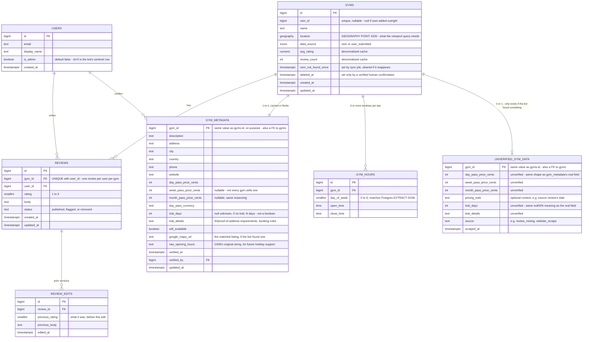
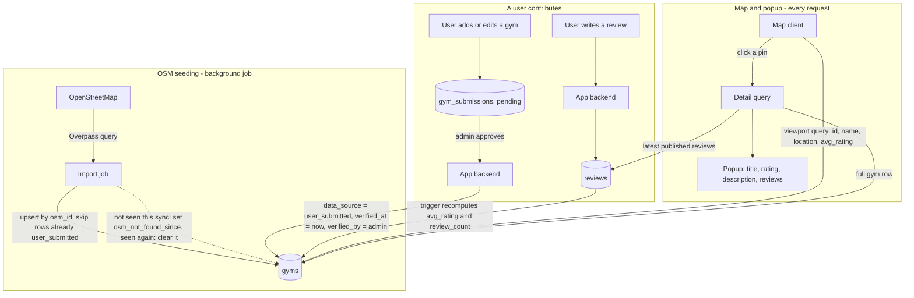
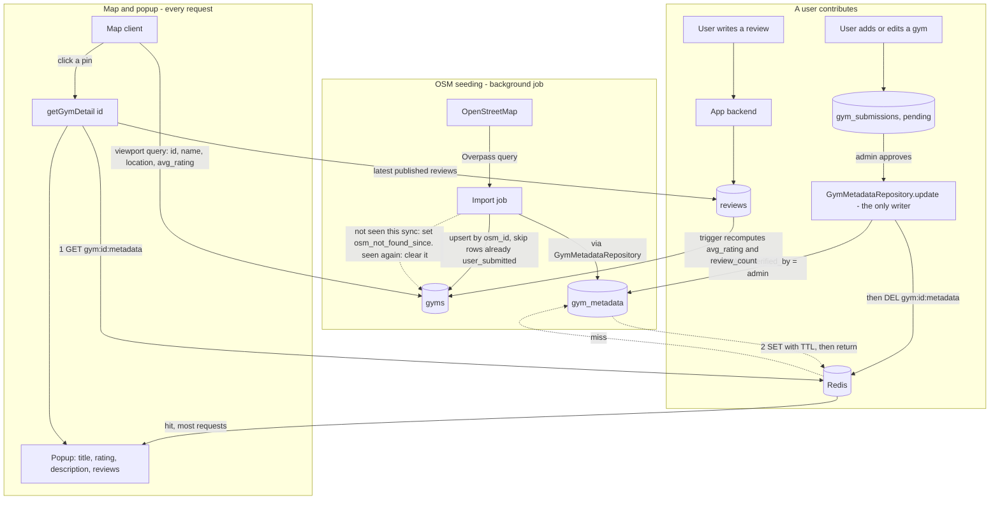

# Gym Finder

A way to find gyms anywhere in the world, weighted toward the places backpackers and digital nomads actually go (Bali/Canggu, Chiang Mai, Lisbon, Medellín, Mexico City, Bangkok, etc.) rather than even global coverage. This doc is about one question: **where does the gym data come from?**

## The options

### 1. Official map/places APIs (Google Places, Foursquare, OpenStreetMap/Overpass)

Three different products, worth distinguishing:
- **Google Places API** — the default choice, best global density, but billed per-request and that bill scales with how many cities/refreshes we do.
- **Foursquare Places API** — Foursquare started as the consumer check-in app (Swarm/City Guide today), but the company is now mainly a B2B places-data business (it merged with Factual, another places-data company) selling exactly this kind of API. Dedicated gym/fitness categories, historically a more generous free tier than Google's, but weaker coverage outside the US/Europe — a real downside for Southeast Asia/Latin America hubs specifically.
- **OpenStreetMap / Overpass API** — free, volunteer-built, `leisure=fitness_centre` tagging. No bill at any scale, and several nomad hubs have surprisingly active local OSM communities, but coverage is inherently uneven since it depends on who's bothered to map a given city.

**Pros**
- Legally clean — licensed, ToS-compliant, no scraping exposure at all. Given everything we just discussed about Air Canada v. Seats.aero and American v. Skiplagged, this matters more than it might look like on a feature list.
- Structured data for free: name, address, coordinates, phone, hours, rating, photos. No parsing/normalization work.
- Having three real options (one free, two paid with different coverage/pricing tradeoffs) means we're not locked into a single vendor's pricing changes the way a lot of Google-Places-only startups got burned before.

**Cons**
- Cost: the two paid options aren't free at real scale. Refreshing a worldwide gym dataset periodically adds up under per-request billing, and the free OSM option trades that cost for coverage gaps.
- Missing exactly the attributes that matter most to this audience: day-pass price, whether drop-ins are even allowed, equipment/specialty (CrossFit vs. commercial chain vs. climbing gym), wifi, long-stay packages. None of the three has any of this.
- Storage/caching restrictions in some API terms — worth checking current Google Maps Platform ToS before architecting "store everything forever."
- Single-vendor pricing risk. Google has changed Maps API pricing substantially before, and it broke a lot of startups' unit economics overnight.

### 2. User-submitted / crowdsourced data

**Pros**
- This is the richest possible source for the attributes that actually differentiate the app — day-pass pricing, drop-in policy, "is this nomad-friendly," real photos, recency ("verified by someone this month").
- The target audience is already a community that shares exactly this kind of info (r/digitalnomad, Nomad List, city-specific Facebook/WhatsApp groups) — crowdsourcing taps a motivated base rather than fighting against apathy.
- Zero marginal cost per record, and a flywheel: more users → better data → more users.
- No legal exposure — it's first-party data people willingly contribute about places they visited.

**Cons**
- Classic cold-start problem: an empty map on day one gets zero contributions, because there's nothing to anchor interaction around.
- Coverage will be wildly uneven early on — popular hubs fill in fast, most of the world stays blank for a long time.
- Needs real moderation: fake entries, stale info, spam. Requires at minimum an upvote/downvote system and a "last verified" timestamp, which is its own build.

### 3. Scraping Google Maps / gym websites directly

**Pros**
- Could theoretically pull richer data than any official API exposes (review text, popular-times graphs, pricing listed on a gym's own site).
- No per-request billing line item.

**Cons**
- This is the exact pattern we spent the last hour establishing is a real, demonstrated legal problem — not a hypothetical one. Google's own ToS explicitly prohibits automated/bulk extraction, and it's been enforced. Doing this as the backbone of a commercial product is the same shape as the Seats.aero/Skiplagged/Kiwi.com cases, not a smaller version of them.
- Technically fragile in the same way `aa.com` 403'd a single plain fetch earlier today — Maps has serious bot detection, and scraped structure breaks whenever Google changes markup.
- I'd steer away from this as a primary strategy for the same reasons already laid out for the airline-miles idea. Happy to revisit narrowly (e.g., a one-time, rate-limited, personal-use pull) if there's a specific gap this is meant to solve that nothing else covers — but not as the main data pipeline.

## Recommendation: seed with an API, enrich with users, skip scraping as the backbone

1. **Seed layer — OpenStreetMap first, Google Places to fill gaps.** Pull baseline gym *locations* (name, address, coordinates) for a short list of launch cities, not the whole world. OSM is free and already decent in several nomad hubs; fall back to Google Places API only where OSM is thin, to control cost. This solves the empty-map cold-start problem on day one, legally and cheaply.
2. **Enrichment layer — user check-ins and edits on top of the seed.** This is where the actual product value lives: day-pass price, drop-in policy, wifi, crowd level, photos, "visited and verified" badges. Map APIs will never have this; your users are the only real source for it.
3. **Later — let gyms claim their own listing.** Once there's real traffic, a "claim this gym" flow (gym owner self-reports pricing/hours, similar to Google Business Profile) solves the verification problem *and* gives gym owners a reason to want to be listed — visibility to a traveling customer base they don't otherwise reach. Possible monetization angle down the line (featured placement), but that's a later conversation.
4. **Start narrow.** Launch with 5-8 known nomad-dense cities rather than "the whole world" — makes the cold-start problem tractable and lets the data model get validated before scaling out.

**Decided: v1 is Bali only.** Resolves the open "how does the sync job know which cities to cover" question from earlier — there's exactly one bounding box to configure, and the 15-minute Overpass polling cadence has enormous headroom against the fair-use budget at a single city. Expanding to a second city is a config change (one more bounding box in whatever `launch_cities` list the import job reads), not a schema change — nothing in the design above assumed one city specifically.

**Superseded by `docs/gym-data-design.md`: there's no fixed city list anymore, launch or otherwise.** Photon-powered location search means a user can search any city or area, not just ones pre-configured in advance — the per-area `fetched_areas`/`last_fetched` tracking there replaces "which cities do we cover" entirely. The country → region navigation this originally implied (world map → Indonesia → Bali) is gone too, replaced by a single search box on the home screen routing straight to one generic `/map` screen with the searched area's bounds. Bali isn't special anymore; it's just the first area that happened to get searched.

## A couple of technical notes for later

- Postgres has **PostGIS**, which is the right tool for "gyms near me" geospatial queries — worth enabling from the first migration rather than bolting on distance math later.
- Every enriched field (price, hours, drop-in policy) should carry a `last_verified_at` timestamp from day one, so the UI can show "confirmed 2 weeks ago" vs. "nobody's checked this in 8 months" — that distinction is probably more valuable to a traveler than the raw data point itself.

---

## Database schema: three ways to let OSM data and user edits coexist

Decided: OpenStreetMap/Overpass seeds the map, verified user submissions grow it, PostgreSQL + PostGIS underneath. The one real design question left is **how an OSM-sourced row and a later user correction to that same row coexist** — specifically, what happens when we re-sync from OSM and a user has already verified/edited that gym's name, hours, or description. Three ways to handle it, from simplest to most capable.

### Design A — One table, source-tagged per row (simplest)

A single `gyms` table. Each row starts from an OSM import; once *any* user-verified edit lands on a gym, the whole row flips to user-owned and future OSM re-syncs for that gym are skipped entirely (new OSM gyms still import normally; it's only re-syncing an *already-edited* gym that's blocked).

```sql
CREATE EXTENSION IF NOT EXISTS postgis;

CREATE TYPE gym_data_source AS ENUM ('osm', 'user_submitted');

CREATE TABLE gyms (
  id              BIGSERIAL PRIMARY KEY,
  osm_id          BIGINT UNIQUE,              -- null if a user added it outright, not from OSM
  name            TEXT NOT NULL,
  description     TEXT,                       -- OSM rarely has this; usually empty until a user fills it in
  location        GEOGRAPHY(POINT, 4326) NOT NULL,
  address         TEXT,
  city            TEXT,
  country         TEXT,
  phone           TEXT,
  website         TEXT,
  day_pass_price_cents INT,
  day_pass_currency   TEXT,
  allows_drop_in  BOOLEAN,
  wifi_available  BOOLEAN,
  data_source     gym_data_source NOT NULL DEFAULT 'osm',
  verified_at     TIMESTAMPTZ,                -- last time a human confirmed these details
  verified_by     BIGINT REFERENCES users(id),
  avg_rating      NUMERIC(2,1),               -- see "Rating aggregation" below
  review_count    INT NOT NULL DEFAULT 0,
  created_at      TIMESTAMPTZ NOT NULL DEFAULT now(),
  updated_at      TIMESTAMPTZ NOT NULL DEFAULT now()
);

CREATE INDEX idx_gyms_location ON gyms USING GIST (location);
```

*(Superseded below — once Redis entered the picture, this one table split into `gyms` + `gym_metadata` so there's a clean cache-key boundary between what the viewport needs and what the popup needs. See "Caching gym metadata with Redis" further down for the current shape; the provenance rule above — a row flips to user-owned on its first verified edit — still applies, just to `gym_metadata` now instead of `gyms`.)*

**Pros**
- Easy to build and query — one table, no joins to render the map or the popup.
- Matches the MVP's actual complexity: with a handful of launch cities, re-sync conflicts will be rare at first.

**Cons**
- All-or-nothing per gym: if a user fixes just the phone number, the *entire* row stops receiving OSM updates — including things OSM might still track better than we ever will, like the gym closing down.
- No history. If an edit turns out to be wrong or vandalized, there's no trail back to what it was before.

### Design B — Two-layer: immutable OSM mirror + canonical editable table

`osm_gyms` is a pure, disposable mirror of whatever Overpass returns — fully replaced on every sync, never hand-edited. `gyms` is the real, user-facing table, created once from `osm_gyms` and updated field-by-field: a re-sync only overwrites a field if nothing has verified that *specific* field since.

```sql
CREATE TABLE osm_gyms (
  osm_id        BIGINT PRIMARY KEY,
  name          TEXT,
  location      GEOGRAPHY(POINT, 4326),
  raw_tags      JSONB,                        -- the full OSM tag set, for anything not modeled explicitly
  last_synced_at TIMESTAMPTZ NOT NULL DEFAULT now()
);

CREATE TABLE gyms (
  id              BIGSERIAL PRIMARY KEY,
  osm_id          BIGINT UNIQUE REFERENCES osm_gyms(osm_id),
  name            TEXT NOT NULL,
  description     TEXT,
  location        GEOGRAPHY(POINT, 4326) NOT NULL,
  address         TEXT,
  day_pass_price_cents INT,
  day_pass_currency    TEXT,
  allows_drop_in  BOOLEAN,
  wifi_available  BOOLEAN,
  -- which fields a user has verified, so a re-sync knows what NOT to touch
  locked_fields   TEXT[] NOT NULL DEFAULT '{}',
  verified_at     TIMESTAMPTZ,
  verified_by     BIGINT REFERENCES users(id),
  avg_rating      NUMERIC(2,1),
  review_count    INT NOT NULL DEFAULT 0,
  created_at      TIMESTAMPTZ NOT NULL DEFAULT now(),
  updated_at      TIMESTAMPTZ NOT NULL DEFAULT now()
);

CREATE INDEX idx_gyms_location ON gyms USING GIST (location);
```

**Pros**
- Field-level, not row-level: a user fixing the phone number doesn't block the name or location from still getting OSM updates.
- Clean separation of "what the source says" from "what we show" — re-syncing is safe by construction, and `osm_gyms` doubles as a debugging/audit log of raw source data.

**Cons**
- More moving parts: two tables to keep in sync, and the sync job itself needs real logic (`locked_fields` checks per column) instead of a single upsert.
- Still no *history* — `locked_fields` says a field is user-owned, but not what it used to be or who changed it when.

### Design C — Event-sourced field history (full audit trail)

Every change — an OSM sync or a user edit — is logged as its own immutable row. The "current" value of any field is just the latest one in the log. This is a genuinely different shape, not a variation on A/B: there's no single `gyms.name` column to `SELECT`, there's a stream of edits to replay (in practice, backed by a view or a trigger-maintained snapshot table for fast reads).

```sql
CREATE TABLE gyms (                            -- now just identity + location
  id        BIGSERIAL PRIMARY KEY,
  osm_id    BIGINT UNIQUE,
  location  GEOGRAPHY(POINT, 4326) NOT NULL,
  created_at TIMESTAMPTZ NOT NULL DEFAULT now()
);

CREATE TABLE gym_field_edits (
  id          BIGSERIAL PRIMARY KEY,
  gym_id      BIGINT NOT NULL REFERENCES gyms(id),
  field_name  TEXT NOT NULL,                   -- 'name', 'description', 'day_pass_price_cents', ...
  new_value   TEXT,                            -- stored as text; cast on read
  source      TEXT NOT NULL CHECK (source IN ('osm_sync', 'user_edit')),
  user_id     BIGINT REFERENCES users(id),
  created_at  TIMESTAMPTZ NOT NULL DEFAULT now()
);

CREATE INDEX idx_gym_field_edits_gym_field ON gym_field_edits (gym_id, field_name, created_at DESC);

-- a materialized view (or trigger-maintained table) picks the latest row
-- per (gym_id, field_name) to produce the "current gym" read model
```

**Pros**
- Full history for free: "who changed what, and when" is just a query, not a feature you have to bolt on. Genuinely nice for a travel-community product — "see the edit history" or "this user has 40 accepted edits" is a trust signal competitors like Seats.aero-style aggregators can't easily offer, since they don't own the data pipeline.
- Naturally supports rollback/dispute resolution — bad edits don't destroy the previous value, they just get superseded (or un-superseded).

**Cons**
- The most engineering work by far, for a feature (title/rating/description/reviews in a popup) that doesn't need any of this on day one.
- Reads need a materialized view or snapshot table kept in sync — the same staleness-vs-triggers tradeoff as the rating-aggregation question below, just applied to every field instead of one number.

### Decided: Design A for v1

The stated scope — OSM seed, a handful of launch cities, a map popup with title/rating/description/reviews — doesn't have enough edit volume yet to need field-level conflict resolution. Move to **Design B** once OSM re-syncs actually start clobbering real community edits in practice (that's a "when it hurts" migration, not a guess upfront). **Design C** is worth revisiting later as a trust/differentiation feature in its own right, not as a data-integrity necessity — "see who verified this" is a product decision, not just a schema one.

## Smaller decisions that apply no matter which design above you pick

**Rating aggregation — denormalized cache vs. computed live.** `avg_rating`/`review_count` on `gyms` can be a real column kept in sync by a trigger (or application code) on every review insert/update/delete, or just `AVG(rating)`/`COUNT(*)` computed on read. Cache is faster for the map view (which needs a rating per pin, for every gym in the viewport, on every pan) but needs to stay correctly in sync. Computed-live is simpler and always correct but gets slower exactly where it matters most — rendering a map full of pins. **Recommendation: cache it** — the map-view access pattern (many gyms, one query, every pan) is the one offset pagination/grouped-counts lesson from the retail project applies to directly.

**Decided: one review per user per gym, editable, with a full edit history.** A `UNIQUE (gym_id, user_id)` constraint (Yelp-style, one review that gets edited rather than a new row per visit) avoids rating inflation from repeat visitors. Editing doesn't silently overwrite, though — every edit archives what the review used to be into `review_edits` first, so there's a real trail of "this place changed since I last reviewed it" instead of losing that information.

**Review moderation — trust-by-default vs. pending-approval.** Given the audience (a travel community, not an adversarial marketplace), publishing reviews immediately with an after-the-fact "report" flag is probably enough for v1 — a `status` column (`published` / `flagged` / `removed`) on `reviews` covers it without needing a moderation queue blocking every submission.

```sql
CREATE TABLE reviews (
  id          BIGSERIAL PRIMARY KEY,
  gym_id      BIGINT NOT NULL REFERENCES gyms(id) ON DELETE CASCADE,
  user_id     BIGINT NOT NULL REFERENCES users(id),
  rating      SMALLINT NOT NULL CHECK (rating BETWEEN 1 AND 5),
  body        TEXT,
  status      TEXT NOT NULL DEFAULT 'published' CHECK (status IN ('published', 'flagged', 'removed')),
  created_at  TIMESTAMPTZ NOT NULL DEFAULT now(),
  updated_at  TIMESTAMPTZ NOT NULL DEFAULT now(),
  UNIQUE (gym_id, user_id)
);

CREATE INDEX idx_reviews_gym_id ON reviews (gym_id) WHERE status = 'published';

-- One row per edit, holding what the review used to say *before* that edit.
-- The current text/rating always lives on `reviews` itself - this table is
-- purely the trail of prior versions, not a second source of truth.
CREATE TABLE review_edits (
  id              BIGSERIAL PRIMARY KEY,
  review_id       BIGINT NOT NULL REFERENCES reviews(id) ON DELETE CASCADE,
  previous_rating SMALLINT NOT NULL,
  previous_body   TEXT,
  edited_at       TIMESTAMPTZ NOT NULL DEFAULT now()
);

CREATE INDEX idx_review_edits_review_id ON review_edits (review_id, edited_at DESC);
```

An edit is two statements, not one: insert the review's *current* `rating`/`body` into `review_edits` first (snapshotting what it was about to stop being), then `UPDATE reviews` with the new values and `updated_at = now()`. The full history of any review is just `reviews` (current) plus its `review_edits` rows (everything it used to be), ordered by `edited_at`.

**Not decided yet, on purpose:** a lightweight user-activity log was discussed and deliberately deferred — not needed for v1, revisit later if moderation/trust turns out to need it. Gyms and `gym_metadata` were explicitly decided to stay historyless, full stop, not deferred — that's Design A as already built, not an open question. Review edit history is no longer in this deferred bucket — see above, it's decided and built.

## The map-popup query pattern (recommended, not really a fork)

Two genuinely different queries, not one:

1. **Viewport query** — as the map pans/zooms, fetch just `id`, `name`, `location`, `avg_rating` for every gym in the current bounding box. Cheap, called constantly.
2. **Detail query** — only when a specific pin is clicked, fetch that one gym's full row *plus* a page of its reviews.

The thing to actively avoid: fetching reviews (or anything review-sized) for every gym in the viewport just because the popup *might* need them for whichever one gets clicked. That's the same N+1-shaped mistake as the retail project's original product-count bug, just in a new place — load the heavy stuff once, on click, for the one gym that needs it, not for all of them speculatively.

```sql
-- 1. Viewport query — PostGIS's && uses the GIST index; cheap, called on every pan/zoom
SELECT id, name, ST_AsGeoJSON(location) AS location, avg_rating
FROM gyms
WHERE deleted_at IS NULL
  AND location && ST_MakeEnvelope(:min_lng, :min_lat, :max_lng, :max_lat, 4326);

-- 2. Detail query — only on click, for exactly one gym
-- (superseded below once Redis entered the picture - gym_metadata and
-- gym_hours are fetched through the cache-aside getGymDetail path, not
-- queried directly like this; reviews still are, since they aren't cached)
SELECT * FROM gym_metadata WHERE gym_id = :gym_id;
SELECT * FROM gym_hours WHERE gym_id = :gym_id ORDER BY day_of_week, open_time;
SELECT * FROM reviews WHERE gym_id = :gym_id AND status = 'published'
  ORDER BY created_at DESC LIMIT 20;
```

One thing that isn't really a fork: use `geography(Point, 4326)`, not `geometry`. This app is global by design — `geography` does distance/containment math correctly on the sphere everywhere, where `geometry` needs a locally-appropriate projected CRS to stay accurate, which doesn't exist for "every nomad hub on Earth" at once.

## Design A — the v1 schema, drawn out

**Not decided yet, on purpose:** `users` needs real authentication (login + password) before any of this actually ships — `gyms.verified_by` and `reviews.user_id` both assume a real, logged-in person. Deferred deliberately rather than guessed at now; revisit before building the submission/review flow, not before.

### Table diagram



### Data flow

Three separate flows through the same two tables: OSM seeding (background, periodic), a user contributing (adds a gym, edits one, or leaves a review), and the map itself reading on every request.



## Caching gym metadata with Redis, designed for scale now

**Superseded on build order, not on design: see `docs/gym-data-design.md`.** Redis is now deferred until production rather than built immediately — the schema/cache-key reasoning below is still the right design for when that happens, it just isn't being built yet.

Decided: Redis goes in now, in front of `gym_metadata`, built so it doesn't need reworking as traffic grows. The design below splits into pieces that each age differently — the schema and cache-key shape are the parts that are expensive to change later and are locked in now; the invalidation *trigger* mechanism is deliberately the one piece built to swap out without touching anything else, since that's the part that actually depends on how much write-path complexity shows up later.

### The split: `gyms` stays lean, `gym_metadata` holds the detail

**Revised: `gym_data_source` grows a third value, since "user_submitted" was conflating two different provenances.** The original two-value version (`osm` / `user_submitted`, from Design A) only ever needed to answer one question: is this row still eligible for OSM re-sync, or has it been locked by a human/automated edit? That's still the real purpose, but "locked by what" turned out to matter too — a gym the bot confidently verified against Google Maps with no human involved is a different kind of claim than one an admin personally reviewed and approved. Same re-sync semantics (`osm` = still syncs, anything else = locked), one more value to say *how* it got locked:

```sql
CREATE TYPE gym_data_source AS ENUM ('osm', 'bot_verified', 'admin_verified');
```

- `osm` — straight from the Overpass sync, never touched by a submission or edit. Still eligible for re-sync.
- `bot_verified` — the bot's Google Maps sweep confirmed this (a new gym, or an edit to an existing one) with no human in the loop. Locked from re-sync, same as any other non-`osm` value.
- `admin_verified` — a human admin approved this directly, whether resolving an escalated submission or overriding the bot.

```sql
-- gyms: everything the viewport query needs, and nothing it doesn't
CREATE TABLE gyms (
  id              BIGSERIAL PRIMARY KEY,
  osm_id          BIGINT UNIQUE,
  name            TEXT NOT NULL,
  location        GEOGRAPHY(POINT, 4326) NOT NULL,
  data_source     gym_data_source NOT NULL DEFAULT 'osm',
  avg_rating      NUMERIC(2,1),
  review_count    INT NOT NULL DEFAULT 0,
  osm_not_found_since TIMESTAMPTZ, -- set by the sync job the first time this osm_id stops appearing; cleared if it reappears
  deleted_at      TIMESTAMPTZ,     -- set only once a human verifies the gym is actually gone - never set automatically
  created_at      TIMESTAMPTZ NOT NULL DEFAULT now(),
  updated_at      TIMESTAMPTZ NOT NULL DEFAULT now()
);

-- Partial, same reasoning as reviews' partial index below: almost every
-- query only cares about gyms that are actually still there.
CREATE INDEX idx_gyms_location ON gyms USING GIST (location) WHERE deleted_at IS NULL;

-- gym_metadata: everything the detail popup needs, 1:1 with gyms,
-- and the exact row shape that gets cached in Redis
CREATE TABLE gym_metadata (
  gym_id          BIGINT PRIMARY KEY REFERENCES gyms(id) ON DELETE CASCADE,
  description     TEXT,
  address         TEXT,
  city            TEXT,
  country         TEXT,
  phone           TEXT,
  website         TEXT,
  day_pass_price_cents INT,
  week_pass_price_cents INT,               -- nullable - most gyms won't have one, see note below
  month_pass_price_cents INT,              -- nullable, same reasoning
  day_pass_currency    TEXT,
  -- allows_drop_in removed - derived from whether any pass price is set, not stored. See note below.
  trial_days      INT,                     -- null = unknown, 0 = confirmed no trial, >0 = trial length - not a boolean, see note below
  trial_details   TEXT,                    -- free text: ID/proof-of-address requirements, booking rules, etc.
  wifi_available  BOOLEAN,
  google_maps_url TEXT,                    -- the listing the bot matched against, if it did - lets anyone verify the approval themselves
  raw_opening_hours TEXT,                  -- OSM's original opening_hours string, kept for future holiday support - see below
  verified_at     TIMESTAMPTZ,
  verified_by     BIGINT REFERENCES users(id),
  updated_at      TIMESTAMPTZ NOT NULL DEFAULT now()
);

-- gym_hours: structured, queryable hours - one row per open/close window.
-- No row for a day_of_week means closed that day. A day can have more than
-- one row (split hours, e.g. 06:00-10:00 and 16:00-21:00), and that's
-- handled for free just by not constraining to one row per day.
CREATE TABLE gym_hours (
  id          BIGSERIAL PRIMARY KEY,
  gym_id      BIGINT NOT NULL REFERENCES gyms(id) ON DELETE CASCADE,
  day_of_week SMALLINT NOT NULL CHECK (day_of_week BETWEEN 0 AND 6), -- matches Postgres EXTRACT(DOW): 0 = Sunday
  open_time   TIME NOT NULL,
  close_time  TIME NOT NULL
);

CREATE INDEX idx_gym_hours_gym_id ON gym_hours (gym_id);
```

**Decided: drop-in policy and the three pass-price fields are the two things this app is actually for.** Neither Google Maps nor OSM carries drop-in policy or day/week/month pricing — a traveler passing through for a few days has no reliable way to find out whether a gym even lets them pay for a single visit, let alone what it costs, from either of those sources. That's precisely the gap user-submitted data is meant to fill (see "Recommendation" at the top of this doc), and it's worth treating as the differentiator rather than one field among many: the map should be filterable on "accepts drop-ins" specifically, not just something you discover after clicking in. `week_pass_price_cents`/`month_pass_price_cents` are both nullable independent of `day_pass_price_cents` and each other — plenty of gyms only sell one or two of the three tiers, and "doesn't offer a week pass" is different information from "nobody's filled that in yet," even though both render as empty for now (same `last_verified_at`-style ambiguity named back in "A couple of technical notes for later" — not re-solved here, just reused).

**Revised: "accepts drop-ins" isn't its own column — it's derived from whether any pass price is set.** The original draft had a separate `allows_drop_in` boolean alongside the pricing fields. Dropping it is a deliberate tradeoff, not a simplification for its own sake: it collapses "confirmed yes, exact price just not known" into the same "not known yet" bucket as a gym nobody's looked at — a real information loss, since a traveler might genuinely want to know "can I get in at all" before the exact rate matters. The call was made anyway, on the reasoning that a separate column maintained in parallel with three price fields is one more thing to keep in sync for a distinction that, in practice, rarely gets used — and if it turns out "yes, but price unknown" matters enough to track later, that's a column to add back, not a design that's hard to extend.

**Decided: `trial_days` is a count, not a boolean — same "is this a fact about the gym, or do we just not know yet" distinction as the pricing fields.** A yes/no "has a trial" flag can't tell a traveler whether that means one free class or a full week, and collapsing that into a boolean would throw away exactly the information that makes it useful. The null/0/positive-integer pattern mirrors the pass-price fields directly: `null` means nobody's filled it in, `0` means a human (or the bot sweep) confirmed there genuinely isn't one, and any positive number is the real trial length. `trial_details` rides alongside it as free text — the kind of thing that doesn't fit a filterable column (ID required, proof of address, whether it has to be booked in advance) but still matters enough to show once someone's actually looking at the gym, so it's collapsed by default in the UI rather than always-visible clutter.

**A gym open past midnight doesn't need special-case logic — it needs two rows.** `close_time < open_time` on a single row would be ambiguous (does `22:00-02:00` mean "open 4 hours" or "closed 20 hours"?). Storing it as two rows instead — Monday `22:00-23:59:59`, Tuesday `00:00-02:00` — means "is this open right now" is always a simple `open_time <= now AND close_time >= now` check, with no wraparound logic needed anywhere in the query layer.

**`raw_opening_hours` exists specifically because holidays are being deferred, not built around.** OSM's own `opening_hours` tag syntax can express holiday exceptions (`PH off`, specific date overrides) that `gym_hours`' day-of-week model deliberately doesn't capture yet. Rather than lose that information when parsing OSM's string down to structured rows, the original string gets kept too — so adding holiday support later means re-parsing data already in the database, not re-fetching from OSM (which may have since changed, or that gym may since have gone fully user-owned and stopped syncing from OSM at all).

**Same provenance rule as the rest of `gym_metadata` — no special case.** Editing hours through the app flips the gym to user-owned exactly like editing any other field does; `gym_hours` rows get replaced as a set on that edit, same as updating any other `gym_metadata` column. The import job is the one place with real new work: translating OSM's `opening_hours` mini-language into `gym_hours` rows is a genuine parser to write, not a trivial mapping — worth sizing as its own task when the import job actually gets built, not assumed free.

`gym_metadata` having its own primary key (`gym_id`, not a surrogate `id`) is deliberate — it makes "the cache key" and "the row's identity" the same value everywhere, with no translation step.

**Why `avg_rating`/`review_count` live on `gyms`, not `gym_metadata`, even though they're review-derived "detail":** reviews are written through a completely different path than `gym_metadata` (the `reviews` table, not `GymMetadataRepository`). If these two columns lived on `gym_metadata` instead, submitting a review would *also* need to invalidate that gym's Redis cache — a second write path touching the one table the whole invalidation design assumes has exactly one writer. Keeping them on `gyms`, which has no cache in front of it, means a new review never has to think about Redis at all. Secondary reason: they're always updated together by the same trigger, so splitting them across two tables would be an arbitrary separation with no benefit.

**Confirmed: no "OSM review" to keep separate from a user review, because OSM has none.** OpenStreetMap has no rating/review concept at all — Overpass gives us location and tags, nothing review-shaped. `avg_rating`/`review_count` are already 100% derived from our own `reviews` table, with nothing from OSM mixed in.

### Cache design

- **Key:** `gym:{gym_id}:metadata` — a versionable prefix (`v1:gym:...`) is worth reserving now too, so a future schema change can roll out as a new key namespace instead of needing a manual flush.
- **Value:** the whole `gym_metadata` row *plus* its `gym_hours` rows, serialized as one JSON blob, not a Redis hash. The popup always wants all of it at once, never a single field — a hash would only pay off if something needed partial-field reads, which nothing here does. `gym_hours` isn't its own cache entry; it rides along inside the same blob since it's always fetched and invalidated together with the rest of a gym's detail.
- **TTL:** every key gets one regardless of invalidation — a few days is plenty. This is defense in depth, not a hedge against the design being wrong: if an invalidation is ever missed (a bug, a dropped notification, a process that crashed mid-write), the cache self-heals within a bounded window instead of serving stale data forever. Every production cache that's ever shipped without a TTL as a backstop has eventually been burned by exactly this.

### Read path: cache-aside

```
getGymDetail(gymId):
  cached = redis.GET("gym:{gymId}:metadata")
  if cached: return deserialize(cached)
  row = postgres.query("SELECT * FROM gym_metadata WHERE gym_id = $1", gymId)
  redis.SET("gym:{gymId}:metadata", serialize(row), TTL=3days)
  return row
```

### Write path: one repository, invalidate — don't write-through

Every write to `gym_metadata` (a user's edit, an OSM sync touching an unlocked field) goes through one function — `GymMetadataRepository.update(gymId, changes)` — and nothing else is allowed to write that table directly. That function does the Postgres `UPDATE`, and on success, `DEL`s the Redis key rather than pushing a freshly-serialized value into it.

DEL-then-let-the-next-read-repopulate, not write-through, on purpose: if the write path builds its own serialized version of "the new value" independently from how the read path builds it, those two serialization steps drift out of sync over time — one gets updated when a field is added, the other doesn't, and now the cache is wrong in a way that's hard to notice. Deleting and letting `getGymDetail` repopulate means the cached value is *always* produced by the exact same code path, so there's only one place that can be wrong, not two.

The "one repository" rule is what makes this invalidation actually reliable — not a database trigger, application code. That's a real tradeoff worth naming: it's correct as long as every write genuinely goes through that one function. The moment there's a second legitimate write path — a separate admin tool, a future microservice, a raw migration script — this stops being airtight, and that's the one thing in this design that's built to swap out cleanly when it happens: a Postgres trigger (`AFTER UPDATE ON gym_metadata`) calling `pg_notify('gym_metadata_changed', NEW.gym_id)`, consumed by a small worker that issues the same `DEL`, catches every write regardless of which code path made it. Nothing else about this design changes if that gets added later — same key, same TTL, same read path — only *what triggers the DEL* moves from the application layer to the database layer.

Explicitly not building yet: a full change-data-capture pipeline (Debezium-style, feeding a message bus) to multiple downstream consumers. That's the right tool when *several* different systems all need to react to the same database changes — a search index, analytics, cache invalidation, webhooks, all at once. Right now there's exactly one consumer of "did `gym_metadata` change" — this cache — so that's real infrastructure solving a multi-consumer problem this app doesn't have.

### One more real failure mode at scale: cache stampede

If a specific gym suddenly gets a burst of simultaneous clicks — a city goes viral on a travel subreddit, say — and that key isn't cached yet (or just expired), every one of those requests can miss at once and all hit Postgres for the same row simultaneously. The standard fix: the first request to miss acquires a short-lived lock (`SETNX gym:{gymId}:lock`, a few seconds' TTL) before querying Postgres; requests that see the lock already held wait briefly and retry the cache read instead of also querying Postgres. Worth building alongside the rest of this now, since it's the same shape of problem as the TTL safety net — cheap to add up front, genuinely painful to retrofit once it's actually happening in production under real load.

### Updated data flow



## Keeping the OSM seed fresh: no webhook exists, so it's a scheduled job

**Superseded by `docs/gym-data-design.md`: the scheduled-per-launch-city job below is replaced by a lazy, per-area, on-lookup staleness check.** Once location search lets someone search any area, there's no fixed `launch_cities` list left to schedule against — the per-area `last_fetched` check generalizes to cover that, including Bali itself (now just "an area," fetched the same lazy way as any other). The OSM-push-mechanism research below is still accurate and worth keeping; the scheduling decision it led to isn't current anymore.

**OSM has no push mechanism — checked directly, not assumed.** There's no webhook registration, no way for OpenStreetMap to call out to our server when a gym gets edited. Everything it offers is pull-based: Overpass (what we're using), the raw minutely-diff replication feed, or third-party RSS-style watch services. Overpass itself already stays within a few minutes of the live OSM database on its own end, so we don't need to consume the raw diff feed ourselves — we just need to *ask* on a schedule.

**Decided: poll Overpass every 15 minutes, per launch city.** Overpass's fair-use policy treats automated/regular use more strictly than one-off queries (roughly 100 queries/day, under 10MB/day, enforced by an active rate-limiter) — a 15-minute interval across a handful of scoped city queries stays comfortably inside that budget, and it's already more than fresh enough for data that doesn't change minute-to-minute in reality (a gym's address or hours aren't moving targets).

**Decided: BullMQ's repeatable jobs, on the Redis we already have, not a plain in-process cron library.** A simple `node-cron`-style scheduler running inside the API server has a real gotcha once there's more than one instance of that server running (for redundancy, under real traffic): every instance fires the job independently on the same schedule, racing each other into duplicate imports. BullMQ's repeatable jobs use Redis for coordination, so only one worker actually executes each scheduled run no matter how many instances are up — the same "design once, don't rework" reasoning as the caching layer above, and it reuses infrastructure already being stood up rather than introducing a new decision.

**Left open on purpose:** BullMQ assumes at least one long-running Node process to host the worker. That's a non-issue if the backend is a persistent API server (there's already a process to put it in); it's a real question if the backend ends up fully serverless (Lambda-style), where AWS EventBridge Scheduler triggering a Lambda directly would be the more idiomatic fit instead. Revisit this specific choice once the backend's own architecture (persistent server vs. serverless) is actually decided — not before.

## A gym disappearing from OSM isn't the same as it closing down

**Decided: a missing gym gets flagged, not deleted.** A gym falling out of an Overpass query result could mean it closed — or it could mean a mapper temporarily removed a tag, an Overpass instance had a hiccup, or the node got re-tagged mid-edit. Treating "not found this sync" as "delete it" risks destroying a gym with real reviews over something transient. Instead:

- **`osm_not_found_since`** gets set by the sync job the *first* time a previously-seen `osm_id` stops appearing (only if it was previously `NULL`, so it always holds the original missing date, not the most recent check) — and gets cleared back to `NULL` automatically if the gym reappears in a later sync. This is purely a signal, not a judgment.
- The UI shows a soft warning when it's set — something like "data may not be accurate" — without hiding the gym or blocking the popup. Travelers can still see it, with the caveat visible.
- **`deleted_at`** is the real, user-facing removal — set only once a human (see "who verifies this," below) confirms the gym is actually gone. The sync job never sets this on its own, no matter how long `osm_not_found_since` has been sitting there.

## Filling gaps OSM doesn't have — and who gets to make that live

**Decided: whatever OSM doesn't give us stays empty until a user fills it in.** This was already true by construction for most of `gym_metadata` (OSM rarely tags `description`, day-pass pricing, wifi), and now applies explicitly to `gym_hours` too — if a gym has no `opening_hours` tag in OSM, it simply gets no `gym_hours` rows, not a guess. Nothing gets fabricated to fill a gap.

**Decided: every user-submitted gym or edit needs verification before it goes live — reviews are the one exception.** Reviews stay trust-by-default (published immediately, flagged after the fact if needed) because they're opinions, not facts about a place. A new gym, or an edit to an existing one's name/location/hours/pricing, is a factual claim other travelers will actually navigate off of — wrong information there is a worse failure mode than a bad review. This changes the write path from what was drafted earlier: a submission no longer flips `gyms`/`gym_metadata` directly. It lands in a queue first.

**Decided: "admin" is a boolean on `users`, not its own table.** An admin is just a user with `is_admin = true` — there's no admin-specific attribute anywhere in this design (no permission levels, no admin-only fields) that would earn a separate table's complexity. The bot that runs the first-pass sweep still needs to be a legitimate, FK-able actor wherever "who approved this" gets recorded, though, not a magic unconstrained number living outside the data model — so it gets one literal sentinel row in `users` itself: `id = 0`, `is_admin = true`, no real email or login. `approved_by = 0` then points at something real, same as any other admin's id — no special-cased comment needed to explain why a foreign key sometimes doesn't reference a real row, because it always does.

```sql
-- Added to the eventual real `users` table, whenever auth gets built (still deferred, see below).
ALTER TABLE users ADD COLUMN is_admin BOOLEAN NOT NULL DEFAULT false;

-- Seeded once. Not a real person, but a real row - so `approved_by = 0`
-- is an honest foreign key, not a magic number the schema can't enforce.
INSERT INTO users (id, is_admin) VALUES (0, true);
```

**Decided: status lives in a picklist table, not a `TEXT` + `CHECK` column.** Every other status column in this doc (`reviews.status`, below) uses `TEXT` + `CHECK` — simpler, no join to read a label. The difference here: these statuses are specifically meant to be editable without a deploy if the approval flow ever grows a new stage, so a real lookup table earns the extra join.

```sql
CREATE TABLE gym_submission_statuses (
  id    SMALLINT PRIMARY KEY,
  label TEXT NOT NULL
);

INSERT INTO gym_submission_statuses (id, label) VALUES
  (1, 'Pending Bot Approval'),
  (2, 'Pending Admin Approval'),
  (3, 'Approved'),
  (4, 'Disapproved'),
  (5, 'Scraping Failed');

CREATE TABLE gym_submissions (
  id              BIGSERIAL PRIMARY KEY,
  gym_id          BIGINT REFERENCES gyms(id),  -- null if this is a brand-new gym, not an edit to an existing one
  submitted_by    BIGINT NOT NULL REFERENCES users(id),
  submission_type TEXT NOT NULL CHECK (submission_type IN ('new_gym', 'edit')),
  payload         JSONB NOT NULL,              -- proposed gym/gym_metadata/gym_hours fields
  status_id       SMALLINT NOT NULL DEFAULT 1 REFERENCES gym_submission_statuses(id),
  approved_by     BIGINT REFERENCES users(id),  -- 0 = the bot, otherwise a real admin (users.is_admin = true)
  approved_at     TIMESTAMPTZ,
  created_at      TIMESTAMPTZ NOT NULL DEFAULT now()
);

CREATE INDEX idx_gym_submissions_pending ON gym_submissions (created_at) WHERE status_id IN (1, 2);
```

A submission starts at `status_id = 1` ("Pending Bot Approval") and can resolve four different ways, each carrying different information for whoever looks at it later:

- The bot completes its check, confident and clean → `3` ("Approved"), `approved_by = 0`. This is what actually calls `GymMetadataRepository.update()` (or the equivalent new-gym insert) — and sets `gyms.data_source = 'bot_verified'` on a new-gym insert, same `approved_by = 0` provenance reflected on the gym row itself, not just the submission.
- The bot completes its check but isn't confident, or suspects a duplicate → `4` ("Disapproved"), `approved_by = 0`. A real judgment, even an uncertain one — never touches the live tables, and escalating past it is the submitting user's choice (see "A user's request history").
- The bot never manages to complete its check at all — blocked, CAPTCHA'd, timed out past its retry budget — → `5` ("Scraping Failed"), `approved_by` left null. This is deliberately a different value from `4`, not a variant of it: getting blocked says nothing about whether the gym is real, so it isn't a disapproval, and it reaches the admin queue automatically rather than waiting on the submitting user to escalate anything.
- A human — either resolving `2` or `5` — sets `approved_by` to their own `users.id` and the status to `3` or `4` accordingly, and (on a `3`) `gyms.data_source = 'admin_verified'`.

Either way, `approved_by`/`approved_at` record whoever — or whatever — made the final call, not the original submitter.

## What counts as reviewable, and the duplicate-gym problem

**Decided: any gym that's been confirmed can be reviewed — never a pending submission.** "Confirmed" here means it's cleared either approval path (bot-verified or admin-approved) and has a real row in `gyms`. This mostly falls out of the schema already in place rather than needing new structure: `reviews.gym_id` references `gyms(id)`, and a pending submission only exists as a row in `gym_submissions` — it has no `gyms.id` yet, so there's structurally nothing for a review to attach to until it's confirmed. Submitting a new gym and reviewing one are two separate endpoints, deliberately not bundled into one call — you can't "add a gym and leave a review" in a single request. If someone wants to review a place that isn't in the system yet, the flow is: submit it, wait for approval, then review it like any other gym.

**Decided: the same Google Maps bot sweep (below) handles duplicate detection — it's not a separate problem.** The bot isn't just confirming "does this place exist" — it's also the thing checking "does this place already exist *in our system*," using the same name/location match against Google's listing to catch a submission like "Bali Fitness Canggu" when "Canggu Fitness Center" is already live. If the bot's confident the submission is both legitimate and new, it auto-approves. If it suspects either the gym is fake *or* it's a duplicate of something already in `gyms`, that uncertainty is exactly what routes it to the human admin queue instead of guessing.

## First-pass gym approval: a scraping bot before the human queue

**Decided: before a new-gym submission sits in the human admin queue, a bot gets one automated attempt to confirm it against Google Maps — checking both legitimacy and duplicates in the same pass.** The bot verifies the place is real *and* uses the same lookup to judge whether it's actually a new entry or a duplicate of an existing gym. If it comes back confident on both counts (real, and not already in the system), that's enough to auto-verify and go live immediately — no human in the loop.

**Revised: a bot that completes its check and isn't confident disapproves it — but a bot that never even managed to check goes to admin as its own distinct status, not a disapproval.** These are genuinely different situations, not two flavors of the same thing, and the status picklist now says so directly: running the lookup and concluding "doesn't look real" or "looks like a duplicate" is an actual judgment, even an uncertain one — that's `status_id = 4` ("Disapproved") with `approved_by = 0`, and escalating past it is a *choice the submitting user makes* (see "A user's request history," below), not something automatic. Getting blocked by a CAPTCHA or timing out says nothing at all about whether the gym is real, so it isn't a disapproval at all — it's `status_id = 5` ("Scraping Failed"), reached automatically once retries are exhausted, no user action needed. See "Rate limiting the scraper," below, for the retry mechanics that lead there.

**The one thing this doesn't apply to: an admin's own disapproval is final.** If `status_id = 4` but `approved_by` is a real admin id (not `0`), a human already looked at this and said no — there's nothing left to escalate to. The distinction between "the bot gave up" and "a person reviewed and rejected it" is exactly what `approved_by = 0` vs. a real admin id already captures, with no new column needed.

**This is a knowingly accepted risk, not an overlooked one.** Scraping Google Maps sits in the same legal-risk category already mapped out earlier for airline-fare scraping — Google's ToS prohibits automated scraping of Maps, and Google has pursued legal action against scrapers before. The difference here is shape and scale: this bot would run per-submission (low volume, triggered by user action, not a continuous high-frequency crawl of Google's whole dataset), which changes the risk profile but doesn't eliminate it. Noted explicitly rather than re-litigated, since the call to accept this risk for v1 has already been made — revisit if submission volume grows enough to make the bot's traffic pattern look more like the aggressive, continuous scraping that actually drew lawsuits elsewhere.

### Scraping tooling: Playwright

**Decided: Playwright over Puppeteer, both free/open-source (MIT vs. Apache-2.0 — no licensing cost either way).** Google Maps is a JavaScript-heavy single-page app; a plain HTTP fetch gets back a near-empty shell, not place data, so this genuinely needs a real headless browser rendering the page, not a lightweight request. Playwright's auto-waiting (it waits for an element to actually be ready before acting, instead of guessing with manual timeouts) matters more than it sounds like against a page that loads content asynchronously, and its trace-viewer debugging will earn its keep once bot detection or a layout change starts causing unexplained failures — which, given the section above, it will. Puppeteer would work too; neither tool has a built-in edge at evading detection specifically.

**Decided: one browser session gets reused across attempts, until it's blocked or hits a lifetime cap — whichever comes first.** Launching a fresh browser for every single attempt pays real startup cost every time (roughly 1-2 seconds, plus CPU/memory), and counter-intuitively, a browser with zero history or cookies is itself a minor signal — real human browsers usually already carry some Google cookies and search history, not a totally blank slate each visit. Reusing a session avoids both problems. The risk reuse introduces is the opposite one: if that specific session ever gets flagged, every attempt after it inherits the taint silently. Two independent triggers retire a session and start a fresh one:
- **Blocked.** A detected CAPTCHA/block ends that session immediately — no more attempts on it, full stop.
- **A lifetime cap, hit first regardless of blocks.** Even a session that's never been explicitly blocked gets retired after roughly 20 attempts or 30 minutes, whichever comes first — a single session running many searches back-to-back is its own volume pattern Google could notice, independent of whether any individual attempt ever gets flagged. Both numbers are starting guesses, the same way the 200m/word-overlap matching threshold is — worth tuning against the scrape-attempt log once there's real data, not something to treat as final now.

### Matching logic: how "confident" actually gets decided

The bot searches Google Maps for the submitted name near the submitted location, and needs a concrete, two-part rule for what counts as a match — not just a vibe.

**Decided: within a radius of the submitted location, and the names share enough words, case-insensitive.** Distance is the easy half — the same haversine formula already used for duplicate-checking against our own `gyms` table, just run against whatever coordinates Google's result shows instead. The actual radius (2km, see below) is deliberately looser than the 100m used for our own-table duplicate check — Google's pin and a submitter's dropped pin for the same real place can disagree by more than a tight radius, and a wider net also means fewer real gyms coming back `not_found` just because the search didn't resolve cleanly.

**Name similarity: word-set overlap, not character-by-character.** "Similar words" is a real, specific technique — Jaccard similarity on the two names' word sets, not raw string similarity. The reason to prefer this over something like trigram character-similarity (already used elsewhere in this doc, for the duplicate check) is that gym names tend to vary by *word order and extra words* rather than typos — "Bali Fitness Canggu" vs. "Canggu Fitness Center" share two meaningful words in a different order, which character-trigram similarity can score inconsistently depending on exact spelling, while word-set overlap handles reordering for free:

```js
function nameWords(name) {
  return new Set(
    name.toLowerCase()
      .replace(/[^\w\s]/g, '')   // strip punctuation
      .split(/\s+/)
      .filter(Boolean)
  );
}

function wordOverlapScore(nameA, nameB) {
  const a = nameWords(nameA);
  const b = nameWords(nameB);
  const shared = [...a].filter((w) => b.has(w)).length;
  return shared / new Set([...a, ...b]).size;   // Jaccard similarity, 0 to 1
}
```

**Revised against a real example, not a guess: `distance <= 2km AND wordOverlapScore >= 0.3`.** The first live test against a real seeded gym ("Crossfit Wanderlust") resolved on Google Maps to "Wanderlust Fitness Village" — 68m away, sharing only the word "wanderlust" (Jaccard 0.25). The call: approve it — the cost of a false positive here is low, since worst case a real gym gets added under a name/listing variant that doesn't perfectly match what the submitter typed. From there, the radius widened to 2km deliberately ("more data is better" — a tighter radius means more real gyms come back `not_found` just because the search didn't resolve cleanly, not because nothing was there). But radius and name-strictness aren't independent: loosening both at once stops being "the same place, imperfectly named" and starts being "any gym-ish business in the neighborhood," which doesn't actually verify the submission at all. So the wider net comes with the name bar going back up to 0.3, not staying at "any shared word" — a deliberate trade, not an oversight.

**A third signal, closing the gap the Wanderlust example actually exposed: judge the listing's own photos.** Distance and name overlap can both pass against something that isn't even a gym — the real test's top result rendered hotel/vacation-rental booking widgets, meaning Google's own categorization isn't reliable enough to lean on by itself. Once distance and name both clear their bar, the bot looks at the listing's photos and judges — the same way a person glancing at them would — whether they actually look like a gym (equipment, mats, people training) rather than a hotel room, a restaurant, a spa. This is a real, separate capability, not more scraping logic: it means a vision-capable LLM call per candidate match, which is **not free** the way the scraping itself is — worth being explicit about, since cost was the whole reason scraping got chosen over an official API in the first place. If the listing has no photos to judge, that's inconclusive, not a fail — it doesn't block an otherwise-confident match on its own.

**Combined rule: `distance <= 2km AND wordOverlapScore >= 0.3 AND (no photos OR photos look like a gym)`.**

**Decided: on a match, Google's name and location become canonical — not the submitter's typed values.** The submission's own `name`/`lat`/`lng` are what get searched *with*, not necessarily what get stored. Once the bot confirms a match, the gym is created using what Google Maps actually displays, not whatever the submitter typed — this keeps names consistent across submissions of the same real place (different people typing "Crossfit Canggu" vs. "CrossFit Canggu" vs. "crossfit canggu" all converge on one canonical spelling) and means the location on the map is exactly where Google says the place is, not wherever the submitter happened to drop a pin.

**Revised: a new-gym submission only ever collects `name` — nothing else gets asked for up front.** Address, description, pricing, trial info, drop-in policy, wifi — none of it is a field on the submission form anymore. The location comes from where the submitter dropped the pin, not a typed field. Two of those fields have a real source once the bot confirms a match, so it fills them in for free at approval time: `address` from Google's listing (a Google-trackable field, same as name), and `description` from Google's one-line category text ("Martial arts club," "Fitness center") — not a real description, but better than nothing, and free since the bot's already there. Everything else — pricing, trial, drop-in, wifi, and corrections to address/description later — only ever arrives through the edit-request flow described below. There's nothing to lose by not asking up front: a near-empty new gym is strictly better than one with fields a random submitter guessed at, and the edit flow exists specifically to fill these in properly, with review.

### Mining reviews and the gym's own website for pricing/trial hints

**Decided: while the bot is already on the listing, it also skims review text and the gym's own website (if Google shows one) for mentions of pricing or trial terms — surfaced as a labeled suggestion, never as fact.** This isn't a new scrape target needing its own rate-limit/retry design — it rides along on the same visit that's already confirming the gym exists.

**Revised twice now, and this is the one that stuck: a real joined table, `unverified_gym_data` — not columns on `gym_metadata` at all.** The first draft stored one prose note per topic, which couldn't sort into a real list. The second draft fixed that by mirroring every confirmed field with a `suggested_*` column directly on `gym_metadata` — structured, but at the cost of permanently widening the one table that's cached in Redis and read on every gym click, with most of those columns sitting null forever once a gym's real data gets confirmed. A separate table avoids that bloat entirely, and it also matches the *lifecycle* of this data better: the bot replaces its entire guess wholesale on every re-scrape, a human edits confirmed fields one at a time — those are different write patterns, and a side table scopes "wipe and replace" to exactly the rows it should ever touch. It's the same shape of decision as `gym_hours` already living in its own table and getting joined in at cache-population time, not a new pattern:

```sql
CREATE TABLE unverified_gym_data (
  gym_id               BIGINT PRIMARY KEY REFERENCES gyms(id) ON DELETE CASCADE,
  day_pass_price_cents INT,
  week_pass_price_cents INT,
  month_pass_price_cents INT,
  pricing_note         TEXT,                 -- optional context, e.g. "mentioned in a review from Jan 2026"
  trial_days           INT,                  -- same null/0/N meaning as the real trial_days
  trial_details        TEXT,
  source               TEXT,                 -- e.g. 'review_mining', 'website_scrape'
  scraped_at           TIMESTAMPTZ NOT NULL DEFAULT now()
);
```

A row only exists here when the bot actually found something to suggest — no row means nothing suggested, which is a more explicit signal than six more nullable columns ever was. `getGymDetail` joins this in exactly like `gym_hours` already gets joined in, bundled into the same cached blob, and every field here is only ever surfaced when its real counterpart on `gym_metadata` is still null — it fills a gap, it never contradicts or second-guesses a confirmed value, and a real value showing up later just makes this row irrelevant without needing to delete it.

**This is a third kind of judgment call, and it's worth naming the asymmetry honestly: it's a much softer signal than the match itself.** Confirming "is this the right place" has a real pass/fail bar (distance + name + photos). Mining review text for "does anyone mention a price" has no such bar — it's pattern-matching on casual, inconsistent human writing, and will sometimes surface a stale price, a one-off promotional rate, or a reviewer's guess rather than the real policy. That's exactly why it's labeled "suggested, based on reviews" rather than stated as fact.

**UI: the sorted price list gets a divider, not just a note in the detail panel.** Confirmed prices sort to the top as before; gyms with only an `unverified_gym_data.day_pass_price_cents` sort below a visible divider, clearly labeled unverified — in the list, not just discoverable one gym at a time inside a detail panel. The Pricing section in the detail panel still becomes collapsible like Trial, showing the unverified value (with its note) inside the expanded view whenever the real one is null.

**Decided: a recently-dated price menu found on the listing is a stronger signal than review text, and gets treated as confirmed, not unverified.** Review text is pattern-matching on casual human writing — genuinely soft, as above. A price menu the business itself posted (a photo on the listing, or one on its own website), dated within the last year, is a different kind of evidence — it's the business's own stated pricing, not someone's secondhand mention. When the bot finds one, it writes straight to the real `gym_metadata` fields (`day_pass_price_cents`, etc.) with `approved_by = 0`, the same provenance as any other bot approval — not to `unverified_gym_data` at all. Two conditions gate this, both necessary: the source has to actually be a posted menu (not a reviewer's photo of their own receipt), and it has to be recent enough that last year's prices aren't being presented as today's. No menu, or one older than a year, falls back to the review-mining path above.

### Users can also request metadata updates — and the bot's role shrinks for them

**Decided: `submission_type = 'edit'` (already in the schema, `gym_id` set to the existing gym) is how a user proposes changing day-pass/week-pass/month-pass pricing, trial info, drop-in policy, or anything else on an existing, already-confirmed gym.** Same table, same queue, same history page as a new-gym submission — just a different `submission_type` and a `gym_id` pointing at something that already exists, rather than null.

**Decided — and worth catching before building it wrong: the bot sweep only makes sense for fields Google Maps actually tracks.** The bot verifies a proposal by checking it against Google Maps. That works fine for `name`, `address`, `phone`, `website`, opening hours, and now `description` (Google's one-line category text gives the bot something real to check it against, now that it's the actual source for new gyms too) — Google has this data, so there's something real to confirm a change against. It does not work for `day_pass_price_cents`/`week_pass_price_cents`/`month_pass_price_cents`, `trial_days`/`trial_details`, or `wifi_available` — Google Maps carries none of this, by the same "core differentiator" reasoning from earlier in this doc. ("Accepts drop-ins" isn't in this list at all anymore — it's derived from the pricing fields, not a column of its own to verify.) Running the bot sweep against these fields anyway wouldn't make the review *more* rigorous; it would just burn a scrape attempt on a check that can never succeed, guaranteed to fall through to admin review every single time regardless of whether the proposed value is correct.

**So: an edit touching only the nomad-specific fields skips the bot sweep entirely and goes straight to `status_id = 2` ("Pending Admin Approval") — unless the submitter attaches photo evidence.** The real rule underneath this was never "nomad-specific fields always skip the bot" — it's "the bot only runs when there's something to check a proposal against." For Google-trackable fields, that something is Google's own listing. For nomad-specific fields, it's normally nothing — but a user proposing a price change can attach a photo of the gym's posted price menu as evidence, and that's a second, different kind of something to check. If a photo's attached, the submission still starts at `status_id = 1` and the bot looks at the photo: legible, genuinely looks like a posted price menu (not an unrelated image), and consistent with the proposed numbers — confident on all three, auto-approve (`status_id = 3`, `approved_by = 0`), same as any other bot approval. Not confident, or no photo at all, falls back to the existing default: straight to `status_id = 2`, no bot step wasted on a check it can't make. This is the same capability as the listing-photo gym-category judgment above, pointed at a different image with a different question.

**An edit touching both kinds of field in one request still skips the bot for the whole thing, photo or not.** If *any* field in the payload is bot-unverifiable and there's no photo covering it, skip the bot entirely rather than splitting one edit into two differently-routed pieces — real complexity for a case that isn't common yet.

**The request history page shows what's being changed, not just the gym's name.** A `new_gym` row and an `edit` row both point at a gym, but "Added Crossfit Canggu" and "Updated Crossfit Canggu: day-pass price" are different information — the history list needs to surface `submission_type` and which fields are in the `payload`, not just which gym the row is about.

### Rate limiting the scraper

A scraping bot needs real rate-limiting design in a way an official API wouldn't — there's no documented quota to stay under, just Google's own detection getting more suspicious the more it looks like automation. Decided pieces:

- **Pacing between requests, jittered, not fixed.** A constant, perfectly regular interval between lookups is itself a signal of automation; the delay between scrape attempts should vary randomly within a range, not tick like a metronome.
- **Concurrency of 1.** Each scrape is a full browser instance, and running several from the same IP at once looks more automated, not less. Submissions get scraped one at a time, in order — cheaper and safer than parallelizing.
- **The queue this runs on already exists — reuse it.** A submission already sits in `gym_submissions` as "Pending Bot Approval" before anything runs, which is naturally a job queue. Rather than building a second queuing mechanism, this is exactly the kind of work the BullMQ/Redis setup already decided for the OSM sync job is for: one worker pulls one pending submission at a time, waits the jittered pacing interval, processes it, moves to the next.
- **"Blocked" and "doesn't exist" must be distinguishable outcomes, not the same failure.** This is the easiest thing to get wrong: if a CAPTCHA/block looks identical internally to "searched and found nothing," then as the scraping IP's reputation with Google degrades over time, more and more *legitimate* gyms silently get kicked to the admin queue for the wrong reason, with no visible signal that anything's actually wrong. The scraper has to surface "got blocked" as its own distinct result, not fold it into "couldn't confirm."
- **Backoff on detection, not flat retry — and a retry goes to the back of the queue, not the front.** A detected block/CAPTCHA should make the worker wait *longer* before its next attempt on that same submission, not retry at the same pace. This resolves a question worth spelling out explicitly: a failed attempt doesn't jump the line to retry sooner — it gets re-enqueued with a growing delay, which in practice means it drifts *later* in processing order each time it fails. That's not unfair FIFO treatment of other submitters' requests — their place in line is completely undisturbed; a BullMQ worker just picks up whatever's actually ready next. It's the failing submission's own next attempt that moves later, and that delay is also the entire point: real wall-clock time has to pass for whatever triggered the block to actually stop looking suspicious. Retrying quickly "to be fair" would directly undermine the one thing backoff is for.
- **Bounded retries, then straight to admin — as its own status, not a disapproval.** A transient failure (timeout, one blocked attempt) gets a small number of retries with the backoff above, staying at `status_id = 1` the whole time. Past that retry budget, it moves to `status_id = 5` ("Scraping Failed") automatically — distinct from `4`/"Disapproved" precisely because nobody, not even the bot, has actually judged this gym; a human needs to do what the bot couldn't, not review a rejection.
- **A hard daily ceiling**, the same shape as the Overpass fair-use cap decided elsewhere in this doc — a fixed cap on scrape attempts per day, independent of submission volume, as a safety valve.

### Logging every scrape attempt, for research — not as a column on `gyms`

**Decided: a dedicated log table, one row per attempt, not a column anywhere.** A column on `gyms` is the wrong grain twice over: a failed scrape might never produce a gym row at all (the submission could land on `4` or `5` instead), and a single submission can rack up several attempts — one blocked, one timed out, one that finally succeeds — before it resolves. A column on `gym_submissions` would at least point at the right row, but still only holds the *last* outcome; the research value here is in the pattern across attempts (how often does a submission need 2 retries vs. 5? do blocks cluster at certain times of day? what fraction of failures are CAPTCHA vs. timeout?), and that's exactly what collapsing to one column throws away.

```sql
CREATE TABLE bot_scrape_attempts (
  id             BIGSERIAL PRIMARY KEY,
  submission_id  BIGINT REFERENCES gym_submissions(id),
  report_id      BIGINT REFERENCES gym_reports(id),
  attempt_number SMALLINT NOT NULL,              -- 1st try, 2nd retry, ...
  outcome        TEXT NOT NULL CHECK (outcome IN ('matched', 'not_found', 'duplicate_suspected', 'blocked', 'timeout')),
  attempted_at   TIMESTAMPTZ NOT NULL DEFAULT now(),
  CHECK ((submission_id IS NOT NULL) <> (report_id IS NOT NULL))  -- exactly one subject - the same bot sweep runs for both, never mix them up on one row
);

CREATE INDEX idx_bot_scrape_attempts_submission ON bot_scrape_attempts (submission_id);
CREATE INDEX idx_bot_scrape_attempts_report ON bot_scrape_attempts (report_id);
```

This table is pure history — nothing reads it to decide what happens next (that's still just `status_id` on the parent row). It exists so a later question like "is this bot actually viable, or is it getting blocked most of the time" has a real answer instead of a guess.

**Explicitly out of scope for now: rotating IPs/proxies.** A real technique for spreading load across multiple addresses, but it meaningfully escalates both engineering complexity and the legal/ethical weight of the whole approach. Worth revisiting only if a single IP's rate limit turns out to actually be the bottleneck in practice — not something to reach for by default.

## A user profile page, and a request history that does real work

**Decided: users get a profile page, and the one thing it needs to show for now is a history of their gym submissions.** Nothing elaborate — this isn't a dashboard, it's a list of `gym_submissions` rows where `submitted_by` is the current user, each showing the gym name they proposed and its current status label (`Pending Bot Approval`, `Pending Admin Approval`, `Approved`, `Disapproved`, `Scraping Failed`). This is also the first screen in this whole design that genuinely needs real auth to exist at all — it's a "my stuff" page by definition, which sharpens exactly where that still-deferred `users` login work actually starts to block something concrete, rather than being an abstract future requirement.

**Decided: this history page is where the bot-disapproval escalation from above actually lives — and it's narrower than "anything pending."** Next to any row where `status_id = 4` and `approved_by = 0` (the bot rendered a real judgment, uncertain as it was, and no human has weighed in since), there's a "Submit for admin approval" action. Clicking it is the only thing that moves that row to `status_id = 2` — nothing else triggers that transition. A `status_id = 5` row shows no such button at all: it's already in the admin's queue automatically, with nothing for the user to opt into. And a `status_id = 4` row where an admin set `approved_by` (a real admin id, not `0`) shows no action either, since a person already made that call.

**Decided: an `Approved` row on this page links out to the actual Google Maps listing that confirmed it.** `gym_metadata.google_maps_url` holds whatever listing the bot matched against (null if nothing was found or it was approved some other way). Showing that link next to "Approved" isn't just a nice-to-have — now that a confident match can be a 2km-radius, 0.3-word-overlap approval rather than something airtight, this is the one place a human can actually glance at the evidence and catch a bad auto-approval after the fact, instead of trusting the bot's verdict with no way to check it.

## Reporting a confirmed gym as fake: the same bot, run in reverse

**Decided: a user can report an already-confirmed gym as fake, which triggers the same bot sweep — but the escalation rule flips.** For a new submission, the bot being confident and finding nothing wrong is what lets it skip the human queue. For a fake report, it's the opposite: if the bot's sweep *agrees* the gym looks fake (can't confirm it on Google Maps), that's enough to act on automatically — no human needed, symmetric with how a confident "yes, this is real" auto-approves a new submission. But if the bot checks and thinks the gym is actually legitimate — disagreeing with the report — that disagreement is exactly what escalates it to a human admin for a second pass, rather than either side's verdict winning by default.

**Same picklist pattern as `gym_submissions`, for the same reason — and the same `users.is_admin` approach, including its `id = 0` bot row.**

```sql
CREATE TABLE gym_report_statuses (
  id    SMALLINT PRIMARY KEY,
  label TEXT NOT NULL
);

INSERT INTO gym_report_statuses (id, label) VALUES
  (1, 'Pending Bot Review'),
  (2, 'Pending Admin Review'),
  (3, 'Confirmed Fake'),
  (4, 'Dismissed');

CREATE TABLE gym_reports (
  id           BIGSERIAL PRIMARY KEY,
  gym_id       BIGINT NOT NULL REFERENCES gyms(id),
  reported_by  BIGINT NOT NULL REFERENCES users(id),
  reason       TEXT,                          -- optional free text from the reporter
  status_id    SMALLINT NOT NULL DEFAULT 1 REFERENCES gym_report_statuses(id),
  resolved_by  BIGINT REFERENCES users(id),  -- 0 = the bot, otherwise a real admin (users.is_admin = true); null while still pending
  resolved_at  TIMESTAMPTZ,
  created_at   TIMESTAMPTZ NOT NULL DEFAULT now()
);
```

- Bot agrees it's fake → `status_id = 3` ("Confirmed Fake"), `resolved_by = 0`, automatically — and this is what actually sets `gyms.deleted_at`. The bot's independent confirmation counts as sufficient here, the same way it's sufficient to auto-approve a new submission.
- Bot thinks it's legitimate → `status_id = 2` ("Pending Admin Review"), `resolved_by` stays null, and it now sits in the admin queue for a human tiebreaker. The admin's call is final either way: `3`/"Confirmed Fake" (overriding the bot, `deleted_at` gets set, `resolved_by` = the admin's `users.id`) or `4`/"Dismissed" (agreeing with the bot, gym stays live, `resolved_by` = the admin's id, nothing else changes).

## What the client shows while something's genuinely slow

The cache-stampede lock above (`SETNX gym:{gymId}:lock`) means a request can occasionally have to wait briefly behind another one filling the cache — worth deciding what the *client* actually displays during that wait, rather than leaving it undefined. **Decided: a lightweight waiting-room state that polls every ~2 seconds, gives up after ~30 seconds, and routes to a failure state** — not an indefinite spinner. Concretely: if the backend responds "still populating, try again shortly" (rather than blocking the HTTP request itself until the lock clears), the client shows a brief "loading this gym's details" state, retries on that interval, and after roughly 15 attempts gives up and shows a real error instead of hanging forever. The same pattern is worth reusing anywhere else a request might legitimately need a moment rather than failing outright — not just this one cache-miss case.

## No real-time sync between users — just a normal refresh, plus a local update for the one who just acted

**Decided: other users' additions show up on a normal page load, not pushed live.** When one traveler adds a gym or leaves a review, nobody else's map needs to update in real time — they'll see it next time they load the viewport query, the same way any of this data reaches anyone. No WebSockets, no SSE, no polling-for-everyone infrastructure; the viewport query already designed above is the only mechanism that ever needs to exist for "how does new data reach other people."

**Decided: the one exception is the user who just submitted — their own screen updates locally, without a reload.** This isn't a contradiction of the point above; it's a client-side concern, not a sync concern. The person who just added a gym (or will, once reviews/submissions go through the real approval flow) shouldn't have to manually refresh to see their own action reflected — but that's a local state update after their own request resolves, not a notification pushed to anyone. This is already how the demo behaves: submitting a gym refetches the gym list once the bot resolves it, so a newly-approved gym appears immediately for the person who added it, with nothing pushed to any other open tab or user.

## Bottlenecks at scale — noted, not solved yet

Back-of-envelope target for this exercise: **10,000 active users, roughly one review write per second and a handful of lookups per second across the whole user base.** None of what follows is designed or built — these are the specific places this architecture would start to hurt first, written down now so "let's worry about it later" doesn't quietly become "we forgot this existed."

- **Viewport queries dominate, by a wide margin.** The map's bounding-box query (fetch every gym in the visible viewport) is a read on every pan/zoom, for every user, constantly — reviews and submissions are comparatively rare writes by comparison. If anything in this system gets slow under load first, it's almost certainly this query, not the write path. Practically: this is the first place to point a read replica or lean harder on caching if real traffic ever gets here, ahead of anything write-related.
- **Hot-row contention, if an aggregate rating ever gets denormalized onto `gyms`.** Nothing in the current design increments a counter on the gym row per review — ratings would be computed on read or cached — so this isn't a live problem yet. It becomes one the moment someone adds a `gyms.average_rating`/`review_count` column updated per-review: a handful of popular gyms (the one well-known digital-nomad spot in a given city) would take far more concurrent row-level-lock contention than a typical gym. Worth remembering *before* that denormalization gets added, not after it's already slow.
- **The Overpass sync job doesn't scale with users at all — it scales with launch-city count.** This is a completely different growth dimension from the other three items here. Overpass's fair-use ceiling (~100 queries/day, <10MB/day) caps how many cities can be polled on a schedule, independent of how many people are using the app. 10,000 users in one city changes nothing about this ceiling; 10,000 users spread across fifty newly-launched cities would hit it directly.
- **Postgres connection-pool exhaustion, not raw query throughput, is the likely first wall.** With enough concurrent API server instances behind a load balancer, their combined connection pools can exceed Postgres's `max_connections` well before CPU or disk becomes the limiting factor — this tends to show up as a wall of connection errors, not a gradual slowdown. **Noted fix, not built: PgBouncer-style connection pooling in front of Postgres**, and for the write side specifically, **queues with periodic flush jobs** — batching individual review writes into fewer, larger inserts on a timer rather than one connection-per-request round trip. Both are real, standard answers to this exact problem; neither is designed in detail here on purpose.
