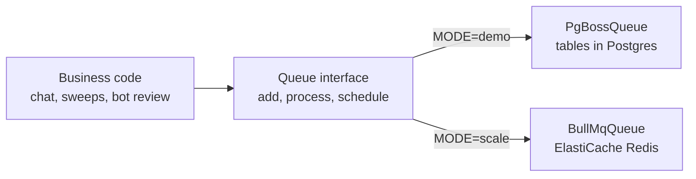
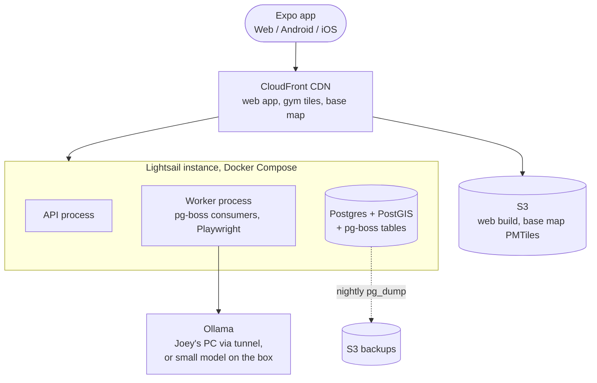
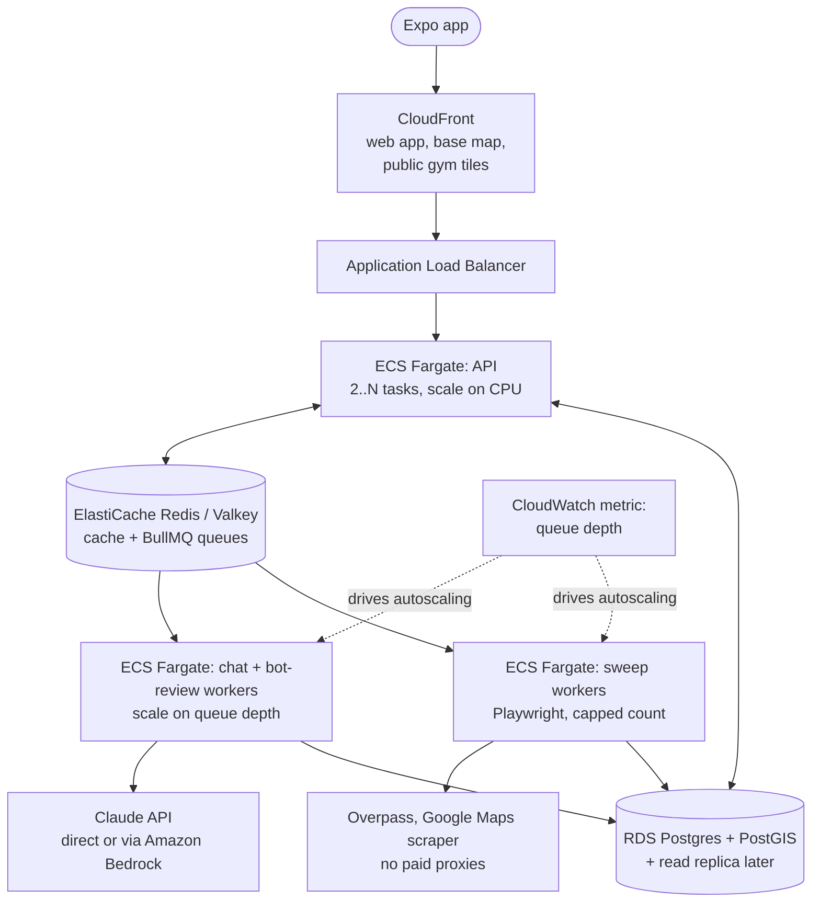
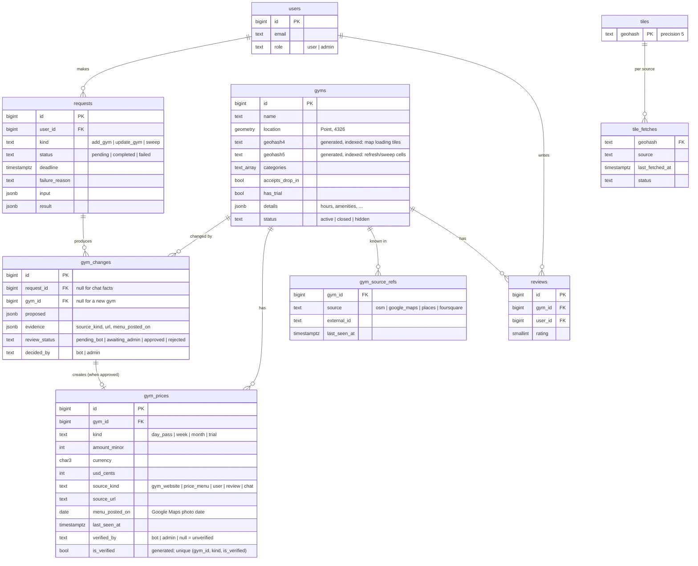
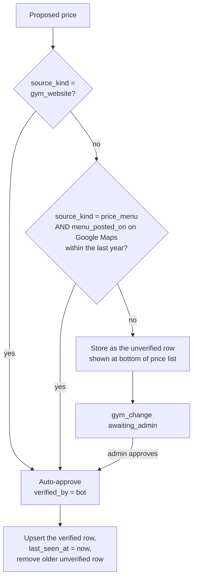
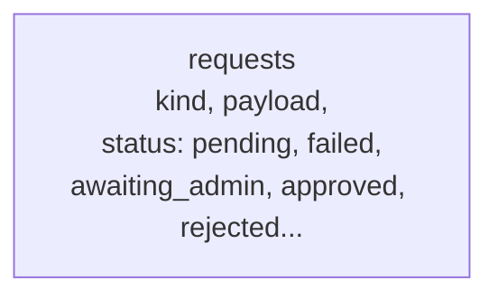
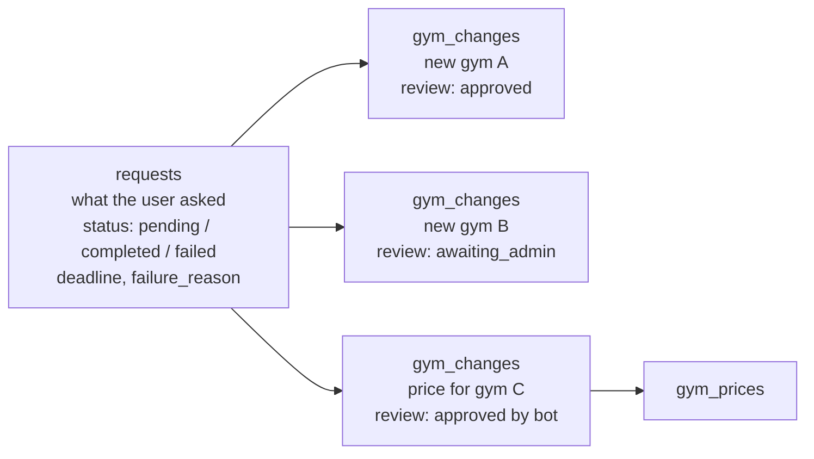
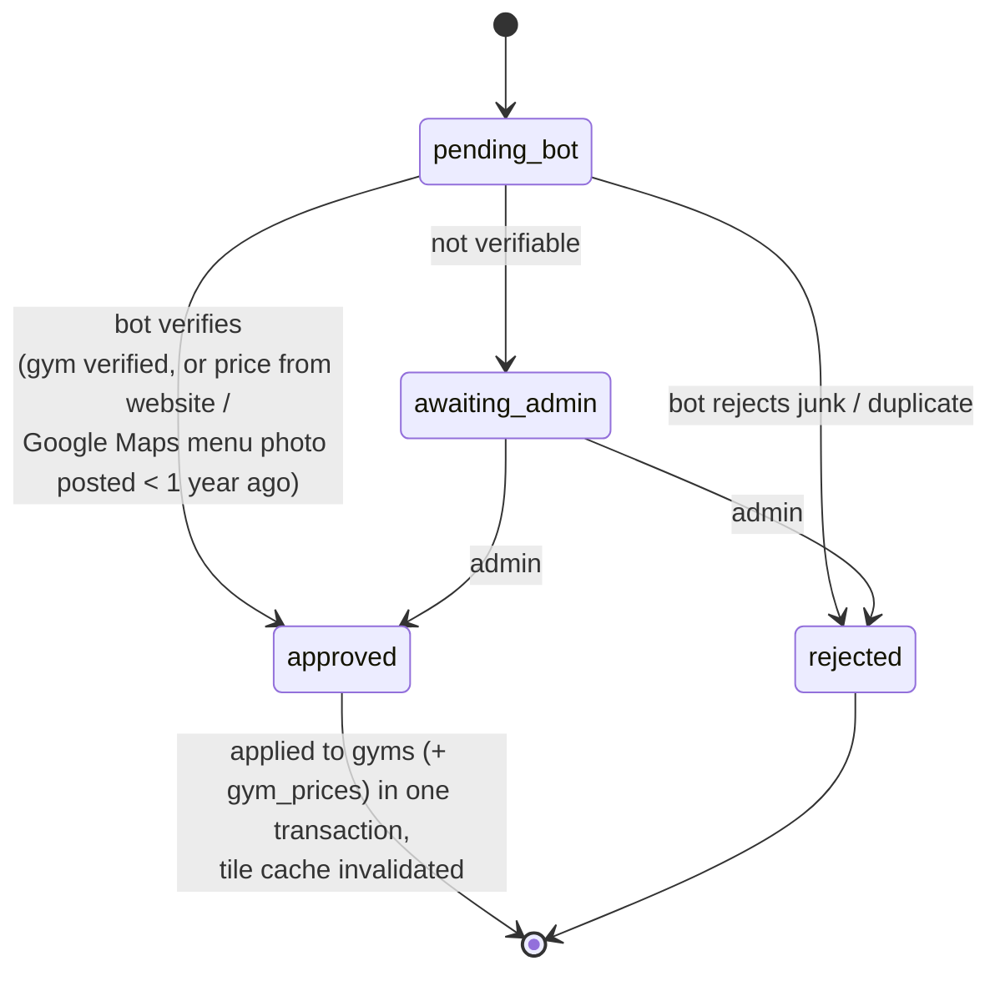

# Gym Finder: Stack and Schema Discussion

Phase 2 of the roadmap, step 2. The high-level design is settled in [DESIGN_DISCUSSION.md](./DESIGN_DISCUSSION.md) (PR #6): **Option B**, a modular monolith API plus background workers on a queue, Postgres + PostGIS, and two modes (cheap **demo** mode, **scale** mode) picked by one setting at startup. Requirement IDs (FR-x, NFR-x) refer to [REQUIREMENTS.md](./REQUIREMENTS.md).

This doc covers what's still open: **which tools build Option B** (part 1) and **what the database looks like** (part 2). The API is the next doc.

**Decided by Joey (2026-10-31): hosting is AWS.** This replaces the earlier Netlify + GCP e2-micro idea. Everything in part 1 assumes AWS.

Each section lists the variations, pros and cons, and a **recommendation**. All decisions are recorded in section 3. Prices are rough on-demand list prices for a US region, to compare options, not quotes; check the AWS pricing pages before buying.

---

## Part 1: Stack

### 1.1 Backend language and framework

The Expo app is TypeScript. The demo server (`server/index.js`) is plain JavaScript on Express 5.

| Variation | Pros | Cons |
|---|---|---|
| **TypeScript + Fastify** | Same language as the app, so request/response types and validation schemas can be shared. Built-in schema validation and good performance. Plugin system maps neatly onto modules (map, chat, sweeps, auth). | Rewrite of the Express routes (they're small). |
| TypeScript + Express 5 | Smallest change from the demo code. Everyone knows it. | No built-in validation or typing; we'd bolt those on. Slower than Fastify (doesn't matter at our load). |
| TypeScript + NestJS | Strong structure (modules, dependency injection), good for big teams. | Lots of boilerplate and framework concepts for a one-person project. |
| TypeScript + Hono | Tiny, fast, runs anywhere (Lambda, Node, edge). | Younger ecosystem; its main strength (edge/serverless) isn't what we're using. |
| Python (FastAPI) or Go | Python is great for scraping/AI; Go is very fast. | Two languages in the repo, no shared types with the app, and Claude sessions have to switch context. |

**Recommendation: TypeScript + Fastify, with Zod schemas shared between app and server.** One language for everything is the biggest win for a solo developer working with several Claudes in parallel.

#### Repo layout

To share types, the repo becomes a small monorepo using npm workspaces:

```
apps/mobile      Expo app (today's src/)
apps/server      Fastify API + workers (one codebase, two entry points)
packages/shared  Zod schemas, types, constants (gym categories, request statuses)
infra/           AWS CDK code (section 1.6)
```

- ✅ The app and server can't drift apart on request shapes.
- ✅ Each module folder in `apps/server/src/modules/*` is a natural unit for one Claude session to build.
- ❌ One-time move of files, and Expo needs a small Metro config tweak for workspaces (documented and supported).

The server has **one codebase and two entry points**: `api.ts` (HTTP) and `worker.ts` (queue consumers). In demo mode both run in one process.

### 1.2 Job queue library

The design needs one queue interface with a Postgres-backed implementation (demo) and a fast one (scale).

| Variation | Demo | Scale | Pros | Cons |
|---|---|---|---|---|
| **pg-boss + BullMQ** | pg-boss (Postgres) | BullMQ (Redis) | Both mature, both have retries, delays, cron schedules, priorities. BullMQ adds per-queue rate limits and job-ID dedupe, which sweeps need. | Two libraries to wrap behind one interface; features differ slightly (we use the overlap). |
| pg-boss everywhere | pg-boss | pg-boss | One library, no Redis needed for queues at all; jobs can be created in the same transaction as the request row. | Adds load to the main database; lower ceiling than Redis. Fine at 10k DAU, weaker near NFR-2's 1,000/s. |
| graphile-worker + BullMQ | graphile-worker | BullMQ | graphile-worker is very fast for a Postgres queue. | Smaller feature set than pg-boss (no built-in priorities per queue in the same way). |
| pg-boss + RabbitMQ | pg-boss | RabbitMQ (self-run, or Amazon MQ) | A real message broker: durable queues, acknowledgements, flexible routing, very reliable. | Delayed jobs need a plugin; no built-in per-queue rate limit, priorities are limited, no "skip if this job ID is already queued" dedupe, which sweeps rely on. One more service to run (Amazon MQ's smallest broker is a fixed monthly fee), while Redis is already there for the cache. |
| pg-boss + Kafka | pg-boss | Kafka (self-run, or Amazon MSK) | Handles millions of messages per second; stores and replays history; many consumers can read the same stream. | It's an event log, not a job queue: retries, delays, rate limits and dedupe all have to be built by us. Heavy to run (a cluster, or MSK at a few hundred dollars a month). 1,000 jobs/s is a tiny fraction of what it's for. Compared in detail in DESIGN_DISCUSSION.md section 5.3. |
| pg-boss + Amazon SQS | pg-boss | SQS | Fully managed, no Redis to run, "very AWS". | No built-in rate limiting or job priorities; delays capped at 15 min; dedupe only on FIFO queues for 5 minutes. We'd rebuild what BullMQ gives for free. |



**Why not Kafka or RabbitMQ (Joey's question).** Both are good, but they solve problems we don't have yet. Our work is *jobs* (sweep this tile, answer this chat) that need retries, delays, priorities, a per-source rate limit and duplicate merging. BullMQ has all five built in; RabbitMQ has about two of them and Kafka none, so we'd write the rest ourselves. BullMQ also runs on the Redis we already need for caching, so there's no extra service to pay for. Because the queue sits behind one interface, a RabbitMQ or Kafka implementation can be added later without touching business code: Kafka if we need several systems reading the same event stream, RabbitMQ if we need complex routing between many services.

**Recommendation: pg-boss in demo mode, BullMQ in scale mode.** This matches the agreed design (Redis in scale mode, Postgres table in demo mode). The interface only exposes what both support: `add(queue, payload, {priority, delay, jobId})`, `process(queue, handler, {concurrency})`, `schedule(cron)`. The per-source rate limiter (don't hammer Google Maps) lives in our own small module, backed by Postgres in demo and Redis in scale, so it works the same either way.

### 1.3 Database access and migrations

The schema leans on PostGIS (points, `ST_Within`, `ST_GeoHash`), JSONB and trigram similarity, so the tool must handle those without fighting us.

| Variation | Pros | Cons |
|---|---|---|
| **Drizzle ORM + drizzle-kit** | Schema written in TypeScript; generates SQL migrations you can read and edit. Supports PostGIS geometry columns. SQL-like query builder, so complex geo queries stay readable; raw `sql` escape hatch. Light, no engine binary. | Younger than Prisma; some advanced Postgres features need raw SQL. |
| Prisma | Very popular, great docs, nice schema language. | PostGIS types are "Unsupported", so every geo query is raw SQL with no typing. Heavier runtime. |
| Kysely + plain SQL migrations | Excellent type safety; you write real SQL. | No schema-as-code; types generated from the database. More manual. |
| Raw `pg` + SQL files (today) | No abstraction; full control. | No types for query results; easy to make mistakes as the schema grows. |

**Recommendation: Drizzle**, with migrations checked into git and run automatically on deploy. Geo queries that Drizzle can't express go through its `sql` template, which is still parameterized.

### 1.4 Auth (FR-13, FR-14, FR-15)

The demo server has its own sign-up with bcrypt + JWT. A real app needs password reset, email verification, Google sign-in, and **Sign in with Apple** (Apple requires it on iOS if any other social login is offered).

| Variation | Pros | Cons |
|---|---|---|
| **Better Auth** (open-source TS library) | Users, sessions and accounts live in **our** Postgres, so no vendor lock-in and no per-user cost. Email/password, Google, Apple, email verification, password reset built in. Has an Expo integration. Roles via a plugin or a `role` column. | We run it ourselves (it's a library inside the API, not a service). Younger project than the others. |
| Amazon Cognito | AWS-native, managed, free for a generous number of monthly users. | Known for awkward developer experience (hosted UI, token handling in React Native). Users live in Cognito, so joining "user → requests" means syncing IDs. Hard to migrate away from (password hashes can't be exported). |
| Clerk / Auth0 | Polished UI components, Expo SDKs, very quick to set up. | Paid beyond free tiers; users live with the vendor; lock-in. |
| Keep our own bcrypt + JWT | Already written. | Password reset, email verification, social login, token refresh and rate limiting all have to be built and secured by us. Easy to get wrong. |

**Recommendation: Better Auth.** It keeps the "no lock-in, data in Postgres" principle and saves writing security code. Cognito is the fallback if Joey prefers everything AWS-managed.

### 1.5 AWS hosting: demo mode

Goal: one cheap server, no paid managed services beyond small fixed costs.



| Variation | Monthly cost (rough) | Pros | Cons |
|---|---|---|---|
| **Lightsail instance (4 GB)**, Postgres in Docker on the box | ~$24 | Fixed price incl. bandwidth and a static IP; simplest. | Database on the same box; we do backups ourselves (nightly `pg_dump` to S3). |
| Lightsail 2 GB | ~$12 | Cheapest that runs Postgres + API + worker. | Too small for Playwright + Ollama on the box. |
| EC2 t4g.small/medium + EBS | ~$15–30 | Same building block scale mode can grow from; ARM is cheap. | Bandwidth, IP and disk billed separately; more knobs. |
| EC2 + RDS (db.t4g.micro) | ~$30–45 | Managed backups from day one; moving to scale mode is easier. | RDS roughly doubles the demo bill for a database that has almost no load. |

New AWS accounts get starter credits for the first months, which cover most of this at the start.

**Recommendation: one Lightsail instance (4 GB) running Docker Compose**, Postgres+PostGIS in a container with nightly backups to S3, and S3 + CloudFront for the web build, base map and public gym tiles. DNS on Route 53 so it's all in one account.

#### Ollama on AWS: the expensive part

| Variation | Monthly cost | Pros | Cons |
|---|---|---|---|
| **Small model on Joey's own PC, reached through a tunnel** (Tailscale or Cloudflare Tunnel) | $0 | Free; can run a bigger model if the PC has a GPU. | Chat is down when the PC is off. Bot review and chat jobs just wait in the queue (they're allowed to fail and the user is told). |
| Small model (~3B, quantized) on the demo box's CPU | ~$20 more (needs an 8 GB box) | Always on. | Slow (several seconds per answer) and lower quality. |
| GPU instance (g4dn.xlarge / g5.xlarge) | ~$380–730 on-demand, 24/7 | Fast, good quality. | Costs more than everything else combined; defeats the point of demo mode. |
| GPU spot instance started on demand | Pay per hour used | Cheap per hour. | Cold start of minutes; spot can be taken away. Complex for a demo. |

**Recommendation: Joey's PC via a tunnel while demoing, falling back to a small CPU model on the box if it needs to be always-on.** Scale mode moves to Claude anyway, so we should not buy GPU capacity for Ollama.

### 1.6 AWS hosting: scale mode



| Piece | Variations | Recommendation and why |
|---|---|---|
| Compute | **ECS on Fargate**, EKS (Kubernetes + KEDA), App Runner, Lambda | **ECS Fargate.** No servers to patch, scales services on any CloudWatch metric (we publish queue depth). EKS is more powerful but costs ~$73/month just for the control plane and needs Kubernetes skills. App Runner can't run background workers that scale on queue depth. Lambda's 15-minute limit and cold starts fit badly with sweeps and Playwright. |
| Database | **RDS Postgres**, Aurora Postgres, Aurora Serverless v2 | **RDS Postgres** with PostGIS. Simple and cheapest at our size. Aurora is worth it for very high read scale or fast failover, which we don't need yet; the move later is a managed migration. |
| Cache + queue | **ElastiCache (Redis/Valkey)**, ElastiCache Serverless, Upstash | **ElastiCache**, one small node to start. Keeps everything in AWS and inside the VPC (low latency). Upstash was the earlier idea; it still works through the cache interface if we want pay-per-request. |
| LLM | Claude via Anthropic API, Claude via **Amazon Bedrock** | Either, behind the LLM interface. Anthropic API gets new models first; Bedrock keeps billing and permissions in AWS. **Decide when we switch to scale mode.** |
| Infrastructure as code | **AWS CDK (TypeScript)**, Terraform, SST, clicking in the console | **CDK in TypeScript**, same language as everything else. Console clicking can't be reviewed or repeated; Terraform is equally good but another language. |
| Secrets/config | SSM Parameter Store, Secrets Manager | **SSM Parameter Store** (free for standard params); env vars injected into containers. Never in git. |
| Logs/errors | CloudWatch Logs, + Sentry | **CloudWatch for logs, Sentry free tier for app + server errors** (it has an Expo SDK). |

Scale mode with the smallest sizes is very roughly **$150–300/month** before Claude usage (ALB, two Fargate services, small RDS, small ElastiCache, NAT). That's why demo mode stays on Lightsail until there are paying users.

### 1.7 Map rendering and base map tiles

Two different kinds of "tiles" are involved:
- **Base map tiles**: the streets and land picture under the gyms.
- **Gym data tiles**: our geohash cells of gym JSON (agreed design).

Today (vibe-coded demo, same code on `GymFinder` and `GymFinderVibeCoded`) the app uses **Leaflet**: `react-leaflet` on web (`gym-map-screen.web.tsx`) and Leaflet inside a WebView on Android/iOS (`leaflet-webview-html.ts`), with raster base tiles from `tile.openstreetmap.org`. **The public OSM tile servers' usage policy forbids heavy app traffic**, so that has to change before launch regardless.

| Variation | Pros | Cons |
|---|---|---|
| **MapLibre** (maplibre-gl-js on web, maplibre-react-native on mobile) + **Protomaps** vector tiles as one PMTiles file on S3 + CloudFront | Real native map on phones (smooth pan/zoom, many markers), same style on all platforms. Self-hosted base map costs only S3 + CloudFront transfer; no per-view fees. | Needs an Expo dev build (no Expo Go) for the native map module. Rewrite of the map screens. |
| Keep Leaflet / WebView, switch base tiles to a provider (MapTiler, Stadia, Thunderforest) | No rewrite; just change the tile URL. | WebView map feels sluggish on mobile with many markers. Provider free tiers are small; per-view fees grow with users. |
| react-native-maps (Apple/Google maps) + Leaflet/MapLibre on web | Native look on each platform. | Two different map libraries to maintain; Google Maps SDK has its own usage costs and terms. |

**Recommendation: MapLibre + self-hosted Protomaps on S3/CloudFront.** **Decided by Joey (2026-11-02): the vibe-coded app's UI stays as it is**, including the right sidebar's collapsible sections (e.g. trial), filters and panels. Only the map underneath changes; pins, clusters and controls should look and behave as they do today. As a quick first step before the rewrite, point Leaflet at the same Protomaps tiles (or a provider) so we stop using the OSM servers.

### 1.8 Getting results back to the app (chat, request status)

Chat answers and sweep results come from workers, not the request that started them.

| Variation | Pros | Cons |
|---|---|---|
| **Polling** `GET /requests/:id` every few seconds | Simplest; works through any CDN/load balancer; stateless. | Slight delay; extra requests (cheap at our scale). |
| **Server-Sent Events** for chat streaming | Shows the answer as it's typed out; plain HTTP, works on ALB. | Needs a Redis/Postgres pub-sub so the API process can hear what the worker wrote. |
| WebSockets (own, or API Gateway WebSockets) | Two-way, real-time. | More infrastructure; we don't need two-way. |
| **Expo push notifications** for "My requests" status changes | User learns a sweep finished without keeping the app open (FR-18). | Needs push token storage and permission prompt. |

**Recommendation: polling for request status at first, SSE for chat streaming when we want the typing effect, and Expo push notifications for status changes on "My requests".**

### 1.9 Scraper infrastructure (FR-11)

Decided in PR #6: sweeps scrape Google Maps, behind the pluggable source interface.

| Variation | Pros | Cons |
|---|---|---|
| **Playwright + headless Chromium inside the sweep worker container** | Already used by the demo; one image; shares the queue and rate limiter. | Chromium needs ~1 GB RAM per browser, so sweep workers are bigger containers with a low max count. |
| A separate scraping service / Lambda | Isolated from other workers. | Lambda + Chromium is fiddly (size limits); not needed with a capped worker pool. |
| Paid scraping API (handles proxies and blocks for you) | Least work, fewer blocks. | Per-request fees. |
**Decided by Joey (2026-11-01): Playwright in the sweep worker, and never pay for proxies or scraping APIs.** If Google starts blocking our AWS IPs, the sweep workers back off (slower rate, longer pauses) and mark affected sweeps `failed` so users are told. Gyms keep arriving from Overpass and user submissions in the meantime.

### 1.10 Stack summary

| Area | Recommendation |
|---|---|
| Language / framework | TypeScript, Fastify, Zod shared with the app, npm-workspaces monorepo |
| Queue | pg-boss (demo) / BullMQ on Redis (scale) behind one interface |
| DB access | Drizzle ORM + drizzle-kit migrations |
| Auth | Better Auth, users in our Postgres (Cognito as fallback) |
| Demo hosting | Lightsail 4 GB + Docker Compose; S3 + CloudFront + Route 53 |
| Scale hosting | ECS Fargate, RDS Postgres, ElastiCache, CDK, SSM, CloudWatch + Sentry |
| LLM | Ollama on Joey's PC via tunnel (demo); Claude via API or Bedrock (scale) |
| Map | MapLibre + Protomaps on S3/CloudFront |
| Results to app | Polling, SSE for chat, Expo push for status changes |
| Scraper | Playwright in sweep workers, never paid proxies (decided) |

---

## Part 2: Database schema

### 2.1 What the schema must support

- Map reads by tile with filters: drop-in, trial, category, text (FR-4, 5, 10).
- Gym details incl. prices in many currencies, hours, description (FR-7).
- Facts found by chat saved after review (FR-9).
- Sweeps and Overpass refresh per tile, deduped against known gyms (FR-11, 12).
- Users, admins (FR-13, 14).
- Requests with `pending / completed / failed`, deadline, retry, and review outcome `approved / rejected` (FR-16, 17, 18, and the PR #6 decision on failed jobs).
- **Approval rule (Joey, 2026-10-31):** a gym can skip admin approval if a bot verifies it; a price change is verified if it's found on the gym's website or on a price menu less than one year old. Everything unverified goes to an admin. So every fact needs its **source** and **date**.

### 2.2 Proposed schema (overview)



Better Auth adds its own `session`, `account` and `verification` tables next to `users`; they're not shown. pg-boss keeps its tables in a separate `pgboss` schema.

The sections below are the choices behind this diagram, each with variations.

### 2.3 Gym location

| Variation | Pros | Cons |
|---|---|---|
| `lat`, `lng` doubles (today) | Simple. | No spatial index; bounding-box and distance queries are hand-written and slow at scale. |
| **`geometry(Point, 4326)` + GIST index**, plus a generated `geohash5` column | Fast "in this tile / box" queries; `ST_GeoHash` gives the tile key; distance in metres by casting to `geography` when needed. | Needs PostGIS (available on RDS and in the `postgis/postgis` Docker image). |
| `geography(Point)` | Distances in metres natively. | Fewer functions and slower for box queries, which are our main query. |

**Why not R-trees (Joey's question)? We are using one.** A PostGIS GIST index *is* an R-tree: Postgres builds it as an R-tree over each gym's bounding box (implemented on GiST, Postgres's general index framework). Queries like "gyms inside this rectangle" or "gyms within 50 m" use it. The geohash column is not instead of the R-tree; it's an extra, cheaper key for the one query we run most (load a whole tile), and it's the same key the CDN and Redis cache by.

| | R-tree (GIST) | Geohash column (b-tree) |
|---|---|---|
| Used for | Any shape: map rectangle, radius, nearest, dedupe within 50 m | Exactly one tile |
| Speed for "load tile X" | Fast | Fastest (exact match) |
| Matches cache keys | No | Yes |

**Recommendation: `geometry(Point, 4326)` + GIST (R-tree), plus a stored `geohash5 = ST_GeoHash(location, 5)` column with a b-tree index.** Loading a map tile becomes `WHERE geohash4 = $1`, which is about as cheap as a query gets, and it's the same key the CDN and Redis cache by.

### 2.4 Tile size (geohash precision)

| Precision | Cell size (approx.) | Pros | Cons |
|---|---|---|---|
| 4 | 39 × 20 km | Few cells per screen. | A big city in one cell = huge responses; Overpass queries for a whole cell get heavy. |
| **5** | **4.9 × 4.9 km** | A city-zoom screen (~zoom 12) needs ~6–12 cells; a busy cell has maybe 50–200 gyms, a few tens of KB. Small enough for one Overpass query or one sweep job. | More cells to request at low zoom, so we need a minimum zoom (already agreed). |
| 6 | 1.2 × 0.6 km | Tiny responses. | Dozens of requests per screen; many more cache keys; sweeps split into many small jobs. |

**Decided by Joey (2026-11-02): two sizes.** The map **loads and caches gyms by geohash4** (about 39 × 20 km), because at zoom 11 a phone screen covers roughly 30 × 65 km, which would be ~100 geohash5 tiles but only ~6 geohash4 tiles. **Overpass refreshes, sweeps and `tile_fetches` stay on geohash5**, so each external job stays small. `gyms` gets both as generated, indexed columns (`geohash4 = left(geohash5, 4)`). **Decided by Joey (2026-11-02): the map loads gyms, shows gym pins and shows filters only at zoom 11 and above** (`FILTERS_VISIBLE_AT_ZOOM = 11` in the vibe-coded map screens). Below zoom 11 nothing is requested or cached and no pins or filters are shown, exactly like the vibe-coded app.

### 2.5 Tile refresh and sweep status

| Variation | Pros | Cons |
|---|---|---|
| `fetched_areas` with bounding boxes (today) | Already exists. | Overlapping boxes, no fixed keys, can't tell which source fetched what. |
| One `tiles` row per cell with columns per source (`osm_fetched_at`, `gmaps_swept_at`, ...) | One row to read. | Adding a source means a schema change. |
| **`tile_fetches(geohash, source, last_fetched_at, status, gyms_found)`**, primary key `(geohash, source)` | Adding a source (Foursquare, Yandex in OOS-1) is just new rows. Overpass weekly refresh and Google sweeps are tracked separately. Seeding progress is "which tiles have a fetch for this source". | One more join (trivial). |

**Recommendation: `tile_fetches` keyed by `(geohash, source)`.** A `tiles` table only exists if we want per-tile extras later (e.g. a gym count for low zoom).

### 2.6 Prices and the verification rule

**Decided by Joey (2026-11-01): no price history.** Keep only the current price (verified and unverified, see below), plus **when it was last seen**. The approval rule needs to know **where** each price came from, and for price menus **when the photo was posted**.

**Decided by Joey (2026-11-01): how prices are verified.**
- **Price found on the web** (the gym's own website): verified, no date check needed.
- **Price menu photo on Google Maps:** verified if the photo was **posted on Google Maps less than a year ago**. The scraper reads the photo's posted date from Google Maps.
- **Anything else** (a user's claim, a chat answer without a source): goes to an admin.

| Variation | Pros | Cons |
|---|---|---|
| Price columns on `gyms` (today: `day_pass_price_cents`, ...) plus `unverified_gym_data` | Simple. | No source, URL or dates, so the rule can't be checked or audited. One currency. Adding source + date + last seen for 4 price kinds means ~20 columns on `gyms`. |
| **`gym_prices` table with one row per gym per price kind** (unique `(gym_id, kind)`): amount, currency, `usd_cents`, `source_kind`, `source_url`, `menu_posted_on`, `last_seen_at`, `verified_by`. Overwritten when a newer price is approved. | Exactly "current price + when last seen + where from", no history. Handles any currency. Adding a new price kind (e.g. 10-visit pass) is a row, not a column. | Map filters join it (one indexed join; or copy `has_day_pass` / cheapest price onto `gyms` if tile queries get slow). |

**Recommendation: `gym_prices`, no history.** When the scraper sees the same price again, it only bumps `last_seen_at`. The old row's details stay in `gym_changes` (section 2.10) as the audit trail of what was approved, so we still know who changed what without a history table.

**Decided by Joey (2026-11-02): unverified prices are stored too**, so they can be shown at the bottom of the right sidebar's day-pass list (as the vibe-coded app does with its "Unverified" prices). So `gym_prices` holds **at most two current rows per gym per kind: one verified and one unverified** (unique on `(gym_id, kind, is_verified)`, where `is_verified` is generated from `verified_by IS NOT NULL`). Still no history: a newer price of the same kind and status replaces the old one.

- **Where unverified prices come from (Joey, 2026-11-02):** user edits (`source_kind = user`), and the chatbot finding a price in an unverified place, such as a Google Maps review that mentions it (`source_kind = review`, or `chat` for other unverified places, with the URL kept in `source_url`).
- **Only an admin can verify them.** The bot never promotes an unverified price; the automatic rule above applies only to prices found on the gym's website or a recent Google Maps menu photo.
- An unverified price is stored **straight away** with `verified_by` empty, so users see it at once, clearly marked unverified.
- It also gets a `gym_changes` row waiting for an admin. When the admin approves it, the price becomes the verified row (replacing any older verified one) and the unverified row is removed.
- When a verified price is newer than the unverified one, the unverified row is removed, since it's out of date.
- The app shows the verified price when there is one, and the unverified one otherwise.



### 2.7 Flexible gym details

| Variation | Pros | Cons |
|---|---|---|
| A column for every field | Fully typed and validated. | Opening hours, amenities, notes vary wildly; schema churn every time we learn a new fact type. |
| Everything in one JSONB blob | Maximum flexibility. | Filters and indexes get awkward; easy to store garbage. |
| **Hybrid**: columns for anything we filter or sort on (categories, drop-in, trial, current prices, status), JSONB `details` for the rest (opening hours in OSM `opening_hours` format, amenities, contact) validated by a Zod schema in `packages/shared` | Fast filters, flexible details, still validated. | Two places to look (minor). |

**Recommendation: hybrid.**

### 2.8 Categories

| Variation | Pros | Cons |
|---|---|---|
| Lookup table + join table (today: `categories`, `gym_categories`) | Classic, easy to rename labels. | Every tile query joins or aggregates. |
| **`text[]` column on `gyms` with a GIN index**, allowed values checked against a list in `packages/shared` (or a CHECK constraint) | One row = everything the map needs; `categories && $1` filter is indexed. | Renaming a category = an update over all gyms (rare). |
| Postgres enum array | Database enforces values. | Changing enums needs migrations, awkward with Drizzle. |

**Recommendation: `text[]` + GIN index.**

### 2.9 Text search (FR-10)

**Decided by Joey (2026-11-02): filters stay exactly as in the vibe-coded app**, so text search runs in the app over the gyms already loaded (name, description, address, categories), not in the database. No full-text index is needed for the app. `pg_trgm` stays for name similarity when deduplicating gyms (2.11). If server-side search is ever needed (e.g. for admins), a generated `tsvector` column with a GIN index can be added then.

There is no price filter. The day-pass price list in the right sidebar sorts by `gym_prices.usd_cents`, verified prices first and unverified (`verified_by` empty) at the bottom.

### 2.10 Requests, changes and approvals (FR-16 to 18)

"My requests" shows add-gym, update-gym and sweep requests together, each `pending / completed / failed`, and approvals/rejections. One sweep can find many gyms. Chats are not stored (decided by Joey, 2026-11-02; see API.md 1.4), so they never create `requests` rows; a fact found by chat is proposed directly as a `gym_changes` row.

**Variation A: one `requests` table does everything** (kind, status, payload, review result)



- ✅ Simplest; "My requests" is one query.
- ❌ A sweep that finds 30 gyms can't have 30 separate approvals; job status and review status get mixed into one column.

**Variation B: `requests` (the job) + `gym_changes` (each proposed change)**



- ✅ Job lifecycle (did the bot run?) and review outcome (was the change accepted?) are separate, which is what the two decisions in PR #6 describe.
- ✅ Sweeps, chat facts and user submissions all produce the same `gym_changes`, so one approval flow and one admin queue (FR-12, FR-17).
- ✅ `gym_changes` doubles as the audit log of every change to every gym.
- ❌ "My requests" joins two tables (cheap).

**Variation C: separate tables per kind** (`gym_submissions`, `sweep_requests`)

- ✅ Each table has exactly its own columns.
- ❌ "My requests" becomes a UNION of several tables; status logic duplicated; the watchdog has to scan each.

**Recommendation: Variation B.** The user-facing status is derived: a request shows `failed` if its job failed, otherwise `pending` until all its changes are decided, then `completed` with counts ("3 gyms added, 1 rejected").

Review lifecycle of a `gym_changes` row, including the approval rule:



Chats never create `requests` rows: they are temporary and live only in the cache for a few minutes (API.md 1.4).

### 2.11 Deduplicating gyms across sources

Overpass, Google Maps and user submissions often describe the same gym.

| Variation | Pros | Cons |
|---|---|---|
| One ID column per source on `gyms` (today: `osm_id`) | Simple. | A new column per source. |
| **`gym_source_refs(gym_id, source, external_id, last_seen_at)`, unique on `(source, external_id)`** | Any number of sources; a refresh finds "our" gym by its external ID instantly; we can tell when a gym disappeared from a source (possibly closed). | One more table. |

Gyms without an external ID (user-submitted) are matched by distance + name similarity (`ST_DWithin` 50 m + `pg_trgm`), which the demo's `isDuplicateMatch` already does.

**Recommendation: `gym_source_refs`.**

### 2.12 Users and roles (FR-13, 14)

| Variation | Pros | Cons |
|---|---|---|
| Separate `admins` table (today) | Exists. | Admin = user, so two tables describe the same person. |
| **`role` column on `users` (`user` / `admin`)** | Simplest; Better Auth's admin plugin works this way. | Only one role per user (enough for us). |
| `roles` + `user_roles` tables | Many roles, fine-grained permissions. | Not needed for two roles. |

**Recommendation: `role` column.** Add a `moderator` value later if we need it.

### 2.13 IDs

| Variation | Pros | Cons |
|---|---|---|
| **`bigint` identity** | Small, fast indexes and joins; easy to read in logs. | Sequential IDs reveal counts (e.g. how many gyms); not an issue for public gym data. |
| UUID v7 | Can be created in the app; doesn't reveal counts. | Twice the size; harder to read. |

**Recommendation: `bigint` identity.** If we ever expose something sensitive by ID, give that table a UUID then.

### 2.14 Migrating from today's demo schema

The demo `db/schema.sql` is a hand-made dump. The plan is a fresh Drizzle schema plus a one-off script that copies demo gyms over: `lat/lng` → `location`, `osm_id` → `gym_source_refs`, price columns on `gyms` → **verified** `gym_prices` rows (the vibe-coded app shows them as confirmed prices), `unverified_gym_data` → **unverified** `gym_prices` rows (`last_seen_at` = the old `scraped_at`), `gym_categories` → `categories[]`, `admins` → `users.role`, `gym_submissions` → `requests` + `gym_changes`, `fetched_areas` / `scanned_areas` → `tile_fetches`. Demo reviews come along with `user_id` left empty.

### 2.15 How different is this from the vibe-coded database?

Moderately. It's still one Postgres database and the core `gyms`, `users` and `reviews` tables keep their meaning. What changes is mostly **how** things are stored, so the queue, tiles and verification rule can work.

| Vibe-coded table / column | New schema | Change |
|---|---|---|
| `gyms.lat`, `gyms.lng` | `gyms.location` (PostGIS point) + `geohash5` | Bigger: enables the R-tree index and tile keys |
| `gyms.osm_id` | `gym_source_refs` | Medium: any number of sources (OSM, Google Maps, ...) |
| `gyms.day/week/month_pass_price_cents`, `unverified_gym_data` | `gym_prices` (one row per kind, source + dates) | Medium: needed for the verification rule |
| `gyms.data_source` enum (osm / bot_verified / admin_verified) | `gym_prices.verified_by` + `gym_changes.decided_by` | Small: verification tracked per fact, not per gym |
| `categories` + `gym_categories` | `gyms.categories text[]` | Small |
| `fetched_areas`, `scanned_areas` (bounding boxes) | `tile_fetches` (geohash + source) | Medium: fixed tiles instead of overlapping boxes |
| `gym_submissions` + `gym_submission_statuses` | `requests` + `gym_changes` | Bigger: adds job status (pending / completed / failed, deadline) for "My requests" and sweeps |
| `admins` | `users.role` | Small |
| `users` (own bcrypt) | Better Auth's `users` / `session` / `account` | Medium: auth library owns these tables |
| `reviews` | `reviews` + `user_id` | Small |
| (none) | pg-boss tables in their own `pgboss` schema | New, managed by the library |

Nothing in the vibe-coded data is lost: section 2.14's one-off script copies it across.

---

## 3. Decisions

**Decided by Joey (2026-11-01):**
- Accepted as recommended: backend (1.1), DB access (1.3), auth (1.4), demo hosting (1.5), Ollama on Joey's PC (1.5), scale hosting (1.6), results to the app (1.8), tile size and location (2.3, 2.4), requests + `gym_changes` (2.10), and the smaller schema items (2.7, 2.8, 2.9, 2.11, 2.12, 2.13).
- **Scraper (1.9):** Playwright in sweep workers; never pay for proxies.
- **Prices (2.6):** no price history; one current price per kind with `last_seen_at`. Unverified prices are stored too (one verified + one unverified row per kind at most) and shown at the bottom of the price list (Joey, 2026-11-02).
- **Price verification (2.6):** web prices are verified with no date check; a price menu counts if its photo was posted on Google Maps less than a year ago.

- **Queue (1.2):** pg-boss in demo mode, BullMQ in scale mode (Joey asked about Kafka and RabbitMQ first; answer in 1.2).
- **R-trees (2.3):** GIST (R-tree) + `geohash5` as recommended.

- **Map (1.7):** MapLibre + self-hosted Protomaps, done together with the switch to geohash tile loading (about 1,000 of the ~2,400 map-screen lines change; needs an Expo development build).

Nothing is still open. The next doc is the API (endpoints, tile URLs and cache headers, request polling).
